# PokeDnD — Project Specification v2

> **Status:** Draft 2 · written 2026-11-08 · replaces nothing: [`project.md`](./project.md) is kept unchanged as the original brief.
> **Licences:** the code described here is MPL-2.0 and the assets are CC BY-NC 3.0 (see [chapter 21](#21-licensing-and-credits)).

PokeDnD is a tabletop-style Pokémon game. Players roll real dice (or digital ones) while their trainers walk through a Minecraft world, and a phone app holds their character sheet, Pokémon and cards. One person runs the game, like a Dungeon Master.

This document is the single source of truth for what PokeDnD is and how it is built. It is written to be read by people first, and it is precise enough for a developer or an AI coding agent to build from.

---

## How to read this document

**Where to start**

| If you want to… | Read |
|---|---|
| Understand the idea in five minutes | Chapters 1 and 2 |
| Know the rules | Chapters 4–8 (Part 1) |
| See how the game looks in Minecraft and on a phone | Chapters 10 and 11 |
| Set a game up quickly or very precisely | Chapter 12 and [Appendix A](#appendix-a--all-settings-and-defaults) |
| Build it | Part 3 (chapters 13–21) and the roadmap (chapter 22) |
| Review what I (the author) proposed and you still need to confirm | [Appendix D](#appendix-d--suggested-values-to-review) and [Appendix E](#appendix-e--gaps-found-while-writing) |

**Conventions**

- **MUST / SHOULD / MAY** are used in the technical parts in their usual sense (MUST = required, SHOULD = recommended, MAY = optional).
- **Decided** means you (the project owner) chose it during planning. **Suggested** means I proposed it because nothing was decided yet. Every default value in a settings table is a *suggestion* unless the text says *decided*.
- A callout like the one below marks content I drafted that needs your review. [Appendix D](#appendix-d--suggested-values-to-review) lists them all.

> **Suggested — please review:** this is what a drafted, not-yet-approved value looks like.

- Each chapter ends with a **Settings & defaults** table. Setting keys look like `combat.joinRadius`. [Appendix A](#appendix-a--all-settings-and-defaults) collects every one of them.
- File paths are relative to the repository root. Paths such as `./Core`, `./API`, `./App` and `./Mod` are the intended layout; some of them do not exist yet (see chapter 13).
- Numbers in worked examples were checked with a small script; they are *illustrations*, not rules.

**Two promises that run through the whole design**

1. **The admin has as much freedom as possible.** Almost every rule is a setting, every setting has a default, and during play the admin can override nearly anything and undo the last action.
2. **Every setting has a default.** A game can start in one click with the defaults, or be tuned in detail.

---

## Contents

<!-- TOC -->

**[Part 1 — The game](#part-1--the-game)**

- [1. What PokeDnD is](#1-what-pokednd-is)
- [2. A session, step by step](#2-a-session-step-by-step)
- [3. Roles, accounts and game states](#3-roles-accounts-and-game-states)
- [4. Trainers](#4-trainers)
- [5. Pokémon](#5-pokémon)
- [6. Dice](#6-dice)
- [7. Combat](#7-combat)
- [8. Exploring the world](#8-exploring-the-world)
- [9. Cards](#9-cards)
- [10. What you see in Minecraft](#10-what-you-see-in-minecraft)
- [11. The App](#11-the-app)

**[Part 2 — Settings and admin control](#part-2--settings-and-admin-control)**

- [12. Starting a game, rule sets and admin powers](#12-starting-a-game-rule-sets-and-admin-powers)

**[Part 3 — How it is built](#part-3--how-it-is-built)**

- [13. Repository layout and tech stack](#13-repository-layout-and-tech-stack)
- [14. Architecture](#14-architecture)
- [15. The Mod](#15-the-mod)
- [16. The API](#16-the-api)
- [17. Data model](#17-data-model)
- [18. REST and WebSocket reference](#18-rest-and-websocket-reference)
- [19. The data import pipeline](#19-the-data-import-pipeline)
- [20. Testing, quality and deployment](#20-testing-quality-and-deployment)
- [21. Licensing and credits](#21-licensing-and-credits)

**[Part 4 — The plan](#part-4--the-plan)**

- [22. Roadmap](#22-roadmap)

**[Appendices](#appendices)**

- [Appendix A — All settings and defaults](#appendix-a--all-settings-and-defaults)
- [Appendix B — Smart-dice reference](#appendix-b--smart-dice-reference)
- [Appendix C — Missing assets](#appendix-c--missing-assets)
- [Appendix D — Suggested values to review](#appendix-d--suggested-values-to-review)
- [Appendix E — Gaps found while writing](#appendix-e--gaps-found-while-writing)
<!-- /TOC -->

---

## Part 1 — The game

### 1. What PokeDnD is

#### 1.1 The idea in one page

A group of friends plays a Pokémon adventure at a table (or remotely). Each person is a **trainer** with a D&D-style character sheet and a team of Pokémon. Everything that depends on luck is decided by dice: whether an attack hits, whether a Pokémon is caught, how far the party travels today. The dice can be real ones rolled at the table, or digital ones.

The adventure is *shown* in Minecraft: trainers appear as player characters walking along paths between towns and wild areas, Pokémon appear as 3D models, and battles play out in front of everyone on a shared screen. The adventure is *controlled* from a phone app: the app shows each player their sheet, team, bag and cards, asks them to roll when it is their turn, and lets the admin run the whole game.

One person is the **admin** (the Game Master). They open the game, accept players, enter or approve dice results, and can bend any rule on the fly. During play the admin is a flying camera in Minecraft.

Pokémon can also be printed as **physical trading cards** with a QR code. A game can be played entirely with digital cards, or with physical ones where a card's moves cannot be changed.

#### 1.2 The pieces

| Piece | Folder | What it is | Technology |
|---|---|---|---|
| **Mod** | `./Mod` | Minecraft mod: renders Pokémon, runs the fake players, regions, paths, NPCs, cameras and HUD | Fabric, Java 25, Minecraft 26.3 |
| **API** | `./API` | The brain on the network: accounts, games, rules, dice, rolls, sync with Minecraft, card PDFs, map proxy | Java 25, Quarkus, Gradle |
| **App** | `./App` | The phone/PC app (installable web app): sheet, team, cards, map, battles, admin panel | Angular, Angular Material, PWA |
| **Core** | `./Core` *(new)* | Shared Java library: game rules, dice logic, data models, data importer | Java 25, Gradle |
| **Tools** | `./tools` | Scripts: icon and card-art renderer, CSV builder, sounds filter (all exist); asset checker (new) | Node.js |
| **Resources** | `./resources` | Models, textures, sounds, icons, species data, four CSV files | existing |
| **Vendor** | `./vendor` | The BlueMap and SkinRestorer mods (not ours; installed next to our mod) | existing |

How the pieces talk to each other is drawn in [chapter 14](#14-architecture).

#### 1.3 How `project.md` maps to this document

Everything in the original brief is kept. This table shows where each part now lives.

| `project.md` section | Now in |
|---|---|
| Intro (mod + API + app) | Chapters 1, 13, 14 |
| Cards (export by generation, type, manual) | Chapter 9 |
| App (phones and PC, accounts, fake player, virtual cards, admin) | Chapters 3, 11, 12 |
| Mod (render resources, real players configure) | Chapters 10, 15 |
| Regions | Chapter 8.2 |
| Paths | Chapter 8.3 |
| Game Start | Chapters 2, 3.5, 14 |
| Shiny Pokémon | Chapter 8.9 |
| Bosses | Chapter 8.9 |
| NPCs | Chapter 8.6 |
| Skins | Chapter 3.6 |
| Combat (turn-based, 1-in-x dice, admin enters results) | Chapters 6 and 7 |
| API (BlueMap) | Chapters 11.5, 16 |

One thing changed on purpose: `project.md` says a real Minecraft player who joins can configure the server. In v2 only **linked server admins** can do that, and real players never walk around by themselves (see chapter 10).

#### 1.4 Design principles

1. **The table is the star.** Real dice, real conversation. The software keeps track and does the arithmetic; people make the decisions.
2. **Dice that fit the odds.** A 25 % chance is a d4, not a d20 (chapter 6).
3. **Admin freedom.** Every rule is a setting; every automatic result can be overridden; the last action can be undone (chapter 12).
4. **Defaults for everything.** Fast start or deep tuning, the admin chooses.
5. **One rulebook, written once.** The rules live in `Core` and are used by the API and the mod, so they can never disagree.
6. **Only what is complete is playable.** A species without a model, texture and icon is hidden until its assets exist (chapter 22, asset track).
7. **Online-only, but forgiving.** The app needs a connection; if a player drops, their trainer simply waits in the world.

#### 1.5 Glossary

| Term | Meaning |
|---|---|
| **Admin** | The person who runs a game (Game Master). A *server admin* account. May also play, if the game allows it. |
| **Site admin** | Manages the whole installation: users, servers, global data. |
| **Server admin** | An app account assigned to one registered Minecraft server; can run games on it and configure it in Minecraft. |
| **Player** | Someone who plays a trainer in a game. |
| **Spectator** | Someone who watches (map, battles, teams) without playing. |
| **Trainer** | A player's character: a 5e-style sheet plus a team. Shown in Minecraft as a *fake player*. |
| **Fake player** | A server-side player entity controlled by the game, with the trainer's name and skin. Real people never control it. |
| **Party** | A group of trainers moving together on the map. A solo trainer is a party of one. |
| **Game** | A persistent campaign on one Minecraft server. It can be paused and resumed. |
| **Rule set** | A named bundle of settings an admin can save and reuse. |
| **Region** | A cuboid of the world with its own wild-Pokémon table and rules. |
| **Node / Edge / Path** | Points on the map (towns, encounters, events, junctions) and the walkable links between them; together they form the path graph. |
| **Movement point** | The unit of travel. An edge costs a number of movement points; the movement roll gives points to spend. |
| **Encounter** | A moment when a wild Pokémon (or boss) appears and a battle begins. |
| **Boss** | A giant, stronger wild Pokémon with rare loot. Cannot be caught. |
| **NPC** | A non-player character: trainer, merchant, tutor, healer, quest giver, trade centre, daycare. |
| **Species card** | A printable card for a species/form (generic QR). |
| **Personal card** | A printable card made from one owned Pokémon (unique QR). |
| **Physical mode / digital mode** | Whether the game uses printed cards (moves frozen) or only virtual cards. |
| **Smart dice** | The rule that picks the die that best matches the odds (chapter 6). |
| **Roll request** | A prompt asking someone to roll specific dice and report the result. |
| **Dex** | National Pokédex number. |
| **₽** | Pokédollars, the currency. |

---

### 2. A session, step by step

This walkthrough shows a whole game from the first click to the end of a first evening. Names and numbers are made up; the rules behind each step are in later chapters.

**The people:** Dani (admin), and three players: Ana, Bruno and Carla. Dani runs the Minecraft server; the players sit in Dani's living room with phones and a bag of dice. The Minecraft client on the TV is logged in as a spectator.

#### Step 1 — One-time setup *(done once per server)*

1. The site admin opens the app, registers Dani's Minecraft server and copies the **server token**.
2. Dani pastes the token into the mod's config file and starts the server. The mod connects to the API and the server shows up as *online* in the app.
3. The site admin assigns Dani as **server admin** of that server.
4. Dani runs `/pokednd link` in Minecraft and types the code it prints into the app, so the app knows which Minecraft account is Dani's.

#### Step 2 — Create the game

Dani taps **New game**, picks the server, and chooses a starting point:

- **Defaults** (recommended for the first game), or
- one of the presets (*Casual*, *Hardcore*), or
- one of Dani's own saved **rule sets**.

Everything is editable now or later. Dani names the game *"Kanto Weekend"* and taps **Open lobby**.

#### Step 3 — Lobby and joining

A big **join code** (for example `K7M2QX`) appears on the TV, drawn by the mod. The three players open the app, tap **Join game**, and type the code. Dani sees three requests and taps **Accept** for each.

Each player creates a trainer:

1. a **trainer name** (this is also their Minecraft name in this game),
2. a **class** (for example Ace Trainer, Breeder, Researcher),
3. **ability scores** (default: 27-point buy) and two skills,
4. a **skin**: upload a PNG, or copy the skin of any Minecraft username,
5. a **starter Pokémon** from the list Dani allowed.

As each player finishes, their fake player appears on the TV in the starting town, wearing their skin.

#### Step 4 — Start and the first overworld round

Dani taps **Start game**. The game is now *running* and play goes in **rounds**. Dani's own Minecraft client is a free-flying camera over the town.

*Ana's party of one* is first. The app tells her: **"Roll 1d6 and add your Dexterity (+2)."** She rolls a 4, types it in, and Dani's approval pops up on his phone: **Approve**. She has **6 movement points**.

The map shows two ways out of town. Ana picks the road to Route 1, which costs 6 points. On the TV, her trainer walks the road. As she arrives, the game checks for an encounter (it is an encounter node: 60 % chance). The check is made in secret by the system and says: *encounter*.

#### Step 5 — A battle

A wild **Pidgey, level 4** appears. The battle begins; only trainers within 16 blocks join, which is just Ana. The TV camera cuts to a battle frame, and a HUD shows both Pokémon with HP bars.

**Initiative.** Both sides roll a d20: *Ana's prompt: "Roll 1d20 — Charmander's initiative (+0)."* She rolls 14; the system rolls 9 for Pidgey. Charmander will go first.

**Declare.** Ana's app shows her Charmander's moves. She chooses **Scratch**. The Pidgey's AI also chooses an attack, hidden for now.

**Resolve.** The actions now happen in order, starting with Charmander.

**The hit roll.** Scratch has 100 accuracy, so it can't miss, but it can crit. The prompt reads:
> **Roll 1d20 for Scratch.** 1–19: hit · 20: critical hit.

Ana rolls 13: a hit.

**The damage roll.** Scratch has power 40, which means **2d8**. The prompt reads: **"Roll 2d8 for damage."** Ana rolls a 3 and a 6, a total of 9. The app does the maths (level, stats, type) and reports: **6 damage**. Pidgey has 17 HP and is now at 11.

Pidgey's turn is automatic: it uses Tackle, rolls itself and does 4 damage to Charmander (19 HP → 15).

#### Step 6 — Catching

After two more rounds, Pidgey is at 3 HP out of 17. Ana throws a Poké Ball. The app works out the catch chance from the Pidgey's catch rate (255), its remaining HP and the ball: about 88 %. The die that fits that best is a d8 (7 results out of 8 = 87.5 %), so the prompt is:

> **Roll 1d8 to catch the Pidgey.** 2–8: caught · 1: it breaks free.

Ana rolls a 5. On the TV the ball shakes and clicks. Pidgey joins her team. The battle ends: Charmander gains XP, Ana gains trainer XP, and the camera pulls back to the party.

#### Step 7 — Bruno and Carla travel together

Bruno and Carla formed a party in the app. One roll moves them both: Carla rolls first (*"first come"*). The party moves **the same number of points**. A mid-road **encounter check** (every 24 blocks inside a region) triggers a wild Rattata, and so on.

#### Step 8 — Town, shop, cards

Back in town, Ana visits the **Pokémon Center** NPC (free healing in the default settings) and a **merchant** (buying Poké Balls with ₽). In a game using physical cards, she takes the Pidgey card out of her printed deck and **scans its QR code** in the app to bind it to her new Pidgey. In digital mode she just opens the virtual card.

#### Step 9 — Pause and resume

At the end of the evening Dani taps **Pause**. Everything is saved: positions, teams, bags, quests, even the half-finished round. Fake players stay where they are. Next week Dani taps **Resume**, and the game continues exactly where it stopped.

#### What happened behind the scenes

| What you saw | What the software did |
|---|---|
| "Roll 1d6 +2" | Core computed the prompt; the API sent a *roll request* to Ana's app and to the TV |
| Ana typed a 4, Dani approved | The API stored the roll (source: physical, approved by admin) and applied it |
| The fake player walked | The API told the mod the destination; the mod walked the fake player along the edge |
| The wild Pidgey appeared | The mod reported "arrived at node"; the API rolled the encounter and told the mod what to spawn |
| "2d8, 6 damage" | Core picked the dice from the power table, then calculated the damage from the roll |
| The camera cut to the fight | The mod's camera director switched to a battle shot |

---

### 3. Roles, accounts and game states

#### 3.1 Who can do what

| | Site admin | Server admin | Player | Spectator |
|---|:-:|:-:|:-:|:-:|
| Manage users and global data | ✔ | | | |
| Register Minecraft servers | ✔ | | | |
| Assign server admins | ✔ | | | |
| Create and run games on their servers | ✔ | ✔ | | |
| Configure the server in Minecraft (regions, paths, NPCs) | | ✔ (linked account) | | |
| Accept players, approve rolls, override anything | | ✔ (admin of that game) | | |
| Own a trainer in a game | | if `game.admin.plays` | ✔ | |
| Roll dice, command their Pokémon | | if playing | ✔ | |
| Watch map, battles, teams and cards | ✔ | ✔ | ✔ | ✔ |

A **game** has one *owner admin* (the server admin who created it). The owner can add **co-admins** (other server admins of the same server) who have the same powers.

#### 3.2 Accounts and login

- Sign up with **email + password** (with email verification and password reset), or sign in with **Discord** *(decided: Google and Microsoft sign-in were considered and cut on 2026-11-08)*.
- Everyone links their Minecraft account in the game with `/pokednd link`: the mod prints a short code; the user types it in the app (or the other way round). There is no automatic link through a Microsoft account, so **no Mojang application is needed**.
- A user can link several Minecraft accounts; each Minecraft account belongs to one app account.
- **Roles are per scope.** *Site admin* is global. *Server admin* is per Minecraft server. *Player* and *spectator* are per game.

#### 3.3 The admin can also play

By default the admin only runs the game (`game.admin.plays` = off). If a game turns it on, the admin also creates a trainer and plays it. They keep every admin power; their camera defaults to trainer view but they can switch to the free-flying camera at any time.

#### 3.4 Game states

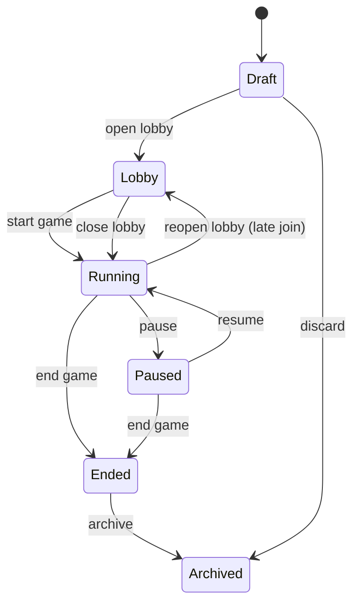

| State | Meaning |
|---|---|
| **Draft** | Created, settings editable, nobody can join yet. |
| **Lobby** | A join code is shown in Minecraft. Players request to join; the admin accepts. |
| **Running** | Rounds are being played. Late joiners can still be accepted (the admin reopens the lobby; the game keeps running). |
| **Paused** | Everything is frozen and saved. Fake players stay in place. |
| **Ended** | The campaign is over; read-only, can be exported. |
| **Archived** | Hidden from lists, kept in the database. |

#### 3.5 Starting a game from Minecraft

The brief says the server "tells the API it wants to start a game and shows a code on the Minecraft screen". In v2:

1. The server admin opens the lobby (from the app, or with `/pokednd game lobby open` in Minecraft).
2. The mod receives the **join code** from the API and shows it as a full-screen overlay on every connected client.
3. The code is a short, easy-to-type string (6 characters, no look-alike characters such as 0/O or 1/I) and is **valid while the lobby is open**.
4. Players enter it in the app; the admin sees requests and accepts or rejects them.

#### 3.6 Trainer names and skins

- The fake player's name is the **trainer name chosen per game**. It MUST follow Minecraft username rules (3–16 characters: letters, digits, underscore) and be unique among the game's trainers.
- **Skin sources:** upload a 64×64 PNG (classic or slim), or copy the skin of any Minecraft account by username.
- The API validates the PNG (size, dimensions, no metadata), then asks the mod to apply it through SkinRestorer.
- **What SkinRestorer really is:** the jar in `./vendor` is the MIT-licensed SkinRestorer mod by Lionarius. It has `/skin` commands (set, clear, refresh) and several skin providers (Mojang, MineSkin, Ely.by, custom URL), but **no written API documentation**. Its jar does contain a **public Java API** (found with `javap`, see 15.13), so the suggested integration is for the mod to **call that API directly**; running the `/skin` command targeted at the fake player is the fallback. A short spike (roadmap M4) must confirm this works for fake players and uploaded PNGs.

#### 3.7 Disconnected players

When a player closes the app, their fake player **stays in the world, idle**. The admin may skip their turns, or wait. When the player returns they pick up where they were. If a roll prompt was pending, it is still there.

#### 3.8 One server, one active game; progress between games

- One API serves **many Minecraft servers** (decided). Each server has **one active game at a time**: opening another game on the same server pauses or ends the current one first.
- A trainer, their team, bag, money and badges belong to **one game** (decided: progress is per game).
- The admin can allow **importing** a trainer and team from another game that the same player took part in. The import **copies** the chosen parts (trainer sheet, Pokémon, bag, money) into the new game, limited by the new game's caps and rules, and leaves the original untouched. Imported Pokémon keep their origin information. In physical-card mode they arrive *unbound* and have to be scanned again. By default the admin must approve each import.

#### 3.9 Settings & defaults

| Key | Default | What it does |
|---|---|---|
| `game.admin.plays` | `false` | The admin also has a trainer. |
| `game.admin.coAdminsAllowed` | `true` | The owner can add co-admins. |
| `game.lobby.lateJoin` | `true` | Players can join after the game started (admin accepts). |
| `game.lobby.codeLength` | `6` | Length of the join code. |
| `game.lobby.autoAccept` | `false` | Accept every join request automatically. |
| `game.players.max` | `0` | Maximum number of players (0 = no limit). |
| `game.spectators.enabled` | `true` | Spectators may join. |
| `game.spectators.allowUnlinked` | `true` | Minecraft accounts that are not linked to the app may join as spectators. |
| `game.trainerNames.mode` | `perGame` | Trainer name chosen per game (alternatives: `accountName`). |
| `game.skins.allowUpload` | `true` | Players may upload PNG skins. |
| `game.skins.allowCopyFromUsername` | `true` | Players may copy a skin from a Minecraft username. |
| `game.disconnect.behaviour` | `idle` | Disconnected player's trainer stays in the world (`idle`) or is removed until return (`hide`). |
| `game.import.allow` | `false` | Players may import a trainer and team from another game. |
| `game.import.copy` | `trainer,pokemon,bag,money` | What an import copies. |
| `game.import.requireApproval` | `true` | The admin must approve each import. |


---

### 4. Trainers

A trainer is the player's character. It has a D&D 5e-style character sheet and owns a team of Pokémon. The trainer does **not** fight with its own attacks; the sheet matters in three ways:

1. **Out-of-combat skill checks:** gates, events, persuading NPCs, traps.
2. **Bonuses to Pokémon actions:** the trainer's skill makes their Pokémon more accurate, catches easier and escapes likelier.
3. **Being a target:** wild Pokémon and enemies can attack the trainer. The trainer has HP and an Armor Class, and defends with a dice roll.

#### 4.1 The sheet

**Ability scores** (six, as in 5e): Strength, Dexterity, Constitution, Intelligence, Wisdom, Charisma. The *modifier* of a score is `floor((score − 10) / 2)`.

| Ability | In PokeDnD it is used for |
|---|---|
| **STR** | Athletics; carrying (bag limits); Hiker features |
| **DEX** | **Movement roll**, Armor Class, defence against attacks, Acrobatics/Stealth |
| **CON** | Trainer HP |
| **INT** | Pokémon Lore, Nature, Investigation, Appraisal |
| **WIS** | **Pokémon Handling** (accuracy and catch bonuses), Medicine, Perception, Survival, Insight |
| **CHA** | Persuasion, Performance, Intimidation, Deception; shop prices |

**Proficiency bonus** by trainer level:

| Trainer level | 1–4 | 5–8 | 9–12 | 13–16 | 17–20 |
|---|:-:|:-:|:-:|:-:|:-:|
| Bonus | +2 | +3 | +4 | +5 | +6 |

**Ability Score Improvement:** at levels 4, 8, 12, 16 and 19 the trainer gains 2 points to spread over their scores (no score above 20).

**Hit points (HP).** Level 1: the class hit die at its maximum + CON modifier. Each later level: the die's average rounded up (d6 → 4, d8 → 5, d10 → 6) + CON modifier, at least 1 per level.

**Armor Class (AC).** `10 + DEX modifier + class bonuses`. AC is used for the opposed roll when a trainer is attacked (chapter 7.12).

**Skills.** Seventeen skills, each tied to an ability. A trainer is *proficient* in two of their class's skills (add the proficiency bonus). *Expertise* doubles the bonus. The skill list is data-driven and can be edited per game.

| Ability | Skills |
|---|---|
| STR | Athletics |
| DEX | Acrobatics, Sleight of Hand, Stealth |
| INT | Investigation, Nature, Pokémon Lore, Appraisal |
| WIS | Insight, Medicine, Perception, Survival, **Pokémon Handling** |
| CHA | Deception, Intimidation, Performance, Persuasion |

**Saving throws.** Each class is proficient in two. Used when a trainer must resist something (traps, story events).

**Skill checks.** Roll **1d20 + ability modifier + proficiency (if proficient)** against a **DC** set by the admin or by a gate/event. Suggested DC guide:

| Task | Very easy | Easy | Medium | Hard | Very hard | Nearly impossible |
|---|:-:|:-:|:-:|:-:|:-:|:-:|
| **DC** | 5 | 10 | 15 | 20 | 25 | 30 |

*Advantage* = roll two d20 and keep the higher; *disadvantage* = keep the lower. A natural 20 or 1 has no special effect on skill checks unless the admin turns that on (`dice.skillChecks.natural20And1`).

#### 4.2 How a trainer affects their Pokémon

These bonuses use the **Pokémon Handling** modifier (WIS modifier + proficiency if proficient). Together they are the "trainer skill" mentioned in the brief.

| Effect | Rule | Setting |
|---|---|---|
| **Command** (accuracy) | The trainer's active Pokémon's moves gain **+1 percentage point of accuracy per point** of Handling modifier, capped at +10 | `combat.command.accuracyPpPerPoint`, `combat.command.accuracyCapPp` |
| **Catching** | Catch chance is multiplied by `1 + 0.05 × Handling modifier` (never below ×1 for negative modifiers unless `combat.catch.allowPenalty`) | `combat.catch.bonusPerPoint` |
| **Fleeing** | Flee chance gains **+2 percentage points per DEX modifier point** | `combat.flee.bonusPpPerPoint` |

> **Suggested — please review:** these three conversion rates (1 pp, 5 %, 2 pp). They are small on purpose so that the trainer's sheet helps without overpowering the official odds.

#### 4.3 Creating a trainer

1. **Name** — Minecraft-valid, unique in the game.
2. **Class** — picked from the game's class list (4.4).
3. **Ability scores** — by the method the game allows: **point buy** (default), **standard array**, or **4d6 drop the lowest**. Rolled scores use the game's dice input modes.
4. **Skills** — choose two from the class list.
5. **Skin** — upload or copy (chapter 3.6).
6. **Starter Pokémon** — chapter 5.11.
7. **Starting kit** — money and items (see settings).

*Point buy:* 27 points; scores start at 8; maximum 15 before bonuses. Cost of a score: 8→0, 9→1, 10→2, 11→3, 12→4, 13→5, 14→7, 15→9.
*Standard array:* 15, 14, 13, 12, 10, 8, assigned as the player likes.

There is **no race, origin or background** (decided).

#### 4.4 Classes

Classes are **data**. A class is a record with these fields; admins can edit or delete the defaults and add their own per game.

| Field | Meaning |
|---|---|
| `id`, `name`, `description` | Identity and flavour |
| `hitDie` | `d6`, `d8`, `d10`… |
| `primaryAbility` | Hint for the creation screen |
| `saves` | Two proficient saving throws |
| `skillChoices` | How many to pick, and from which skills |
| `acBonus` | Extra AC |
| `startingItems` | Extra items on top of the common kit |
| `features[]` | `{ level, id, name, text, effects[] }` |

A feature's **effects** are small machine-readable parts drawn from a fixed vocabulary, so admins can build features without code. Anything the vocabulary can't express is a `narrative` effect: the text is shown to players and the admin adjudicates it.

| Effect key | What it does |
|---|---|
| `accuracy.bonusPp` | Adds percentage points to the hit chance of the trainer's Pokémon |
| `crit.stageBonus` | Adds to the crit stage of the trainer's Pokémon |
| `catch.multiplierBonus` | Adds to the catch-chance multiplier (e.g. 0.25 = +25 % relative) |
| `flee.bonusPp` | Adds percentage points to the flee chance |
| `initiative.bonus` / `initiative.advantage` | Adds to initiative / rolls twice and keeps the best |
| `movement.bonus` | Adds movement points to the party's movement roll |
| `encounter.chanceShiftPp` | Shifts random-encounter chances for the party (negative = fewer) |
| `heal.itemBonusPct` | Healing items used by the trainer heal more |
| `xp.bonusPct` | Pokémon XP bonus |
| `friendship.gainMultiplier` | Friendship gain multiplier |
| `damage.trainerReductionFlat` | Flat damage reduction when the trainer is hit |
| `hp.perLevelBonus` | Extra trainer HP per level |
| `skill.expertise` / `skill.advantage` / `skill.reroll` | Skill modifiers |
| `battle.rerollPerBattle` | Re-roll one of your rolls per battle |
| `battle.freeSwitchPerBattle` / `battle.freeItemPerBattle` | Free switch or item use per battle |
| `battle.surviveKoPerBattle` | A Pokémon that would faint survives at 1 HP, per battle |
| `battle.forceRerollPerBattle` | Make an enemy re-roll a hit against your Pokémon |
| `battle.styleDie` | Extra die added to a damage roll a number of times per battle |
| `battle.superEffectiveBonusPct` | Bonus damage on super-effective hits |
| `battle.statusResistPp` | Reduces the chance that enemy status effects apply to your Pokémon |
| `battle.startStage` | Start-of-battle stat stage for certain types |
| `battle.interposePerBattle` | The trainer takes a hit meant for their Pokémon |
| `session.revive` / `session.fullHeal` / `session.survive` | Once-per-session powers |
| `money.bonusPct` / `shop.discountPct` / `shop.sellBonusPct` | Economy |
| `loot.extraRolls` | Extra rolls on boss loot tables |
| `bag.extraSlots` | More bag room (if limits are on) |
| `map.revealAll` | No fog of war for this trainer |
| `narrative` | Text only; the admin adjudicates |

**The nine default classes.** All are drafts. Each lists features at levels 1, 3, 6, 10, 14 and 20.

> **Suggested — please review:** the whole default class list (names, hit dice, saves, skills, features and numbers).

| Class | Idea | Hit die | Primary | Saves | Pick 2 skills from |
|---|---|:-:|:-:|---|---|
| **Ace Trainer** | The battle all-rounder who gets the best from any Pokémon | d8 | CHA | DEX, CHA | Pokémon Handling, Persuasion, Insight, Athletics, Intimidation |
| **Breeder** | Nurturer: healing, friendship, eggs | d6 | WIS | WIS, CON | Pokémon Handling, Medicine, Nature, Insight, Survival |
| **Researcher** | Studies Pokémon to find weaknesses | d6 | INT | INT, WIS | Pokémon Lore, Investigation, Nature, Medicine, Insight |
| **Ranger** | Scout and explorer; best at travel and catching | d10 | DEX | STR, DEX | Survival, Perception, Stealth, Athletics, Pokémon Handling |
| **Hiker** | Tough mountain traveller; takes the hits | d10 | STR | STR, CON | Athletics, Survival, Perception, Intimidation, Nature |
| **Coordinator** | Stylish performer; flashy moves and charm | d6 | CHA | DEX, CHA | Performance, Persuasion, Deception, Acrobatics, Pokémon Handling |
| **Psychic** | Foresight and mind tricks | d6 | WIS | INT, WIS | Insight, Perception, Pokémon Lore, Deception, Medicine |
| **Collector** | Money, items and rare finds | d8 | CHA | INT, CHA | Appraisal, Persuasion, Investigation, Sleight of Hand, Insight |
| **Medic** | Healer who keeps the team standing | d8 | WIS | WIS, CON | Medicine, Pokémon Handling, Insight, Perception, Nature |

| Class | Lv 1 | Lv 3 | Lv 6 | Lv 10 | Lv 14 | Lv 20 |
|---|---|---|---|---|---|---|
| **Ace Trainer** | *Commanding Presence:* `accuracy.bonusPp +2` | *Quick Switch:* one free switch per battle | *Second Wind:* re-roll one roll per battle | *Critical Eye:* `crit.stageBonus +1` | *Unbreakable Bond:* once per battle a Pokémon that would faint survives at 1 HP | *Champion's Presence:* `accuracy.bonusPp +3` more and initiative advantage |
| **Breeder** | *Gentle Hands:* healing items +25 %, friendship gain ×2 | *Egg Whisperer:* eggs hatch twice as fast | *Field Medic:* one free item use per battle | *Natural Mender:* at the end of each overworld round your Pokémon recover 10 % HP | *Perfect Care:* hatched Pokémon get at least 3 good IVs; Pokémon XP +10 % | *Soul Tender:* once per session revive a Pokémon to 50 % HP anywhere |
| **Researcher** | *Field Notes:* expertise in Pokémon Lore; at battle start learn every enemy's type and HP level | *Weakness Analysis:* once per battle reveal an enemy's moves; your next attack on it gets +10 pp accuracy | *Data Gathering:* +10 trainer XP the first time the party meets each species | *Exploit Weakness:* super-effective hits +10 % damage | *Encyclopedic Mind:* re-roll failed Lore, Nature or Investigation checks | *Perfect Analysis:* once per battle suppress an enemy's ability for 3 rounds |
| **Ranger** | *Pathfinder:* +1 movement point; advantage on Survival and Perception | *Light Step:* −10 pp on random-encounter chances for the party | *Wild Whisperer:* catch multiplier +25 % | *Swift Retreat:* flee +20 pp, and the whole party escapes on one success | *Trailblazer:* +2 more movement points | *Master of the Wild:* once per session skip an encounter |
| **Hiker** | *Tough as Rock:* +1 HP per level; trainer damage reduced by the proficiency bonus | *Stand Your Ground:* Rock, Ground and Steel Pokémon start battles with +1 Defense | *Heavy Pack:* +10 bag slots | *Bulwark:* once per battle the trainer takes a hit instead of a Pokémon | *Mountain Stride:* Athletics gates auto-pass; +2 movement points | *Immovable:* once per session survive a knock-out at 1 HP |
| **Coordinator** | *Showmanship:* expertise in Performance; 5 % shop discount | *Appeal:* once per battle add a d6 to a damage roll | *Crowd Favourite:* friendship gain ×1.5 | *Combo Master:* *Appeal* works twice per battle | *Encore:* when your Pokémon crits it heals 10 % HP | *Grand Festival:* once per session all your Pokémon in a battle get +1 in every stat |
| **Psychic** | *Foresight:* once per round the admin tells you the category and target of an enemy's declared move | *Mind Link:* party members can use your initiative if higher | *Calm Mind:* −20 pp chance of enemy status effects on your Pokémon | *Precognition:* once per battle make an enemy re-roll a hit | *Psychic Shield:* advantage on the defence roll when you are targeted | *Clairvoyance:* see the whole map (no fog of war) and the species of the next encounter |
| **Collector** | *Keen Eye:* expertise in Appraisal; +10 % ₽ from NPC trainers and bosses | *Haggler:* −5 % buy prices, +5 % sell prices | *Item Savvy:* held items are 10 % stronger | *Hidden Stash:* +5 bag slots; key items don't count | *Treasure Hunter:* +1 roll on boss loot | *Midas Touch:* buy ×0.75, sell ×1.5 |
| **Medic** | *First Aid:* healing items +50 %; allies at 0 HP are stabilised automatically | *Triage:* one free item use on an ally's Pokémon per battle | *Status Clear:* once per battle cure a status for free | *Field Hospital:* once per session heal the party 50 % at any node | *Resuscitate:* up to 3 times per session revive a Pokémon at 25 % HP without an item | *Miracle Worker:* once per session fully heal the whole party anywhere |

**Common starting kit** (all classes): ₽ 3000, 5 Poké Balls, 3 Potions. Suggested extras: Ranger +3 Poké Balls; Medic +2 Antidotes and +1 Revive; Collector +₽ 1000.

#### 4.5 Levelling up

Trainers earn **trainer XP** automatically from events. The level cap is **20** (decided).

**XP needed in total to reach level L:** `25 × L × (L − 1)`. That gives:

| Level | 2 | 3 | 4 | 5 | 8 | 10 | 15 | 20 |
|---|---:|---:|---:|---:|---:|---:|---:|---:|
| Total XP | 50 | 150 | 300 | 500 | 1,400 | 2,250 | 5,250 | 9,500 |

**Where the XP comes from** (every trainer who took part gets the full amount):

| Event | Trainer XP |
|---|---|
| Defeat a wild Pokémon | its level |
| Defeat an NPC trainer or a PvP opponent | 5 × the opponent's highest level |
| Defeat a boss | 10 × its level |
| Catch a Pokémon | 10 |
| Evolve a Pokémon, or hatch an egg | 20 |
| Discover a node (first arrival of anyone in the game) | 10 |
| Pass a gate or event skill check for the first time | 15 |
| Complete a quest | set by the quest (default 100) |

> **Suggested — please review:** the XP curve and the XP table. A multiplier (`trainer.xp.multiplier`) scales everything, and the admin can grant XP at any time.

On level-up the app walks the player through: new HP, features, proficiency, and (at levels 4, 8, 12, 16, 19) the ability improvement.

#### 4.6 Trainer health, being attacked, and knock-out

When an enemy attacks a trainer (chapter 7.12), the trainer defends with an opposed roll, and damage is scaled down so that trainers aren't one-shot.

**Recovery.** Trainer HP recovers fully at a healer NPC, and by `trainer.hp.recoverPerRoundPct` of their maximum at the end of each overworld round.

**At 0 HP**, the game uses its **knock-out rule**:

| Mode | What happens |
|---|---|
| `faintRespawn` *(default)* | The trainer is knocked out. After the battle (or immediately, outside battle) they return to the last town with a healer, their party is healed, and they lose `combat.whiteout.moneyLossPct` % of their ₽. |
| `deathSaves` | 5e rules. The trainer is unconscious. At the start of each of their turns they roll 1d20: 10+ is a success, 9 or less a failure; a natural 20 brings them back to 1 HP; a natural 1 counts as two failures. Three successes stabilise them; three failures: with `trainer.ko.deathAllowed` off they fall back to `faintRespawn`; with it on the trainer dies and the admin decides what happens. An ally can stabilise them with a Medicine check (DC 10) or a healing effect. |
| `admin` | No automatic rule; the admin decides. |

#### 4.7 Settings & defaults

| Key | Default | What it does |
|---|---|---|
| `trainer.abilityScores.method` | `pointBuy` | Allowed method: `pointBuy`, `standardArray`, `roll4d6DropLowest`, or `any`. |
| `trainer.abilityScores.pointBuyBudget` | `27` | Points for point buy. |
| `trainer.level.start` | `1` | Starting trainer level. |
| `trainer.level.cap` | `20` | Maximum trainer level. |
| `trainer.xp.multiplier` | `1.0` | Scales all trainer XP. |
| `trainer.xp.table` | *(table in 4.5)* | XP awarded per event. |
| `trainer.xp.curveFactor` | `25` | Total XP to reach L is `factor × L × (L − 1)`. |
| `trainer.start.money` | `3000` | Starting ₽. |
| `trainer.start.items` | `pokeBall×5, potion×3` | Common starting kit. |
| `trainer.classes.set` | *(the nine defaults)* | Class list used by the game; fully editable. |
| `trainer.skills.set` | *(the 17 skills)* | Skill list; fully editable. |
| `trainer.hp.recoverPerRoundPct` | `10` | Trainer HP regained per overworld round. |
| `trainer.ko.mode` | `faintRespawn` | `faintRespawn`, `deathSaves` or `admin`. |
| `trainer.ko.deathAllowed` | `false` | With `deathSaves`: third failure kills the trainer. |
| `dice.skillChecks.natural20And1` | `false` | Natural 20 always passes and natural 1 always fails on skill checks. |
| `combat.command.accuracyPpPerPoint` | `1` | Accuracy bonus per Handling point. |
| `combat.command.accuracyCapPp` | `10` | Cap on the command accuracy bonus. |
| `combat.catch.bonusPerPoint` | `0.05` | Relative catch bonus per Handling point. |
| `combat.catch.allowPenalty` | `false` | Negative Handling modifiers also reduce the catch chance. |
| `combat.flee.bonusPpPerPoint` | `2` | Flee bonus per DEX modifier point. |

---

### 5. Pokémon

#### 5.1 What a Pokémon is

Every individual Pokémon in a game has:

| Field | Notes |
|---|---|
| Species + form | From the playable roster (only species with complete assets). Forms (Alolan, Galarian, Hisuian, Paldean, gender differences, cosmetic forms) are included when they have assets. |
| Nickname | Optional, editable on the virtual card. |
| Level and XP | Level 1–100 (cap is a setting). |
| Nature | One of 25. |
| IVs and EVs | IVs 0–31 per stat; EVs 0–252 per stat, 510 in total. |
| Gender | Male, female or genderless, from the species ratio. |
| Ability | One of the species' abilities, including the **hidden ability**. |
| Shiny | A flag; cosmetic only. |
| Held item | At most one. |
| Moves | Up to four, each with current PP. |
| Status | Major status (burn, poison, paralysis, sleep, freeze) and volatile ones during battle. |
| Friendship | 0–255. |
| Origin | Original trainer, ball used, where and when it was caught or hatched. |
| Cards | Virtual card, and the physical card bound to it (if any). |
| Location | In the party (up to 6), in storage, or with a daycare/trade NPC. |

#### 5.2 Stats

Each Pokémon has six stats: HP, Attack, Defense, Special Attack, Special Defense and Speed. They come from the official formulas, with the base stats from `./resources/pokedex.csv`:

```
HP    = floor((2 × Base + IV + floor(EV / 4)) × Level / 100) + Level + 10
Other = floor( (floor((2 × Base + IV + floor(EV / 4)) × Level / 100) + 5) × NatureMultiplier )
```

The nature multiplier is 1.1 for the boosted stat, 0.9 for the lowered one, 1.0 otherwise.

| Nature | + | − | Nature | + | − | Nature | + | − |
|---|---|---|---|---|---|---|---|---|
| Hardy | — | — | Docile | — | — | Serious | — | — |
| Bashful | — | — | Quirky | — | — | | | |
| Lonely | Atk | Def | Brave | Atk | Spe | Adamant | Atk | SpA |
| Naughty | Atk | SpD | Bold | Def | Atk | Relaxed | Def | Spe |
| Impish | Def | SpA | Lax | Def | SpD | Timid | Spe | Atk |
| Hasty | Spe | Def | Jolly | Spe | SpA | Naive | Spe | SpD |
| Modest | SpA | Atk | Mild | SpA | Def | Quiet | SpA | Spe |
| Rash | SpA | SpD | Calm | SpD | Atk | Gentle | SpD | Def |
| Sassy | SpD | Spe | Careful | SpD | SpA | | | |

**Stat stages** during battle go from −6 to +6. The multiplier is `(2 + n) / 2` for positive stages and `2 / (2 − n)` for negative ones (Attack, Defense, Sp. Atk, Sp. Def, Speed). Accuracy and evasion stages use `(3 + n) / 3` and `3 / (3 − n)` and are explained in chapter 7.5.

#### 5.3 Experience and levelling

The species' **growth group** (from `pokedex.csv`) decides how much total XP each level needs.

| Group | L2 | L5 | L10 | L20 | L30 | L50 | L75 | L100 |
|---|---:|---:|---:|---:|---:|---:|---:|---:|
| Fast | 6 | 100 | 800 | 6,400 | 21,600 | 100,000 | 337,500 | 800,000 |
| Medium Fast | 8 | 125 | 1,000 | 8,000 | 27,000 | 125,000 | 421,875 | 1,000,000 |
| Medium Slow | 9 | 135 | 560 | 5,460 | 21,760 | 117,360 | 429,235 | 1,059,860 |
| Slow | 10 | 156 | 1,250 | 10,000 | 33,750 | 156,250 | 527,343 | 1,250,000 |
| Erratic | 15 | 237 | 1,800 | 12,800 | 37,800 | 125,000 | 326,531 | 600,000 |
| Fluctuating | 4 | 65 | 540 | 5,440 | 23,760 | 142,500 | 582,187 | 1,640,000 |

Formulas (n = level, results floored; a Pokémon at level 1 has 0 XP):

| Group | Total XP for level n |
|---|---|
| Fast | `4n³ / 5` |
| Medium Fast | `n³` |
| Medium Slow | `6n³/5 − 15n² + 100n − 140` |
| Slow | `5n³ / 4` |
| Erratic | `n ≤ 50: n³(100 − n)/50` · `51–68: n³(150 − n)/100` · `69–98: n³ ⌊(1911 − 10n)/3⌋ / 500` · `99–100: n³(160 − n)/100` |
| Fluctuating | `n ≤ 15: n³(⌊(n+1)/3⌋ + 24)/50` · `16–36: n³(n + 14)/50` · `37–100: n³(⌊n/2⌋ + 32)/50` |

**XP from a defeated Pokémon:**

```
XP = floor( ( b × Lf / (5 × s) ) × ( (2 × Lf + 10) / (Lf + Lp + 10) ) ^ 2.5 + 1 ) × t × e
```

`b` = the defeated species' *Experience Value* (from `pokedex.csv`), `Lf` = its level, `Lp` = the level of the Pokémon receiving XP, `s` = 1 for participants and 2 for the rest of the team (the Gen 6+ "Exp. Share always on" rule — **decided**), `t` = 1.5 if the defeated Pokémon belonged to an NPC trainer, `e` = 1.5 with a Lucky Egg.

*Example.* A level-12 wild Pidgey (b = 50) is defeated. A level-10 participant gets **140 XP**; a team-mate who sat out gets **70**. If the Pidgey had belonged to an NPC trainer, the participant would get **210**.

**EVs.** A defeated Pokémon also gives its *EV yield* (the "EVs" columns of `pokedex.csv`) to the participants.

#### 5.4 Evolution

Evolution is **automatic with a choice**: when the conditions are met, the owner gets a prompt, *"Your Pokémon is evolving! Evolve / Not now"*. Declining pauses it until the next trigger (for level evolutions, the next level-up).

`pokedex.csv` writes evolutions as text (450 species have one). These are the kinds found, and how the game handles them:

| In the data | Handled as |
|---|---|
| `Level N` | Triggers on reaching level N |
| `Level N, Day` / `Night` | Level N and the game clock says day/night |
| `Level N, Gender …` | Level N and the right gender |
| `Level N, Attack > Defence` (and `<`, `=`) | Level N and the stat comparison (Tyrogue) |
| `Friendship >= N` (with Day/Night, or "Knows a Fairy-type move") | Triggers on level-up with enough friendship (default 220) |
| `Use <Item>` (stones and similar) | The owner uses the item on the Pokémon from the bag |
| `Trade` / `Trade, Holding <Item>` | On trade at a trade-centre NPC; the held item is consumed |
| `Holding <Item>, Day/Night` | Evolves on level-up while holding the item at the right time (sweets for Alcremie, Razor Claw/Fang) |
| `Knows <Move>` | On level-up while knowing the move |
| `Use <Move> ×N` (Rage Fist) | After the Pokémon has used the move N times in battle |
| `Travel N blocks` | After travelling N blocks as lead Pokémon; converted to movement points using `world.movement.blocksPerPoint` |
| `Biome Evolution/Regional/…` and `Biome Is …` | Needs a **region tag** (for example `biome:alola`); see chapter 8.2 |
| `Wurmple Cocoon Species …` | A hidden value stored when the Wurmple is created decides Silcoon or Cascoon |
| `Moon FULL MOON`, `Gimmighoul Coins N` | Not automatic: the app asks the admin to confirm |

Anything the importer can't classify is handled as *"ask the admin"* (`pokemon.evolution.unknownFallback`).

**Physical card mode:** the evolution completes only when the player **scans the evolved species' card** (decided). Until then the Pokémon stays as it was.

#### 5.5 Moves

A Pokémon knows up to **four** moves. The learnset data is `./resources/pokemon-attacks.csv` (130,704 rows, one per species/form/move/method).

| Method | How it is learned |
|---|---|
| `level` (18,645 rows) | Offered on reaching the level. If the Pokémon already knows four moves, the player picks one to forget. |
| `tm` (64,125) | Using a **TM item**. There is one TM item for each of the **391 moves** that any species learns by TM: Cobblemon already defines 334 of them (move, type and how it is obtained, in `data/cobblemon/tms`) and the importer generates the other 57. The icon is Cobblemon's TM disc for the move's type (18 types). The full list is `resources/tm.csv` *(decided)*. |
| `tutor` (27,739) | From a **move-tutor NPC**, usually for ₽. |
| `egg` (6,596) | Egg moves: through breeding if enabled, or from a tutor. |
| `legacy` (13,196) | Moves from older games: from a tutor that offers legacy moves. |
| `special` (360) and `form_change` (43) | Special/event moves and moves linked to a form change: by the admin, or automatically with the form. |

The `form` column has 63 different values (for example `Alola`, `Galar`, `Hisui`, `F` for female, or a type for Arceus and Silvally). The importer maps it to the matching species form.

Each move has **PP** (from `attack.csv`). PP is restored at a healer and by Ether/Elixir items. The admin can also switch on a small PP recovery at the end of every overworld round (`pokemon.pp.recoverPerRound`, off by default).

**Physical card mode:** moves are **frozen** to the four printed on the card (decided). Level-up, TM and tutor learning are disabled for those Pokémon.

#### 5.6 Status conditions and stat changes

Status effects, and the dice they use. The odds are the official ones; the die is chosen by the smart-dice rule (chapter 6).

| Status | Effect | Roll |
|---|---|---|
| **Burn** | Lose 1/16 max HP each round; physical damage halved | none |
| **Poison** | Lose 1/8 max HP each round | none |
| **Badly poisoned** | Lose n/16 max HP, n growing each round | none |
| **Paralysis** | Speed ×0.5; 25 % chance each turn that the Pokémon can't act | 25 % → d4, need 4 |
| **Sleep** | Can't act for 1–3 turns | d6: 1–2 = 1 turn, 3–4 = 2, 5–6 = 3 |
| **Freeze** | Can't act; 20 % chance each turn to thaw | 20 % → d10, need 9+ |
| **Confusion** | Lasts 2–5 turns; 33 % chance each turn to hurt itself | duration d4 (+1); self-hit d6, need 5+ |
| **Flinch** | Loses the turn (only if hit by a faster attacker's move) | none |

Other volatile conditions (leech seed, taunt, encore, and so on) come from the imported move data.

#### 5.7 Fainting and healing

- A Pokémon at 0 HP **faints** and stays fainted until it is healed at a **healer NPC** (Pokémon Center) or revived with a **Revive**.
- Healers restore HP, PP and status. Their price is a setting (default free).
- Items can be used **outside battle at any time** from the app (decided).
- There is no permadeath mode in this version (decided: classic fainting).

#### 5.8 Friendship

Friendship starts at the species' *Base Friendship* (from `pokedex.csv`: mostly 50; some 0, 35, 70, 90, 100 or 140). It goes up to a maximum of 255.

| Event | Change (suggested) |
|---|---|
| Level up | +5 below 100, +4 at 100–199, +3 from 200 |
| 10 movement points travelled with the Pokémon as lead | +1 |
| Using a friendship berry or vitamin | as in the main games |
| Fainting | −1 |

Friendship evolutions need 220 by default.

> **Suggested — please review:** the friendship numbers.

#### 5.9 Gender, shiny and forms

- **Gender** comes from the species' ratio (8 different ratios appear in `pokedex.csv`, plus genderless). It affects the icon and model, some evolutions and some forms.
- **Shiny** Pokémon have an alternate texture/icon and nothing else (decided). The chance is set per game or region (chapter 8.9).
- **Forms:** every form that has a model counts as a playable form.

#### 5.10 Breeding *(optional)*

Breeding is off by default (`pokemon.breeding.enabled`), and is a game setting. When enabled:

- A **daycare NPC** takes two compatible Pokémon (matching *egg groups* from `pokedex.csv`; Ditto pairs with anything except "Undiscovered" groups).
- After a number of rounds an **egg** appears. The egg hatches after `Egg Cycles × pokemon.breeding.pointsPerCycle` movement points (default 2 points per cycle; a 20-cycle species needs 40 points).
- The baby is the mother's species at its first stage, and inherits three random IVs from its parents, and egg moves that both the species and a parent allow.

> **Suggested — please review:** the whole breeding model. It is deliberately minimal.

#### 5.11 Starters, team size and storage

- **Starter:** the way a player gets their first Pokémon is a game setting: `pick` from a list (default), `assign` by the admin, or `random` from a pool. The default list is every starter of generations 1–9 that has a model, at level 5.
- **Team:** up to **6** Pokémon in the party (configurable).
- **Storage:** extra Pokémon go to **PC boxes** (unlimited by default; configurable). Boxes are opened at a Pokémon Center NPC by default (`pokemon.pc.access`).

#### 5.12 Settings & defaults

| Key | Default | What it does |
|---|---|---|
| `pokemon.party.size` | `6` | Maximum Pokémon in the party. |
| `pokemon.pc.boxes` | `0` | Number of PC boxes (0 = unlimited). |
| `pokemon.pc.boxSize` | `30` | Pokémon per box. |
| `pokemon.pc.access` | `healerNpc` | Where the PC can be used: `healerNpc`, `anywhere`. |
| `pokemon.starter.method` | `pick` | `pick`, `assign` or `random`. |
| `pokemon.starter.list` | *(all modelled starters, Gen 1–9)* | Species a player may pick from. |
| `pokemon.starter.level` | `5` | Starting level of the starter. |
| `pokemon.level.cap` | `100` | Maximum Pokémon level. |
| `pokemon.xp.share` | `gen6` | `gen6` (non-participants get half), `participantsOnly`, `all`. |
| `pokemon.xp.multiplier` | `1.0` | Scales all Pokémon XP. |
| `pokemon.evolution.mode` | `askPlayer` | `askPlayer`, `askAdmin`, `automatic`. |
| `pokemon.evolution.unknownFallback` | `askAdmin` | What to do with evolutions the game can't evaluate. |
| `pokemon.friendship.evolveAt` | `220` | Friendship needed for friendship evolutions. |
| `pokemon.friendship.levelUpGain` | `5,4,3` | Gain per level-up by friendship band (<100, 100–199, ≥200). |
| `pokemon.friendship.faintLoss` | `1` | Friendship lost when fainting. |
| `pokemon.friendship.pointsPerGain` | `10` | Movement points travelled per +1 friendship. |
| `pokemon.ivs.mode` | `random` | `random` (0–31 each) or `fixed`. |
| `pokemon.ivs.fixedValue` | `15` | The IV used for every stat when the mode is `fixed`. |
| `pokemon.natures.enabled` | `true` | Use natures. |
| `pokemon.breeding.enabled` | `false` | Turn breeding on. |
| `pokemon.breeding.pointsPerCycle` | `2` | Movement points per egg cycle. |
| `pokemon.moves.max` | `4` | Moves a Pokémon can know. |
| `pokemon.pp.recoverPerRound` | `0` | PP recovered per overworld round (0 = off). |
| `pokemon.moves.tutorLegacyAllowed` | `true` | Tutors may teach `legacy` moves. |
| `pokemon.fainting.rule` | `classic` | `classic` only in this version. |


---

### 6. Dice

#### 6.1 The idea: the die fits the odds

In most dice games every chance is a d20. PokeDnD doesn't do that. When the game needs to decide something by luck, it first works out **the real chance** (after every bonus and penalty), and then it asks the players to roll **the simplest die that expresses that chance**:

- A **25 %** chance is a **d4**: "roll a 4".
- A **30 %** chance is a **d10**: "roll 8 or higher".
- A **33 %** chance is a **d6**: "roll 5 or 6".
- A **60 %** chance is a **d8**: "roll 4 or higher".
- A **3 %** chance is a **d100**: "roll 98 or higher".

Easy odds use small, friendly dice; awkward odds use a d100. The players always see the **true chance** next to the roll, so nobody is cheated by rounding.

This is the **smart dice** rule, and it is the default. The admin can switch it to *classic* (everything on d20 and d100), limit which dice the table owns, or force a die for any kind of roll.

#### 6.2 Notation

- **NdS** means "roll N dice with S sides and add them up": `2d8`, `1d20`.
- **"Need X+"** means the roll succeeds on X or higher. PokeDnD always rolls **high to succeed** (the D&D way). It is a setting (`dice.direction`).
- **Bands.** Some rolls decide several outcomes at once. For example one d20 can mean *miss*, *hit* or *critical hit*. The d20 is split into bands from the bottom up: the worst outcome gets the lowest numbers and the best outcome (a critical hit) gets the highest.

#### 6.3 Which rolls exist

| Roll | Who rolls | Style | Details |
|---|---|---|---|
| **Hit + crit** of a move | The Pokémon's owner (players); automatic for enemies | **Smart** (bands: miss / hit / crit) | 7.5 |
| **Damage** | The Pokémon's owner | **Dice from the move's power** (NdS, summed) | 7.6 |
| **Secondary effect** (burn chance, flinch…) | The attacker's owner | **Smart** | 7.8 |
| **Status checks** each turn (paralysis, freeze, confusion) and durations (sleep, confusion) | The affected Pokémon's owner | **Smart** | 5.6 |
| **Multi-hit** count (2–5 hits) | The attacker's owner | **Smart** (bands) | 7.5 |
| **Catch** | The trainer | **Smart** | 7.10 |
| **Flee** | The trainer | **Smart** | 7.11 |
| **Initiative** | Each participant | Classic **1d20 + modifier** | 7.3 |
| **Opposed defence roll** (trainer attacked) | The trainer's player vs an automatic attack roll | Classic **1d20 + modifier** | 7.12 |
| **Skill checks and saving throws** | The trainer | Classic **1d20 + modifier vs DC** | 4.1 |
| **Death saves** | The trainer | Classic **1d20** | 4.6 |
| **Movement** | The party (any member) | **1d6 + DEX** *(configurable)* | 8.4 |
| **Ability scores** (if rolled) | The player | 4d6 drop lowest, six times | 4.3 |
| **Encounter check, shiny, boss, wild level, loot** | **The system**, in secret | Digital (can be switched to physical) | 8.5 |

Classic rolls keep the feel of D&D. Each can be switched to smart dice: `dice.skillChecks.style`, `dice.initiative.style`, `dice.defence.style`.

#### 6.4 How the die is chosen

**Input:** a list of *band probabilities* that add up to 100 %. A simple yes/no check has two bands, `[fail, success]`. A hit roll has three: `[miss, hit, crit]`. Bands with 0 % are left out.

**Settings that matter** (with their defaults):

| Setting | Default | Meaning |
|---|---|---|
| `dice.available` | `4, 6, 8, 10, 12, 20, 100` | The dice the table owns |
| `dice.tolerance.absolutePp` | `2.5` | A band may be off by at most this many percentage points |
| `dice.tolerance.relativePct` | `15` | …and by at most this share of its own size |
| `dice.d100Below` | `5` | If the rarest band is rarer than this %, use a d100 |

**Steps:**

1. Look at the **rarest** band. If it is below `dice.d100Below` (5 %), go to step 4.
2. Try the dice in order of size: d4, d6, d8, d10, d12, d20 (skipping dice the table doesn't own).
3. For each die, **share out its faces** between the bands, in proportion to their probabilities (largest-remainder method; if two remainders tie, the lower band gets the extra face, so ties never favour the attacker). The die is **accepted** if every band keeps at least one face and each band's real share is within *both* tolerances of what it should be. Take the **first die accepted**.
4. If no die was accepted, use the **d100**: each band gets `round(probability × 100)` faces (the largest band takes any rounding leftover).
5. A band with 100 % needs no roll. A roll with a single band is not rolled at all (an automatic success).

If the table has no d100, it rolls two d10 as percentile dice (the first is the tens, the second the units; 00 = 100). That is `dice.percentile.method`.

> **Why 2.5 points and 15 %?** They are the loosest values that still give friendly dice for the common odds. They are suggestions: make them tighter and more rolls use a d100; make them looser and more rolls use small dice but are less exact.

#### 6.5 Worked examples

All of these were computed by the reference algorithm (the same one that goes into `Core`).

| Situation | True chance | Die and rule | Real chance |
|---|---:|---|---:|
| Paralysis: can't move this turn | 25 % | **d4** · 4 = can't move | 25 % |
| Frozen: thaws this turn | 20 % | **d10** · 9–10 = thaws | 20 % |
| Flamethrower burn chance | 10 % | **d10** · 10 = burn | 10 % |
| Body Slam paralysis chance | 30 % | **d10** · 8–10 = paralysed | 30 % |
| Confused: hits itself | 33 % | **d6** · 5–6 = hits itself | 33.3 % |
| Flee, first try (Speed 60 vs 80) | 49 % | **d4** · 3–4 = escapes | 50 % |
| Flee, second try | 61 % | **d8** · 4–8 = escapes | 62.5 % |
| Catch, Pidgey at full HP | 33 % | **d6** · 5–6 = caught | 33.3 % |
| Catch, Bulbasaur at low HP | 16 % | **d6** · 6 = caught | 16.7 % |
| Catch, Bulbasaur asleep at low HP | 40 % | **d10** · 7–10 = caught | 40 % |
| Catch, Pidgey nearly dead | 88 % | **d8** · 2–8 = caught | 87.5 % |
| Catch, legendary at 1 HP, Ultra Ball | 2.3 % | **d100** · 99–100 = caught | 2 % |
| Catch, legendary at full HP, Ultra Ball | 0.8 % | **d100** · 100 = caught | 1 % |
| Move with 80 % accuracy, 5 % crit | 20 / 75 / 5 | **d20** · 1–4 miss · 5–19 hit · 20 crit | exact |
| Move with 90 % accuracy, 10 % crit | 10 / 80 / 10 | **d10** · 1 miss · 2–9 hit · 10 crit | exact |
| Move with 100 % accuracy, 5 % crit | 0 / 95 / 5 | **d20** · 1–19 hit · 20 crit | exact |
| 100 % move after one −1 accuracy stage (75 %) | 25 / 70 / 5 | **d20** · 1–5 miss · 6–19 hit · 20 crit | exact |
| Move with 100 % accuracy, crit stage +3 (25 %) | 0 / 75 / 25 | **d4** · 1–3 hit · 4 crit | exact |
| Sleep length 1–3 turns | ⅓ each | **d6** · 1–2 → 1 turn · 3–4 → 2 · 5–6 → 3 | exact |
| Confusion length 2–5 turns | ¼ each | **d4** · 1 → 2 turns … 4 → 5 | exact |
| Multi-hit move: 2, 3, 4 or 5 hits (35/35/15/15 %) | | **d6** · 1–2 → 2 hits · 3–4 → 3 · 5 → 4 · 6 → 5 | 33/33/17/17 % |

A longer reference (every percentage from 1 % to 99 %) is in [Appendix B](#appendix-b--smart-dice-reference).

#### 6.6 Modifiers

Bonuses and penalties change the **chance** first; the die is chosen afterwards. How each kind of modifier is applied:

| Modifier | Applies as | Example |
|---|---|---|
| Accuracy / evasion stages | Multiplies the move's accuracy (7.5) | −1 stage turns 100 % into 75 % |
| Trainer command bonus | Adds percentage points of accuracy | +4 pp |
| Class features that help a hit | Adds percentage points | Ace Trainer +2 pp |
| Catch bonuses | Multiply the catch chance (4.2) | ×1.25 |
| Flee bonuses | Add percentage points | +6 pp |
| Classic d20 checks | Add to the roll | d20 + 3 |

**Advantage and disadvantage** exist for classic d20 rolls (roll two, keep the higher or the lower). They are not used on smart-dice rolls; features that help those add percentage points instead.

**Rerolls** (class features, admin): the player rolls again and keeps the new result. The roll log shows both.

#### 6.7 Who rolls, and how the result gets in

Every roll is a **roll request** sent to the right person. Three ways to answer it; the admin chooses which are allowed per game (`dice.input.modes`).

| Mode | How it works | Approval |
|---|---|---|
| **Player submits** *(default)* | The player rolls a physical die and types the result in the app. | The admin **approves**, edits or rejects it (default on). |
| **Digital** *(default on)* | The player taps *Roll* and the server rolls for them, with a short dice animation. | No approval needed. |
| **Admin enters** *(always available)* | The admin types the result for anyone, at any time. | none |

The admin can also **override any roll** after the fact: change the value, swap the die, re-roll, or cancel the request. Every change goes in the audit log.

**A roll request** carries: who must roll; why ("Roll for Scratch"); the dice; the band table ("1–19 hit · 20 crit"); the player's modifiers; the true chance; and an optional time limit.

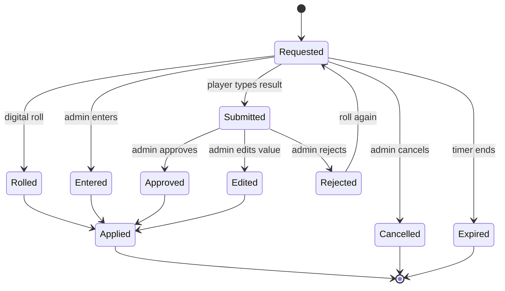

**Entering the result.** For several dice (2d8) the app has one box per die by default, so it can check every die is within range. A setting lets players enter just the total.

**Showing the prompt.** The same roll request shows in two places:

- **In the app**: a card on the player's screen ("Roll 1d20 for Scratch · 1–19 hit · 20 crit") with a dice-entry pad and a *Roll for me* button.
- **In Minecraft**: a title on the shared screen ("Ana: roll 1d20 for Scratch"), a line in the chat log, and the roll panel on the HUD.

**Batching.** To save time at the table, the app can ask for the hit roll, the damage dice and the effect roll **at once**. If the hit misses, the extra dice are ignored. It is off by default (`dice.batch.attackRolls`).

**Fairness.** Digital rolls use a cryptographically secure random generator on the server. Each roll in the log records its **source**: physical (entered by admin), physical (entered by player and approved), or digital.

**Enemy and secret rolls.** The system rolls for enemies automatically. Rolls that are not part of the table's drama (encounter check, shiny, boss, wild levels, loot) are made by the system in secret. The admin can switch either to *physical*: the app then asks the admin to roll and type it in.

#### 6.8 Settings & defaults

| Key | Default | What it does |
|---|---|---|
| `dice.style` | `smart` | `smart`, or `classic` (d20 for most things, d100 for rare ones). |
| `dice.available` | `4,6,8,10,12,20,100` | Dice the table owns. |
| `dice.tolerance.absolutePp` | `2.5` | Maximum error per band, in percentage points. |
| `dice.tolerance.relativePct` | `15` | Maximum error per band, relative to its size. |
| `dice.d100Below` | `5` | Use a d100 when the rarest band is below this %. |
| `dice.percentile.method` | `d100` | `d100` or `2d10`. |
| `dice.direction` | `high` | Roll high to succeed (`high`) or low (`low`). |
| `dice.forceDie` | `{}` | Force a die per roll type, e.g. `{ "catch": 20 }`. |
| `dice.skillChecks.style` | `classic` | `classic` (d20 + mod vs DC) or `smart`. |
| `dice.initiative.style` | `classic` | `classic` or `smart`. |
| `dice.defence.style` | `classic` | Trainer defence roll style. |
| `dice.input.modes` | `playerSubmit,digital,adminEnter` | Allowed ways to answer a roll request. |
| `dice.approval.required` | `true` | Player-submitted physical rolls need the admin's approval. |
| `dice.approval.autoSeconds` | `0` | Auto-approve after this many seconds (0 = never). |
| `dice.entry.perDie` | `true` | Enter each die separately (otherwise the total). |
| `dice.batch.attackRolls` | `false` | Ask for hit, damage and effect dice together. |
| `dice.prompt.showTrueChance` | `true` | Show the exact chance in the prompt. |
| `dice.prompt.timeoutSeconds` | `0` | Time limit for a roll request (0 = none). |
| `dice.enemy.mode` | `auto` | `auto`, or `adminPhysical` (admin rolls real dice for enemies). |
| `dice.secret.mode` | `auto` | `auto`, or `adminPhysical` for encounter, shiny, boss and loot rolls. |
| `dice.rng.source` | `secure` | Random generator used for digital rolls. |
| `dice.advantage.enabled` | `true` | Advantage/disadvantage on classic d20 rolls. |

---

### 7. Combat

#### 7.1 What a battle is

A battle happens between **sides**. A side has one or more **participants**: a trainer (a player or an NPC), or a lone wild Pokémon. Each participant has one **active Pokémon** at a time, the rest of its team waits in reserve.

| Battle type | Sides |
|---|---|
| **Wild** | The trainers who joined vs one or more wild Pokémon (or a boss) |
| **NPC trainer** | The trainers who joined vs the NPC |
| **PvP** | Players vs players; teams are assigned by the admin (free-for-all if not) |
| **Mixed** | The admin can add any combination (e.g. two trainers and a wild Pokémon on one side) |

Usually **one active Pokémon per trainer**. So several Pokémon are on the field only when several trainers take part. The admin can change that per battle (`combat.activePerTrainer`), including doubles or more.

There are no grid positions. For targeting, every Pokémon on the field counts as adjacent to every other one.

#### 7.2 Starting a battle

1. A trigger starts it: an encounter (chapter 8.5), an NPC trainer (8.6), a PvP challenge, or the admin.
2. Players **within `combat.joinRadius` blocks** (default 16) of the encounter point take part. The admin can add or remove anyone (also from a distance).
3. The mod places the fighters (trainers in a line facing the enemy, each active Pokémon between), shows the battle HUD, and the auto camera cuts to a battle shot.
4. **The overworld pauses** for everyone else while the battle lasts (decided). Only one battle runs at a time.

#### 7.3 The round

Each round has five steps.

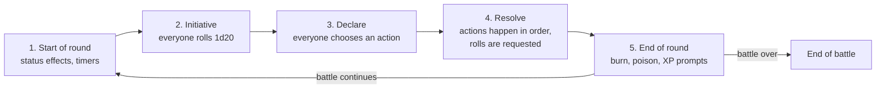

**Initiative.** Every participant rolls **1d20 + their active Pokémon's Speed modifier**, where the modifier is `floor(Speed / 20)` (so Speed 60 gives +3). Speed already includes stat stages and paralysis. Re-rolled every round. Ties: the higher Speed stat wins, then a coin flip. Some class features add to the roll.

**Declare.** Every participant chooses their action (the players on their phones, the enemies by AI). Choices are hidden from the other players (`combat.declare.hidden`); the admin sees all of them. The admin can step in and change any choice.

**Resolve.** Actions happen in this order:

1. **Switches**, then **item use and Poké Balls**, then **flee attempts** (each group ordered by initiative).
2. **Moves**, by **priority bracket** from highest (+5) to lowest (−7), and within the same bracket by **initiative**.

Rules:

- If a Pokémon faints before its action, the action is cancelled.
- A move whose only target has fainted fails.
- When a Pokémon faints, its owner immediately sends in a replacement (this does not use an action).
- The admin can drag actions to reorder the queue.

> **Suggested — please review:** the order of switches, items and flee ahead of moves, and the `Speed / 20` initiative rule.

**End of round.** Burn, poison and other end-of-round effects apply; timers count down; the next round starts. At any point the admin can end the battle.

**Turn timer** (optional). If switched on, a player who hasn't declared in time **skips** their action (`combat.turnTimer.*`). Players can also choose to **skip** on purpose.

#### 7.4 The six actions

| Action | What happens | Rolls |
|---|---|---|
| **Use a move** | Pick a move (needs PP) and a target. With no PP left on any move, the Pokémon uses *Struggle*. | Hit/crit, damage, effects (7.5–7.8) |
| **Switch Pokémon** | Swap the active Pokémon with one from the reserve. | none |
| **Use an item** | A bag item on one of your Pokémon (potion, status heal, revive, X-item…). | none (some items roll) |
| **Throw a Poké Ball** | Try to catch a wild Pokémon. | Catch roll (7.10) |
| **Run / flee** | Try to leave the battle. | Flee roll (7.11) |
| **Skip** | Do nothing. | none |

**Targets** come from the `target` field of `attack.csv`: single foe (`normal`, `adjacentFoe`, `any`), `self`, allies (`adjacentAlly`, `allies`…), or groups (`allAdjacentFoes`, `allAdjacent`, `all`, side targets). The app only offers legal targets.

#### 7.5 The hit roll and the critical hit

For a move that can miss, the game builds three bands: **miss**, **hit** and **critical hit**, then picks the die (chapter 6).

**Hit chance** (as a percentage):

```
hitChance = clamp( moveAccuracy × accuracyStageMultiplier + commandBonus + featureBonuses , 0 , 100 )
```

- `moveAccuracy` is the move's accuracy from `attack.csv` (30–100). A "—" means the move never misses; it only rolls for a crit.
- `accuracyStageMultiplier` uses `s = attacker's accuracy stage − target's evasion stage` (clamped to ±6): `(3 + s) / 3` when `s ≥ 0`, otherwise `3 / (3 − s)`.

| Stage difference | −3 | −2 | −1 | 0 | +1 | +2 | +3 |
|---|---:|---:|---:|---:|---:|---:|---:|
| Multiplier | ×0.50 | ×0.60 | ×0.75 | ×1.00 | ×1.33 | ×1.67 | ×2.00 |

So a 100 % move after one −1 accuracy stage hits 75 % of the time, and the die changes accordingly (chapter 6).

- **One-hit-KO moves** (Fissure, Guillotine, Horn Drill, Sheer Cold) have accuracy `30 % + (attacker level − target level)`; they fail outright if the attacker's level is lower.

**Critical chance** depends on the **crit stage** (0 for most moves; high-crit moves and some items raise it):

| Crit stage | 0 | +1 | +2 | +3 or more |
|---|:-:|:-:|:-:|:-:|
| Chance | 5 % | 10 % | 15 % | 25 % |
| On a d20 | 20 | 19–20 | 18–20 | 16–20 |

*(decided)*. Some moves always crit (e.g. Frost Breath): no roll.

**The three bands:** `[miss = 100 − hitChance, hit = hitChance − critChance, crit = critChance]`. The critical share is part of the hit chance (a crit is always a hit); if the hit chance is lower than the crit chance, the crit band is cut down to the hit chance. Examples are in chapter 6.5.

**A critical hit** multiplies damage by **1.5**, and ignores the target's positive Defense stages and the attacker's negative Attack stages.

**Multi-target moves** roll once for all targets when their chances are equal, and once per target otherwise (`combat.spread.rollPerTarget`). **Multi-hit moves** roll the number of hits once (6.5) and accuracy is checked once.

**Moves that can't miss and can't crit** (most status moves on the user) need no roll.

#### 7.6 Damage

Damage uses **dice** instead of the move's fixed power, then the official formula does the rest ("hybrid" damage, decided).

**Step 1 — dice from power.** Each move's power maps to dice. The dice's *average* × 5 is roughly the power:

> **Suggested — please review:** the power → dice table. It is data (`combat.damage.powerTable`) and can be edited per game.

| Move power | Damage dice | Average × 5 (effective power) |
|---|---|---:|
| 1–15 | 1d4 | 12.5 |
| 16–20 | 1d6 | 17.5 |
| 21–25 | 1d8 | 22.5 |
| 26–30 | 1d10 | 27.5 |
| 31–38 | 1d12 | 32.5 |
| 39–50 | 2d8 | 45 |
| 51–60 | 2d10 | 55 |
| 61–66 | 2d12 | 65 |
| 67–75 | 3d8 | 67.5 |
| 76–90 | 3d10 | 82.5 |
| 91–103 | 3d12 | 97.5 |
| 104–120 | 4d10 | 110 |
| 121–146 | 4d12 | 130 |
| 147–178 | 5d12 | 162.5 |
| 179–227 | 6d12 | 195 |
| 228+ | 8d12 | 260 |

*(Of the 930 moves in `attack.csv`, 929 have a numeric power between 0 and 250; the distinct values are 0, 1, 10, 15, 18, 20, 25 … 200, 210 and 250.)* Moves with a variable power (power 0 or 1 in the data, such as Low Kick or Gyro Ball) first compute their power from the situation, then use the table.

**Step 2 — roll.** The player rolls the dice and the app adds them up. The dice total × 5 is the **effective power**.

**Step 3 — the official formula**, using the attacker's and defender's real stats (5.2). The usual random factor of 0.85–1.0 is dropped, because the dice already supply the randomness:

```
base   = floor( floor( floor(2 × Level / 5 + 2) × EffectivePower × Attack / Defense ) / 50 ) + 2
damage = floor( base × Crit × STAB × TypeEffectiveness × Burn × Other )      (at least 1 if the target isn't immune)
```

| Factor | Value |
|---|---|
| `Attack` / `Defense` | Attack and Defense for physical moves, Sp. Atk and Sp. Def for special ones (with stat stages) |
| `Crit` | ×1.5 on a critical hit |
| `STAB` | ×1.5 if the move's type matches one of the user's types |
| `TypeEffectiveness` | ×0 / ×0.25 / ×0.5 / ×1 / ×2 / ×4 (7.7) |
| `Burn` | ×0.5 for physical moves from a burned attacker |
| `Other` | Everything else from abilities and items (from the imported effect data) |

**Worked example.** A level-20 Charmander (Sp. Atk 32) uses **Ember** (power 40 → **2d8**) on a level-18 Bulbasaur (Sp. Def 31, 46 HP). The player rolls 4 + 5 = **9**, so the effective power is 45.

- `floor(2×20/5 + 2)` = 10; `10 × 45 × 32 / 31` = 464; `464 / 50` = 9; `+ 2` = **11**
- STAB ×1.5, Fire vs Grass ×2 → `11 × 1.5 × 2` = **33 damage** (of 46 HP).

The same move would deal anywhere from 12 (a roll of 2) to 54 (a roll of 16), averaging about 33. This is what makes the table swingier than the main games, and it is intended.

**Special cases.**

- **Fixed-damage moves** (Seismic Toss, Night Shade = user's level; Dragon Rage = 40; Sonic Boom = 20) skip the damage dice.
- **Multi-hit moves** roll damage dice once and apply the result to every hit (`combat.multihit.damageDice` = `once`; alternative `perHit`).
- **Style dice** from class features (e.g. Coordinator) are added to the dice total before the ×5.

#### 7.7 Types

The type chart is the **current official one (Gen 6+, 18 types)** *(decided)*. It is stored as data, so an admin can edit it. Listed here is what each attacking type does to each defending type: `×2` = super effective, `×½` = not very effective, `×0` = no effect. Everything not listed is ×1.

| Attacking type | ×2 against | ×½ against | ×0 against |
|---|---|---|---|
| Normal | — | Rock, Steel | Ghost |
| Fire | Grass, Ice, Bug, Steel | Fire, Water, Rock, Dragon | — |
| Water | Fire, Ground, Rock | Water, Grass, Dragon | — |
| Electric | Water, Flying | Electric, Grass, Dragon | Ground |
| Grass | Water, Ground, Rock | Fire, Grass, Poison, Flying, Bug, Dragon, Steel | — |
| Ice | Grass, Ground, Flying, Dragon | Fire, Water, Ice, Steel | — |
| Fighting | Normal, Ice, Rock, Dark, Steel | Poison, Flying, Psychic, Bug, Fairy | Ghost |
| Poison | Grass, Fairy | Poison, Ground, Rock, Ghost | Steel |
| Ground | Fire, Electric, Poison, Rock, Steel | Grass, Bug | Flying |
| Flying | Grass, Fighting, Bug | Electric, Rock, Steel | — |
| Psychic | Fighting, Poison | Psychic, Steel | Dark |
| Bug | Grass, Psychic, Dark | Fire, Fighting, Poison, Flying, Ghost, Steel, Fairy | — |
| Rock | Fire, Ice, Flying, Bug | Fighting, Ground, Steel | — |
| Ghost | Psychic, Ghost | Dark | Normal |
| Dragon | Dragon | Steel | Fairy |
| Dark | Psychic, Ghost | Fighting, Dark, Fairy | — |
| Steel | Ice, Rock, Fairy | Fire, Water, Electric, Steel | — |
| Fairy | Fighting, Dragon, Dark | Fire, Poison, Steel | — |

A dual-type defender multiplies both. The card's weaknesses and resistances (chapter 9) come from this table.

#### 7.8 Secondary effects and status

Many moves have a side effect with a chance (burn, flinch, stat drop…). The chance becomes **smart dice** (chapter 6) and is rolled by **the attacker's owner**; enemy-side effects are rolled automatically.

Move and ability data come from the imported Pokémon Showdown data (chapter 19): chance, status, stat changes, drain, recoil, healing, multi-hit, priority, flags and so on. Effects the importer can't express automatically are **adjudicated by the admin**: the app shows the move's text and asks the admin to apply the result.

#### 7.9 Abilities and held items

- Every Pokémon has an ability (including a possible hidden one). Held items give effects too. Their effects come from the same imported data; unimplemented ones fall back to the admin.
- Berries held by a Pokémon are used automatically (heal, cure, resist). One-use items (type gems, berries) are consumed.
- The admin can disable abilities and/or held items completely for a simpler game (`combat.abilities.enabled`, `combat.heldItems.enabled`).
- **Not included in this version** *(decided)*: weather and terrain. Moves that set weather or terrain do nothing except their other effects.

#### 7.10 Catching

A trainer can throw a Poké Ball at a **wild Pokémon that isn't a boss and doesn't belong to a trainer**.

**The official chance, then converted to a die.** The game computes the catch value `a`:

```
a = ( (3 × maxHP − 2 × currentHP) × catchRate × ballMultiplier ) / (3 × maxHP)  ×  statusMultiplier
chance = min(1, a / 255)  ×  trainerMultiplier
```

- `catchRate` is the species' *Catch Rate* from `pokedex.csv` (3–255).
- `statusMultiplier`: ×2.5 for sleep or freeze, ×1.5 for paralysis, poison or burn, otherwise ×1.
- `trainerMultiplier`: the trainer's Pokémon Handling bonus (4.2), plus class features.

(This is the same probability as the official "four shakes" procedure, but it is one roll.)

| Ball | Multiplier |
|---|---|
| Poké Ball, Premier Ball, and most special balls | ×1 |
| Great Ball | ×1.5 |
| Ultra Ball | ×2 |
| Master Ball | Always catches |
| Quick Ball | ×5 on the first round, else ×1 |
| Net Ball | ×3.5 against Water or Bug, else ×1 |
| Dusk Ball | ×3 at night or in caves, else ×1 |
| Timer Ball | `min(4, 1 + 0.3 × round)` |
| Repeat Ball | ×3.5 if the species was caught before in this game |
| Ancient balls (Hisui) | Same as their regular counterpart |

Other special balls default to ×1 and can be edited as item data. The repository has 48 balls (`poke_balls` in `item.csv`).

> **Suggested — please review:** the ball table. It covers the common balls only.

*Examples.* A wild Bulbasaur (catch rate 45) at 6 of 46 HP, caught with a normal Poké Ball: `a = 41.1`, so the chance is 16.1 %, **d6, need 6**. Asleep, the chance is 40.3 %, **d10, need 7+**. With an Ultra Ball instead: 32.2 %, **d6, need 5+**. A legendary with catch rate 3 at 1 HP and an Ultra Ball: 2.3 %, **d100, need 99+**.

The mod plays the shake animation: a success shakes three times and clicks; a failure shakes zero to two times, depending on how close the roll was.

#### 7.11 Fleeing

Only from wild battles by default (`combat.flee.allowTrainerBattles`). The official escape formula gives the chance:

```
F      = floor( ownSpeed × 128 / opponentSpeed ) + 30 × numberOfAttempts
chance = min(1, F / 256)   (+ the trainer's DEX bonus, 4.2)
```

If your Speed is at least the opponent's, you always escape. *Example:* Speed 60 against 80 on the first try is 49 %, **d4, need 3+**; on the second try 61 %, **d8, need 4+**.

Each trainer flees on their own. A trainer who escapes leaves the battle, and their Pokémon go with them. Bosses can be fled from (`combat.flee.allowBoss`).

#### 7.12 Enemies attacking trainers

Enemies (wild Pokémon, NPC Pokémon, bosses) can also attack a **trainer** instead of a Pokémon *(decided)*. The trainer defends with a roll.

**When it happens**
- The enemy AI may choose to target a trainer at any time (`combat.ai.targetTrainerPct`, default 10 % per action).
- Specific moves or story events can target trainers.

**The opposed roll**

1. The enemy rolls its attack automatically: **1d20 + `floor(Pokémon level / 8)`**.
2. The trainer's player is prompted: *"Wild Pidgeotto attacks you with Wing Attack! Its attack total is 14. Roll 1d20 (+3): you dodge it if your total is 14 or more, which means 11 or higher on the die."* The trainer rolls **1d20 + (AC − 10)**; here AC is 13.
3. If the trainer's total is **at least** the attacker's, the trainer dodges (ties favour the trainer). A natural 20 by the attacker always hits and counts as a critical hit; a natural 1 always misses.

**Damage to a trainer** uses the normal pipeline (7.6) with the trainer's own *Defense value* (`20 + 4 × trainer level`), no type effectiveness (×1), STAB kept. Then it is **scaled down** so a hit hurts without being fatal: the result is multiplied by `combat.trainer.damageScale` (default 0.25), rounded up, at least 1. The trainer's class features may reduce it further.

*Example.* A level-20 Pidgeotto (Attack 32) uses Wing Attack (power 60, **2d10**, rolled 11 → effective power 55) against a level-5 trainer with Defense 40: `floor(floor(10 × 55 × 32 / 40) / 50) + 2` = 10; STAB (Flying) ×1.5 = 15; × 0.25 = 3.75, rounded up → **4 damage** (of about 33 HP).

> **Suggested — please review:** the 10 % targeting chance, the `level / 8` attack bonus, the trainer Defense value and the 0.25 damage scale.

When a trainer's HP reaches 0, the knock-out rule applies (4.6).

#### 7.13 Enemy AI

The default AI is automatic *(decided)* and the admin can take over any enemy at any moment.

- **Scoring.** For each move the AI estimates `expected damage × hit chance`, adds a bonus for super-effective moves and for finishing a low-HP target, and a smaller value for status or setup moves when they'd help. It picks randomly among the best-scoring moves, weighted by score.
- **Difficulty** (`combat.ai.level`): `easy` (mostly random), `normal` (default), `hard` (always the best-scoring move; switches out of bad matchups).
- **NPC trainers** switch when their Pokémon is at a bad type matchup, and use healing items at low HP. An NPC's own personality (`aggression`, `itemUse`) can change this.
- **Wild Pokémon** and **bosses** never switch or use items.
- **Manual control.** One tap in the admin panel makes the admin choose the enemy's actions (and, if `dice.enemy.mode` is physical, roll for them).

#### 7.14 PvP and NPC trainer battles

- **NPC trainers** have a fixed team (hand-made or generated from a region, chapter 8.6), may use items, and pay a **prize**: `highest enemy level × combat.prize.perLevel` ₽ (default 40), or a custom amount per NPC. Gym leaders can also award a **badge**.
- **PvP** is allowed by default; a prize is only paid if the admin sets a wager (`combat.pvp.wagerAllowed`). Players cannot flee from PvP.
- Players can **surrender**.

#### 7.15 End of battle

1. Defeated enemies give **Pokémon XP** and **EVs** to the participating Pokémon (5.3), and **trainer XP** (4.5).
2. Prize money and any boss loot are paid out (8.9).
3. A queue of prompts follows: level-ups (new moves to learn), evolutions, and friendship changes.
4. Wild Pokémon despawn. Fainted Pokémon stay fainted.
5. If **all** of a player's Pokémon have fainted they **white out**: they return to the last town with a healer, their team is healed and they lose `combat.whiteout.moneyLossPct` % of their money.
6. The camera returns to the overworld shot and the overworld resumes.

#### 7.16 What the admin can do mid-battle

Change any roll; skip or reorder turns; add or remove participants; add, remove or change an enemy; heal or damage anyone; change a Pokémon's level, moves or status; force a flee or a capture; take over enemy control; end the battle; undo the last action (chapter 12).

#### 7.17 Settings & defaults

| Key | Default | What it does |
|---|---|---|
| `combat.joinRadius` | `16` | Blocks around the encounter in which trainers join. |
| `combat.joinRadius.adminOverride` | `true` | The admin can add/remove participants. |
| `combat.activePerTrainer` | `1` | Active Pokémon per trainer. |
| `combat.declare.hidden` | `true` | Hide declared actions from other players. |
| `combat.initiative.speedDivisor` | `20` | Initiative modifier is `floor(Speed / divisor)`. |
| `combat.initiative.rerollEachRound` | `true` | Roll initiative every round (otherwise once per battle). |
| `combat.order.trainerActionsFirst` | `true` | Switch/item/ball/flee resolve before moves. |
| `combat.turnTimer.enabled` | `false` | Use a turn timer. |
| `combat.turnTimer.seconds` | `90` | Length of the timer. |
| `combat.turnTimer.onTimeout` | `skip` | `skip` or `autoMove`. |
| `combat.crit.chancesPct` | `5,10,15,25` | Crit chance for stages 0, +1, +2, +3 or more. |
| `combat.crit.multiplier` | `1.5` | Critical damage multiplier. |
| `combat.stab.multiplier` | `1.5` | Same-type attack bonus. |
| `combat.accuracy.stageEffects` | `true` | Accuracy/evasion stages change hit chance. |
| `combat.damage.dicePowerFactor` | `5` | Effective power = dice total × this. |
| `combat.damage.powerTable` | *(table in 7.6)* | Move power → damage dice. |
| `combat.multihit.damageDice` | `once` | Roll damage once or per hit. |
| `combat.spread.rollPerTarget` | `whenDifferent` | `always`, `never`, `whenDifferent`. |
| `combat.typeChart` | `official` | Type chart data (editable). |
| `combat.pp.enabled` | `true` | Moves use PP. |
| `combat.abilities.enabled` | `true` | Abilities have effects. |
| `combat.heldItems.enabled` | `true` | Held items have effects. |
| `combat.catch.enabled` | `true` | Catching allowed. |
| `combat.catch.allowTrainerOwned` | `false` | Allow catching NPC Pokémon. |
| `combat.flee.allowTrainerBattles` | `false` | Flee from NPC/PvP battles. |
| `combat.flee.allowBoss` | `true` | Flee from bosses. |
| `combat.ai.level` | `normal` | `easy`, `normal`, `hard`. |
| `combat.ai.targetTrainerPct` | `10` | Chance per enemy action to target a trainer. |
| `combat.trainer.damageScale` | `0.25` | Scales damage dealt to trainers. |
| `combat.trainer.defenseBase` | `20` | Trainer Defense value, base. |
| `combat.trainer.defensePerLevel` | `4` | Trainer Defense value, per trainer level. |
| `combat.trainer.attackLevelDivisor` | `8` | Enemy attack bonus is `level / divisor`. |
| `combat.pvp.enabled` | `true` | PvP battles allowed. |
| `combat.pvp.wagerAllowed` | `false` | Players may wager money. |
| `combat.prize.perLevel` | `40` | ₽ per level of the opponent's highest Pokémon. |
| `combat.whiteout.moneyLossPct` | `10` | Money lost on a whiteout or trainer knock-out. |


---

### 8. Exploring the world

#### 8.1 The big picture

Outside battles the game is a **board game on a map**. The Minecraft world contains a **path graph**: **nodes** (towns, encounter spots, events, junctions) joined by **edges** (roads). Trainers move along it in **rounds**, spending **movement points** that they roll. **Regions** cover areas of the world and decide which wild Pokémon appear there. Encounters can happen on arrival, on passing through, and along the road. Towns have **NPCs**: healers, shops, tutors, trainers, quest givers.

Everything in this chapter is Minecraft-side *data* that the admin builds (in game, in the app, or as files) and that is stored **per world** in a datapack (chapter 15.7).

#### 8.2 Regions

A **region** is a cuboid of the Minecraft world with its own rules. It answers: *which Pokémon appear here, how often, how strong, and under what conditions*.

**Creating a region.** A server admin in **build mode** (chapter 10) uses the **region wand**: left-click one corner, right-click the opposite corner, then name it with `/pokednd region create <id>`, in the in-game GUI, or in the app's admin panel. The admin can also edit the JSON file directly (hot-reloaded). **Every region has its own config file** (decided), in the world's datapack.

**What a region config holds** (all optional except the cuboid; anything missing falls back to the game's defaults):

| Field | Meaning |
|---|---|
| `id`, `name` | Identity |
| `cuboid` | Two corners and the dimension |
| `priority` | When regions overlap, the highest priority wins (ties: the smaller region) |
| `tags` | Labels such as `grass`, `cave`, `water`, `biome:alola` (used by spawn conditions and by evolutions that need a biome) |
| `levelRange` | `min` and `max` level for the whole region. The **maximum level** here is what bosses are measured against |
| `spawns[]` | The wild Pokémon table (below) |
| `encounter` | Region-specific encounter chances and how many wild Pokémon appear (`count: { min, max }`) |
| `shiny.oneIn` | Overrides the game's shiny chance in this region |
| `boss` | `oneIn`, `levelBonus`, `statMultiplier`, `scale` and `loot` overrides |
| `ambient` | Whether roaming ambient Pokémon exist here and how many |
| `caps` | Limits (maximum wild Pokémon alive at once) |

**A spawn entry:**

```json
{
  "species": "pidgey",
  "form": null,
  "weight": 45,
  "level": { "min": 2, "max": 5 },
  "conditions": { "time": ["day", "dusk"], "weather": [] }
}
```

- `species` is the Cobblemon species id; `form` is an optional form/aspect such as `alolan`.
- `weight` is relative: the chance of an entry is its weight divided by the sum of the weights of all entries whose conditions are currently true.
- `conditions`: `time` (`day`, `dusk`, `night`, `dawn`), `weather` (`clear`, `rain`, `thunder`). Empty means always.
- The entry's own `level` range is optional; it defaults to the region's `levelRange`.
- Only species with complete assets are allowed.

A shorter example of a whole region:

```json
{
  "id": "route_1",
  "name": "Route 1",
  "cuboid": { "dimension": "minecraft:overworld", "min": [120, 60, -40], "max": [220, 90, 60] },
  "priority": 0,
  "tags": ["grass"],
  "levelRange": { "min": 2, "max": 6 },
  "encounter": { "count": { "min": 1, "max": 1 } },
  "spawns": [
    { "species": "pidgey",  "weight": 45 },
    { "species": "rattata", "weight": 45 },
    { "species": "pidgey",  "weight": 10, "conditions": { "time": ["night"] } }
  ]
}
```

#### 8.3 Paths: nodes, edges and gates

**Nodes** are places on the map.

| Node type | Used for | Random encounters |
|---|---|---|
| **Town** | A safe place: healer, PC, shops, NPCs. The last town visited with a healer is where a trainer returns after a whiteout. | none |
| **Encounter** | A wild spot. | Yes: on stopping and on passing through |
| **Event** | A scripted moment (8.3.1). | defined by the event |
| **Junction** | A fork where a **new path** begins. | none |

A node has: `id`, `name`, `type`, a position, an arrival radius (default 3 blocks), optional tags, the NPCs attached to it, and (for encounter nodes) an optional region override.

**Edges** are roads between two nodes. An edge has:

- its **waypoints**: an ordered list of positions along the road (at least the two ends). The admin records them while walking the road in build mode, or the mod suggests them by pathfinding between the nodes (the admin can adjust);
- its **length in movement points**: `ceil(block length / world.movement.blocksPerPoint)` (default 8 blocks per point), **or a manual override**;
- whether it is one-way;
- an optional **gate**.

```json
{
  "id": "pallet__route1",
  "from": "pallet",
  "to": "route1",
  "waypoints": [[100, 64, 0], [130, 64, 12], [160, 66, 20]],
  "lengthPoints": null,
  "oneWay": false,
  "gate": null
}
```

**Gates.** A gate locks an edge until a condition is met. Conditions can be combined with *all of* or *any of*:

| Condition | Meaning |
|---|---|
| **Badges** | A specific badge, or at least N badges |
| **Item** | The party holds a key item (optionally consumed on use) |
| **Skill check** | One member of the party rolls a skill check against a DC (the party uses its best modifier, or the roller's own; choose in the gate). A failed check can be retried next round. |
| **Admin** | The admin opens the gate manually |

##### 8.3.1 Event nodes

An **event** is a short script made of steps. The admin builds them in the app, in game, or as files. Available steps:

| Step | What it does |
|---|---|
| `say` | Shows text (in the app, as a Minecraft title and in chat) |
| `choice` | Offers options to the party |
| `check` | A skill check or saving throw with different outcomes for success and failure |
| `give` / `take` | Give or take items or ₽ |
| `damage` | Hurts the trainer (with a saving throw) |
| `battle` | Starts a wild or NPC battle |
| `teleport` | Moves the party |
| `quest` | Starts or advances a quest |
| `flag` | Sets a game flag other events can check |
| `camera` | Asks the camera director for a specific shot |

> **Suggested — please review:** this list of steps is a first proposal. It is data-driven, so more can be added.

**Creating nodes and edges.** Three ways, all producing the same data: the **in-game path wand** (build mode), the **app's map editor** (on top of the BlueMap view), and **JSON files**. Changes sync both ways (chapter 15.7).

#### 8.4 Movement

Movement happens in **rounds** (decided: turn-based). The admin controls the flow of rounds.

**Parties.** Players form parties freely in the app, and can split at will. A party is any group of trainers at the same spot; a trainer alone is a party of one. The maximum size is a setting (default 4). Different games can restrict this (`world.movement.mode`):

| Mode | Meaning |
|---|---|
| `freeParties` *(default)* | Players form and leave parties whenever they like |
| `soloOnly` | Everyone moves alone |
| `singleParty` | The whole group travels together |

**A party's turn.**

1. The camera cuts to the party. The app tells every member that the party is up.
2. **Any member** may roll for the party: **first come, first served** (the others see "Carla is rolling"). The default roll is **1d6 + a Dexterity modifier**, at least 1. For a party the modifier is the *lowest* in the group (the party travels at the pace of its slowest member). The result is the party's **movement points** for this turn, plus bonuses from class features. The whole party moves **the same number of points**.
3. The party picks a route, **step by step**: the app shows the nodes reachable with the points left. At a junction the **party leader** chooses (default; or a vote, or whoever rolled).
4. The fake players **walk** the road in Minecraft; the admin can fast-forward or teleport them. Points are spent as edges are crossed.
5. If the points run out **mid-edge**, the party stops there and continues next turn. They may also turn back.
6. Unused points are lost (`world.movement.carryOver`).
7. Talking to NPCs, shopping, trading and using items cost no movement points.

In a game with `world.round.order = sequential` (default) parties take their turns one after another in an order the admin sets (default: parties in order of creation, starting with a different party each round). With `free` order every party acts whenever it likes.

**What counts as the same spot?** Within the node's arrival radius of the same node, or on the same edge within a small distance. Parties can only merge when they are at the same spot.

**Movement for real clients.** There is none: real Minecraft players never move their trainer (chapter 10). Only the game moves fake players.

#### 8.5 Encounters

An encounter starts a battle with wild Pokémon (or a boss) — **a battle starts immediately** (decided), no sneak or avoid option by default (some class features let you skip one).

**When a check is made** (and its default chance; all settings):

| Trigger | Default chance |
|---|---|
| The party **stops** on an encounter node | 60 % |
| The party **passes through** an encounter node | 30 % |
| The party travels along an edge inside a region: **every 24 blocks** | 15 % |
| The **admin** triggers one (any time, anywhere) | always |

Towns, junctions and gated edges don't trigger random checks. A region can set its own chances.

**What happens** on a successful check:

1. Find the **region** at that spot (highest priority).
2. Keep only the spawn entries whose time/weather conditions are true.
3. Pick a species by **weight**.
4. Set the **level**: the average level of the party's lead Pokémon, ± up to 2 at random, clamped to the entry's range.
5. Roll **shiny** (1 in `world.shiny.oneIn`, default 512) and **boss** (1 in `world.boss.oneIn`, default 50), in secret by the system.
6. Pick how many wild Pokémon appear (the region's `count`, default 1).
7. Spawn them about 12 blocks ahead of the party, and start the battle with everyone within the battle radius.

**Ambient Pokémon.** To make the world feel alive, regions also have **ambient wild Pokémon** wandering around (from the region's spawn table). They are scenery: players can't interact with them, they don't start battles, and they have no stats. The admin can click one to **promote** it into a real encounter. Ambient Pokémon are limited per region (default 6). They are optional (`world.ambient.enabled`).

**Following Pokémon.** Each trainer's **lead Pokémon follows** them in the world, and is sent out in battle.

#### 8.6 NPCs

An NPC is a character placed at a node (or at coordinates). Players interact with NPCs **from the app** (a "Talk to…" button appears when the party is at that spot), and the conversation also shows on the shared Minecraft screen.

**Roles** — an NPC may combine several:

| Role | What it does |
|---|---|
| **Trainer** | Has a team and battles. Can be a **gym leader**: defeating them awards a badge. May start the fight on arrival (`forceBattle`) or only on request. |
| **Merchant** | Sells and buys items (stock, prices). |
| **Move tutor** | Teaches moves for ₽ (tutor, legacy and egg moves, as allowed). |
| **Healer** | Heals Pokémon (HP, PP, status) and trainers. Free or priced per NPC. Also opens the PC. |
| **Quest giver** | Starts and completes quests. |
| **Trade centre** | The only place where players can trade (decided). |
| **Daycare** | Takes in Pokémon for breeding (when enabled). |

**Appearance.** A **humanoid with a skin** (uploaded PNG or copied from a username), or **any Pokémon model** (species, form, shiny, scale). Above the head: the name and role icons.

**Trainer teams** are *hand-defined* (species, form, level, moves, ability, item, nature) or *generated* from a region (N Pokémon from its spawn table, levels near the region's maximum). Each NPC chooses.

**Dialogue** is a small tree of lines and choices; choices can check flags, skills, items and quests.

```json
{
  "id": "nurse_joy_pallet",
  "name": "Nurse Joy",
  "node": "pallet",
  "look": { "type": "pokemon", "species": "chansey", "scale": 1.2 },
  "roles": {
    "healer": { "price": 0 },
    "merchant": { "stock": [ { "item": "poke_ball" }, { "item": "potion" } ] }
  }
}
```

NPCs can be created and edited **in game** (commands and GUI), in the **app's admin panel**, and as **JSON files**.

By default, a beaten NPC trainer stays beaten; the admin can reset them or allow rematches (`world.npc.rematch`).

#### 8.7 Quests and badges

**Quests** — two kinds, you can mix them:

- **Structured quests** have objectives that the game tracks automatically.
- **Free-form quests** are just text; the admin marks them done and grants the reward.

A quest has: title, description, giver, prerequisites, repeatable?, visibility, **objectives**, and **rewards**.

| Objective | Meaning |
|---|---|
| `catch` | Catch N Pokémon (any, or a species/type) |
| `defeat` | Defeat N Pokémon, an NPC, or a boss |
| `deliver` | Bring an item to an NPC |
| `reach` | Arrive at a node |
| `talk` | Talk to an NPC |
| `win` | Win N battles |
| `evolve` | Evolve a Pokémon |
| `check` | Pass a skill check |
| `custom` | The admin marks it |

Rewards: trainer XP, ₽, items, a badge, cosmetics, a Pokémon. Quests and their progress are stored per trainer or per party (the quest says which).

**Badges** are defined by the admin per game (name, icon, description, gym leader). They are earned by beating a gym leader, completing a quest, or admin grant. Gates and quests can require them. (Decided: admin-defined badges.)

#### 8.8 Items, money and shops

**Items.** The item list is `./resources/item.csv`: **390 entries in 10 categories**, each with an icon. Seven of them (the Pokédexes) are not used, which leaves **383 usable items**. On top of those come the **391 TM items** (5.5) listed in `./resources/tm.csv`.

**Aprijuice is not part of the game** *(decided)*: in Cobblemon it only changes riding stats, and PokeDnD has no riding. `tools/extract.mjs` leaves its 16 icons (7 drinks and 9 decorative overlays) out of `resources/`, so they are not in `item.csv` either. Items from the main games that Cobblemon 1.8.4 does not have (for example the Shiny Charm) are not in the list. Details of how the item gaps were closed are in [Appendix E](#appendix-e--gaps-found-while-writing).

| Category | Count | Default behaviour |
|---|---:|---|
| `poke_balls` | 48 | Catch multipliers (7.10) |
| `medicine` | 32 | Potions heal (Potion 20, Super 60, Hyper 120, Max = full); status heals cure their status; Revive 50 %, Max Revive 100 %; Ether/Elixir restore PP; vitamins (HP Up, Protein, Iron, Calcium, Zinc, Carbos) add EVs; PP Up/PP Max raise PP |
| `battle_items` | 8 | X items raise a stat 2 stages; Dire Hit +2 crit stages; Guard Spec protects from stat drops |
| `berries` | 71 | Eaten from the bag to heal or cure; held berries trigger automatically |
| `held_items` | 103 | Effects from the imported data (Leftovers, Choice Band, Focus Sash, Life Orb…) |
| `evolution` | 52 | Stones and evolution items, used on a Pokémon or held for trade evolutions |
| `mints` | 33 | 21 are **nature mints**; the other 12 are mint plants (leaf/seeds) and have no battle effect |
| `candy` | 18 | Rare Candy +1 level; Exp. Candy XS/S/M/L/XL give 100 / 800 / 3,000 / 10,000 / 30,000 XP *(suggested)*; the other 12 are **IV candies** *(decided)*: Health, Mighty, Tough, Smart, Courage and Quick **raise** the HP, Attack, Defense, Sp. Atk, Sp. Def and Speed IV by 1; Sickly, Weak, Brittle, Numb, Coward and Slow **lower** it by 1. The IV stays within 0–31 (`items.ivCandy.step`) |
| `type_gems` | 18 | Held, one use: +30 % power for that type's next move |
| `pokedexes` | 7 | Not used (no Pokédex tracking) |
| `tm` | 391 | **Generated** (not in `item.csv`): teaches its move (5.5). 334 come from Cobblemon's `tms` data, 57 are generated |

Item **effects are hard-coded per category** (decided) in `Core`, with item-specific numbers taken from the imported data where it exists. Cobblemon's own item scripts, in its jar under `data/cobblemon/bag_items/` (potion, potion by portion, full restore, revive, ether, elixir, cure status, clear boost, X stat, Dire Hit, Guard Spec), are the reference for the categories they cover. Items whose effect is not defined yet are **text-only**: the admin applies them by hand.

**Using items.** Outside battle at any time from the app (decided). In battle as an action.

**Bag.** Items are sorted into pockets by category. The admin can limit slots per pocket and the stack size (default: no limits).

**Money.** The currency is the **Pokédollar (₽)** (decided). It is earned from **NPC trainers**, **bosses** and **selling items**; wild Pokémon give no money (decided). It is spent in shops and on tutors.

**Prices.** `item.csv` has no prices, so the game ships a default price table and the admin can change any price. Sell price = 50 % of buy price.

> **Suggested — please review:** the whole default price table for shops.

| Item or category | Buy price |
|---|---:|
| Poké Ball / Great Ball / Ultra Ball | 200 / 600 / 800 |
| Special balls (Quick, Net, Dusk, Timer, Repeat…) | 1,000 |
| Potion / Super / Hyper / Max Potion | 200 / 700 / 1,500 / 2,500 |
| Full Restore | 3,000 |
| Revive / Max Revive | 1,500 / 4,000 |
| Status heals (Antidote, Burn Heal…) | 100–250 |
| Full Heal | 400 |
| Ether / Elixir | 1,200 / 3,000 |
| Battle items (X items, Dire Hit…) | 500 |
| Evolution stones | 2,100 |
| Held items | 2,000 (rare ones 5,000) |
| Berries | 100 (rare 300) |
| Nature mints | 5,000 |
| TMs (any) | 3,000 |
| Type gems | 2,000 |
| Rare Candy and Exp. Candy | not for sale |
| Ancient balls, Master Ball, Cobblemon candies | not for sale |

**Merchants** have a stock list (item, optional price, quantity or unlimited, restock every N rounds), can buy and/or sell, and can have a price multiplier. A trainer's class features (Coordinator, Collector) adjust prices.

**Tutors** charge ₽ per move (default 1,000; the NPC can set its own).

**Healers** heal for free by default (the NPC can charge).

**Trading** (decided): only at a **trade-centre NPC**, between two players at the same spot. One proposes Pokémon, items and/or money; the other reviews and confirms; the trade then happens at once. Whether the **admin must also approve** is a game setting (default: no). Trade evolutions trigger on trade. In physical-card mode the new owner scans the card again (chapter 9).

#### 8.9 Bosses and shinies

**Shinies.** Every wild Pokémon has a **1 in n** chance (default 1 in 512; n is configurable globally and per region) of being shiny. It is rolled by the system when the Pokémon is generated. A shiny uses the shiny model texture and icon, has a sparkle effect and sound, and is otherwise identical (decided: cosmetic only). NPC Pokémon are shiny only if their definition says so. There are no shiny physical cards.

**Bosses.** There is a chance (default 1 in 50 encounters; configurable globally and per region) that the Pokémon of an encounter is a **boss**:

| Property | Default |
|---|---|
| Level | The region's **maximum level + 5** (`levelBonus`) |
| Stats | All stats **× 1.5** |
| Size | **× 2.5** model scale |
| Catchable | **No** (decided) |
| Fleeing | Allowed |
| Money | `level × 100` ₽, split between the participants |
| Loot | A rare item drop (below) |

The strength stays "in range with what is available in the region" because the boss is picked from the region's spawn table and its level is based on the region's own maximum.

**Loot.** There is a **global boss loot table** and each region can **replace or extend** it (decided). A table is a list of `{ item, weight, quantity }`. The number of rolls and who receives them is a game setting (`world.boss.lootRecipients`):

| Rule | Meaning |
|---|---|
| `allParticipants` *(default)* | Every trainer in the battle makes `world.boss.lootRolls` rolls (default 3) |
| `lastHit` | Only the trainer whose Pokémon landed the final blow |
| `byDamage` | The rolls are shared out in proportion to the damage each trainer's Pokémon dealt (everyone gets at least one) |

> **Suggested — please review:** the default loot table: Rare Candy (weight 20), Exp. Candy L (25), Exp. Candy XL (10), Revive (25), Max Revive (10), Full Restore (10), a random evolution stone (15), Lucky Egg (5), Leftovers (5), Life Orb (3), Master Ball (1). Loot rolls are made by the system.

#### 8.10 Time and weather

Regions can require a time of day (`day`, `dusk`, `night`, `dawn`) and weather (`clear`, `rain`, `thunder`). Evolutions can too. Who controls them is a game setting:

| Mode | Behaviour |
|---|---|
| `admin` *(default)* | Frozen; the admin changes them (app or commands). Start: noon, clear. |
| `rounds` | Time advances by a fixed amount each overworld round (default 1,000 ticks, so a Minecraft day is 24 rounds); weather changes randomly each round. |
| `vanilla` | Minecraft's own day/night cycle and weather run in real time. |

#### 8.11 Towns and healing

Towns are safe nodes with no random encounters. A **healer NPC** restores HP, PP and status to all Pokémon (and HP to the trainer), and gives access to the **PC** (box storage). The last town with a healer that a trainer visited is their respawn point.

#### 8.12 Settings & defaults

| Key | Default | What it does |
|---|---|---|
| `world.movement.mode` | `freeParties` | `freeParties`, `soloOnly`, `singleParty`. |
| `world.movement.formula` | `1d6+DEX` | The movement roll. |
| `world.movement.minPoints` | `1` | Minimum points from a roll. |
| `world.movement.blocksPerPoint` | `8` | Blocks per movement point (for edge lengths). |
| `world.movement.partyModifier` | `lowest` | Which member's modifier a party uses: `lowest`, `highest`, `roller`, `average`. |
| `world.movement.carryOver` | `false` | Keep unused points for the next turn. |
| `world.movement.allowReverse` | `true` | A party may turn back mid-edge. |
| `world.party.maxSize` | `4` | Trainers per party. |
| `world.party.branchChoice` | `leader` | Who picks at a junction: `leader`, `vote`, `roller`. |
| `world.round.order` | `sequential` | `sequential` or `free`. |
| `world.round.autoAdvance` | `false` | Advance the round automatically when everyone has moved. |
| `world.walk.speedBlocksPerSecond` | `4.3` | Speed of fake players on the road. |
| `world.nodes.arrivalRadius` | `3` | Arrival radius of a node, in blocks. |
| `world.npc.interactRadius` | `6` | Distance at which a party can talk to an NPC. |
| `world.npc.rematch` | `false` | Beaten NPC trainers can be fought again. |
| `world.gates.retry` | `nextRound` | When a failed gate check can be retried. |
| `world.encounter.stopChancePct` | `60` | Chance when stopping on an encounter node. |
| `world.encounter.passChancePct` | `30` | Chance when passing through an encounter node. |
| `world.encounter.edgeChancePct` | `15` | Chance per checkpoint along an edge in a region. |
| `world.encounter.edgeBlocks` | `24` | Blocks between edge checkpoints. |
| `world.encounter.defaultCount` | `1` | Wild Pokémon per encounter (regions override). |
| `world.encounter.spawnDistance` | `12` | Blocks ahead of the party where wild Pokémon appear. |
| `world.wildLevel.mode` | `party` | `party` (near the party's level), `uniform`, `fixed`. |
| `world.wildLevel.spread` | `2` | ± levels around the party level. |
| `world.ambient.enabled` | `true` | Ambient roaming Pokémon. |
| `world.ambient.maxPerRegion` | `6` | Limit per region. |
| `world.shiny.oneIn` | `512` | Shiny chance is 1 in this number. |
| `world.boss.oneIn` | `50` | Boss chance is 1 in this number. |
| `world.boss.levelBonus` | `5` | Boss level above the region maximum. |
| `world.boss.statMultiplier` | `1.5` | Boss stat multiplier. |
| `world.boss.scale` | `2.5` | Boss model scale. |
| `world.boss.moneyPerLevel` | `100` | ₽ per boss level, split between participants. |
| `world.boss.lootRecipients` | `allParticipants` | `allParticipants`, `lastHit`, `byDamage`. |
| `world.boss.lootRolls` | `3` | Loot rolls per recipient. |
| `world.fogOfWar` | `true` | Players only see what they have discovered. |
| `world.fogOfWar.revealRadiusBlocks` | `64` | How far around visited places is revealed. |
| `world.time.mode` | `admin` | `admin`, `rounds`, `vanilla`. |
| `world.time.start` | `noon` | Starting time of day. |
| `world.time.ticksPerRound` | `1000` | Time advanced per round in `rounds` mode. |
| `world.weather.mode` | `admin` | `admin`, `rounds`, `vanilla`. |
| `world.weather.start` | `clear` | Starting weather. |
| `economy.currency.symbol` | `₽` | Currency symbol. |
| `economy.prices.table` | *(table in 8.8)* | Default buy prices. |
| `economy.prices.tm` | `3000` | Default buy price of every TM. |
| `economy.sellRatio` | `0.5` | Sell price as a fraction of the buy price. |
| `economy.healer.price` | `0` | Default healing price (NPCs override). |
| `economy.tutor.price` | `1000` | Default move-tutor price per move. |
| `economy.merchant.restockRounds` | `10` | Rounds between merchant restocks (0 = never). |
| `economy.trade.requireApproval` | `false` | Trades need admin approval. |
| `economy.trade.location` | `tradeCentre` | Where trading is allowed: `tradeCentre` or `anywhere`. |
| `bag.limit.slotsPerPocket` | `0` | Slots per pocket (0 = unlimited). |
| `bag.limit.stackSize` | `0` | Maximum per stack (0 = unlimited). |
| `items.ivCandy.step` | `1` | How much one IV candy raises or lowers an IV (the IV stays within 0–31). It changes that Pokémon's stored IV, so it works in every `pokemon.ivs.mode`. |
| `quests.autoTrack` | `true` | Track structured objectives automatically. |
| `quests.allowFreeForm` | `true` | Allow admin-tracked quests. |


---

### 9. Cards

#### 9.1 Two kinds of card, two ways to play

| | **Species card** | **Personal card** |
|---|---|---|
| What it is | A reference card for a species/form: its four signature moves and its stats | A card printed from one Pokémon a player owns: its nickname, level and current moves |
| QR code | **Generic**: every copy of the same design has the same code | **Unique**: one code per printed card, tied to one Pokémon |
| Who makes it | Anyone (any account), as a batch export | The owner of the Pokémon, one at a time |
| Typical use | Print a deck to play with, or collect a whole generation | A keepsake ("collectible") of a Pokémon you raised |

A **game** picks one of two modes (decided: per game):

| Mode | How Pokémon and cards relate |
|---|---|
| **Digital mode** *(default)* | Pokémon live in the app as **virtual cards** (they can change moves, nickname, held item…). Printed cards are collectibles only. |
| **Physical mode** | Each Pokémon the player wants to use is **backed by a printed card** that they scan. **The card's four moves can't change.** Level, XP, HP and status are still tracked in the app. |

#### 9.2 What is on a card

Front (both kinds):

```
┌───────────────────────────────────┐
│ [Stage]   POKÉMON NAME      HP 45 │
│ ┌───────────────────────────────┐ │
│ │                               │ │
│ │           ART (render)        │ │
│ │                               │ │
│ └───────────────────────────────┘ │
│  #001 · Grass / Poison            │
│ ───────────────────────────────── │
│ (type) Tackle     [phys]  2d8  PP35│
│   hit: d20 1–19 · crit 20          │
│ (type) Vine Whip  [spec]  2d8  PP25│
│   hit: d20 1–19 · crit 20          │
│ (type) …                           │
│ (type) …                           │
│ ───────────────────────────────── │
│ Ability: Overgrow                  │
│ Weak: Fire, Ice, Flying, Psychic   │
│ Resist: Water, Grass, Electric…    │
│ ATK 49 DEF 49 SPA 65 SPD 65 SPE 45 │
│ "Flavour text…"                    │
└───────────────────────────────────┘
```

| Element | Source |
|---|---|
| **Art** | A high-resolution render of the model (9.8) |
| **Name, Dex number, types** | `pokedex.csv` |
| **Stage badge** | *Basic*, *Stage 1* or *Stage 2*, computed from the evolution chain |
| **HP and stats** | Species card: base stats. Personal card: the actual stats at print time, plus the level |
| **Moves** (four) | Type icon, name, category icon (physical / special / status), **damage dice** from the power table (7.6), **hit and crit bands** (6.5) for a normal case, PP, and a short effect line from `attack.csv` |
| **Ability** | `pokedex.csv` (hidden ability marked) |
| **Weaknesses and resistances** | Computed from the type chart (7.7) |
| **Flavour text** | The Pokédex description from Cobblemon's language files, now copied into `resources/assets/cobblemon/lang/` (`en_us`, `pt_br`, `pt_pt`). Lookup order for any game text: **pt_pt → pt_br → en_us** *(decided; setting `app.language.gameTextFallback`)*. Note that `pt_pt.json` has **no** Pokédex descriptions (0 of 1,025; `pt_br` has all 1,025, `en_us` 1,024), so a Portuguese card shows the Brazilian text |
| **Frame colour** | The Pokémon's primary type (9.7) |

A personal card additionally shows nickname, level, nature, and a small "collectible" line (trainer name, game, printed date, serial number).

Back: **one shared design** with the PokeDnD logo and the **QR code** (decided). Optionally the printed ID text under the QR (`cards.back.showId`).

There are **no shiny cards and no boss cards** (decided).

Dice info on a card is computed with the **default rule set** unless the exporter picks a rule set (`rulesetId`), so a game with a custom power table can print matching cards.

#### 9.3 The four signature moves of a species card

Species cards show the four "signature" level-up moves "traditionally known to be available" to the Pokémon. They are picked by a **rule, with manual overrides** (decided).

> **Suggested — please review:** the whole signature-move selection rule (candidate filter, scoring, and the pick order).

1. **Candidates:** the species/form's `level` moves from `pokemon-attacks.csv` (the base form's, if the form has none), without useless moves (Splash, Celebrate, Struggle…) and without duplicates. Only moves learned at or below a level cap by stage: Basic 25, Stage 1 40, Stage 2 / single-stage 100. If that leaves fewer than four, the cap is lifted.
2. **Score** each candidate:
   - damaging move: `min(power, 120) / 2`;
   - +25 if it matches one of the Pokémon's types (STAB);
   - +10 if accuracy is 90 or more (or the move never misses);
   - status move: +20 if it inflicts a status or changes stats, otherwise +5;
   - −15 if it has a drawback (recharge, two-turn, recoil, self-destruct).
3. **Pick** the best STAB damaging move; then the best damaging move of another type; then the best remaining moves, with **at most two moves of the same type**.
4. **Overrides:** a file `cards/signature-overrides.json` can fix the four moves for any species/form:

```json
{ "0006_charizard": ["flamethrower", "air-slash", "dragon-claw", "roost"] }
```

An evolved species has its own card with its own four moves, so evolving in physical mode means a new card (decided).

#### 9.4 Personal cards

A player opens a Pokémon in the app and taps **Print card**. The app creates a **unique card record** (with its own QR code) and a PDF page. In physical mode the printed moves are the ones the Pokémon has *at that moment* and they are then frozen; in digital mode the card is a keepsake. A player may print several copies of the same unique card; they all share one code.

#### 9.5 Scanning and binding

The **QR code holds an opaque card ID**, never a link (decided). Only the app's built-in scanner understands it.

| What is scanned | What happens |
|---|---|
| A **species card** | The app asks which of the player's matching, unbound Pokémon it should be bound to (same species and form, caught by this player in this game). On confirmation the Pokémon takes the card's four moves and becomes **bound**. |
| A **personal card** | If it belongs to a Pokémon of this game and this trainer, it binds that Pokémon. Otherwise the app shows the card details (read-only). |
| An unknown code | "Unknown card". |

**In physical mode:**
- An **unbound** Pokémon can't be used in battle (`cards.physical.unboundBehaviour` = `block`, default; the alternative `digitalMoves` lets it use its species' signature moves until it's bound).
- **Evolution** completes only when the evolved species' card is scanned (5.4).
- After a **trade**, the new owner scans the card again.
- The admin can bind or unbind a card by hand if a phone can't scan.

**In digital mode** scanning just opens the card.

#### 9.6 Exporting species cards

Anyone with an account can export species cards (decided). The **export screen** in the app builds a request:

| Option | Choices |
|---|---|
| **What to include** | By **generation** (National Dex ranges below), by **type**, by **manual selection**, or any combination |
| **Forms** | Include alternate forms (on by default) |
| **Type filter** | Matches either type (default) or only the primary type |
| **Card size** | 63 × 88 mm (trading-card size, default), 70 × 120 mm (tarot), 44 × 63 mm (mini), or custom — set **at export** (decided) |
| **Paper** | A4 or US Letter |
| **Layout** | Cards per sheet fitted automatically, gap between cards, 3 mm bleed, crop marks |
| **Backs** | Also produce the backs, with the columns mirrored for double-sided printing (long-edge flip) |
| **Language** | English or Portuguese |
| **Rule set** | Which rule set to take dice info from |
| **Colour** | Full colour or ink-saving |
| **Copies** | Copies of each card |

Output (decided): **print-ready PDF sheets plus card backs**. A big export (a whole generation has up to 150 cards; everything is about 1,300 with forms) runs as a **background job**; the app shows progress and gives a download link when it is done (kept 24 hours).

**Generations** *(decided: by National Dex range)*:

| Gen | Dex range | Gen | Dex range | Gen | Dex range |
|---|---|---|---|---|---|
| 1 | 1–151 | 4 | 387–493 | 7 | 722–809 *(includes Meltan and Melmetal)* |
| 2 | 152–251 | 5 | 494–649 | 8 | 810–905 *(includes the Hisui species)* |
| 3 | 252–386 | 6 | 650–721 | 9 | 906–1025 |

Forms follow their species' Dex number. Species without complete assets are left out.

#### 9.7 Look and feel

Frame and accents use the **primary type's colour**.

> **Suggested — please review:** the type colours.

| Type | Colour | Type | Colour | Type | Colour |
|---|---|---|---|---|---|
| Normal | `#A8A77A` | Fire | `#EE8130` | Water | `#6390F0` |
| Electric | `#F7D02C` | Grass | `#7AC74C` | Ice | `#96D9D6` |
| Fighting | `#C22E28` | Poison | `#A33EA1` | Ground | `#E2BF65` |
| Flying | `#A98FF3` | Psychic | `#F95587` | Bug | `#A6B91A` |
| Rock | `#B6A136` | Ghost | `#735797` | Dragon | `#6F35FC` |
| Dark | `#705746` | Steel | `#B7B7CE` | Fairy | `#D685AD` |

The stage badge shows *Basic*, *Stage 1* or *Stage 2*. Fonts must have licences that allow bundling.

#### 9.8 Card art

The icons in `resources/icons` are only **128 × 128 px**, which looks soft when printed. For cards (decided) the art is **re-rendered at high resolution** (suggested: 1,024 px, transparent background) from the 3D models with the existing `tools/render-icons.mjs`.

**What the tool does** (upgraded; Appendix E gap 9). `node tools/render-icons.mjs <extractedRoot> <outDir> [options]` is a zero-dependency software renderer. Options: `--size <px>` (default 128), `--ss <n>` supersampling (default 2), `--only <text>` (folder name contains), `--dex <a>-<b>` (Pokédex range), `--no-shiny`, `--yaw`, `--pitch` (defaults −35° and 15°) and `--margin`. It draws the model's first idle-animation frame, **fits it to its own bounding box** (so no per-species framing values are needed; Cobblemon's `portraitScale` and `portraitTranslation` are GUI camera values and are not used), and writes `<outDir>/<dex>_<slug>/<variant>.png`. With the default options its output is byte-for-byte identical to the icons made before the upgrade (checked on all 482 Generation 1 icons).

**Card art, rendered.** `node tools/extract.mjs --card-art 1-151` (or `node tools/render-icons.mjs resources resources/card-art --dex 1-151 --size 1024 --ss 3 --no-shiny`). Three-times supersampling removes most of the shimmer that thin surfaces show at 1,024 px. **Generation 1 is done**: 270 images (151 species with their female and form variants), 21 MB, 0 errors; all generations are estimated at about 100 MB. The output is generated (not stored in git) and the model's CC BY-NC licence terms stay attached (it is a derivative work).

Until a high-resolution render exists for a species, the exporter falls back to the 128 px icon, scaled up without smoothing, and warns.

#### 9.9 Virtual cards in the app

A virtual card is an **app-native** layout (decided), not a copy of the print design: art, name, level, HP bar, status, XP bar, the four moves with PP, ability, nature, held item, friendship and gender. Players can edit **moves** (digital mode), **nickname**, **held item**, **cosmetics** and see **evolution/form** changes as they happen.

**Cosmetics** are frames, backgrounds, foil effects and stickers for the virtual card. They are obtained by buying them with ₽ (shop in the app), as quest or boss rewards, or from the admin (decided). They are digital only.

#### 9.10 Settings & defaults

| Key | Default | What it does |
|---|---|---|
| `cards.mode` | `digital` | `digital` or `physical`. |
| `cards.physical.unboundBehaviour` | `block` | `block` or `digitalMoves`. |
| `cards.physical.evolutionRequiresScan` | `true` | Evolution completes when the new card is scanned. |
| `cards.physical.rescanAfterTrade` | `true` | The new owner must scan the card again. |
| `cards.cosmetics.enabled` | `true` | Virtual card cosmetics. |
| `cards.back.showId` | `false` | Print the card ID text next to the QR code. |
| `cards.export.defaultSizeMm` | `63x88` | Default export card size. |
| `cards.export.defaultPaper` | `A4` | Default paper. |
| `cards.export.bleedMm` | `3` | Bleed. |
| `cards.export.gapMm` | `2` | Gap between cards. |
| `cards.export.maxCardsPerJob` | `1500` | Limit per export job. |
| `cards.export.fileTtlHours` | `24` | How long finished exports stay downloadable. |
| `cards.signature.stageLevelCaps` | `25,40,100` | Level cap for signature moves by stage. |
| `cards.signature.overridesFile` | `cards/signature-overrides.json` | Manual overrides. |

---

### 10. What you see in Minecraft

#### 10.1 The golden rule: real players never walk

In PokeDnD **nobody walks their own character in Minecraft** (decided). Every trainer is a **fake player** moved by the game. A real Minecraft client only chooses **what to look at**.

This keeps the shared screen tidy and the rules honest: movement happens only through dice and the path graph.

#### 10.2 Who sees what

| Who | Default view | Can switch to |
|---|---|---|
| **Admin** (a linked server admin) | **Free-flying spectator camera** | Auto camera; trainer view of any trainer; **build mode** |
| **Player** (linked, in the game) | **Auto camera** | **Trainer view** (through their own fake player), with a key |
| **Spectator** (in the game, linked or not) | **Auto camera** | — |
| **Anyone else** on the server | Auto camera only, if `camera.spectators.allowUnlinked` is on; otherwise kicked with a message to link their account | — |

The **shared screen** in a living room is simply a spectator client in auto camera.

#### 10.3 The auto camera (the "director")

The auto camera follows the action by itself:

| Shot | When | Framing |
|---|---|---|
| **Party follow** | Overworld, a party is moving | Behind and above the party (about 12 back, 8 up), smoothly following |
| **Arrival** | A party reaches a node | A 3-second sweep over the node and its NPCs |
| **Battle** | During a battle | An arena shot; cuts to the attacker and then the target during each action |
| **Catch** | A ball is thrown | Close-up on the ball and the target |
| **Evolution** | A Pokémon evolves | Close-up orbit |
| **Boss intro** | A boss appears | Low angle, slow zoom |
| **Dialogue** | An NPC conversation | Over the shoulder |
| **Town / idle** | Nothing is happening | Slow orbit around the party |

Players can restrict it to **their own party** (`camera.player.followOwnPartyOnly`, default on); the admin can point it at any party. The director never changes game state; it only moves the viewpoint.

#### 10.4 Trainer view

Switches the viewer to the eyes of their own fake player (first person by default, or third person behind it). While in trainer view the player can look around but not move. Pressing the key again returns to the auto camera.

#### 10.5 The admin's flying camera

During a game the admin is a **spectator flying freely**. When parties are far apart, the admin does not fly across the map: they **jump**.

- Keys: **next party / previous party**, **jump to the active turn or battle**.
- A **teleport menu** (key) lists every party, trainer, node, NPC and the active battle.
- Commands: `/pokednd tp party|trainer|battle|node|npc <name>`.
- The same jumps are one tap in the app's admin panel.

#### 10.6 Build mode

Spectators can't click blocks, so editing the world needs a different mode. **Build mode** (admin only) switches the admin to creative with flight and gives access to the **wands** (regions and paths) and building. It can be toggled at any time, **even while the game is running** (`camera.admin.buildModeWhileRunning`, default on). Leaving it returns the admin to the flying camera.

#### 10.7 The PokeDnD section in Controls

All the keys are real Minecraft key bindings, grouped under their own **"PokeDnD" category** in **Options → Controls → Key Binds**, so they can be rebound like any other key (decided). The defaults avoid keys that vanilla Minecraft already uses; the mod checks for conflicts at start-up and warns about them.

> **Suggested — please review:** the default keys.

| Action | Default key | Who |
|---|:-:|---|
| Switch camera: auto ↔ trainer view | **K** | players |
| Next party | **]** | admin |
| Previous party | **[** | admin |
| Jump to the active turn or battle | **G** | admin |
| Build mode on / off | **B** | admin |
| Open the teleport menu | **U** | admin |
| Show / hide the PokeDnD HUD | **H** | everyone |
| Show / hide the path overlay | **N** | everyone |

The key defaults are set by the mod itself (the `camera.keys.*` entries in 10.11 describe them); each player's own binding in the Controls screen always wins. A setting lets players choose between *press to toggle* and *hold to peek* for the camera key (`camera.player.switchKeyMode`, client-side).

Each key also exists as a command (for example `/pokednd camera auto` or `/pokednd camera trainer`).

#### 10.8 On-screen elements (HUD and screens)

| Element | What it shows |
|---|---|
| **Join-code screen** | A large, full-screen join code while the lobby is open |
| **Roll prompt** | A title ("Ana: roll 1d20 for Scratch"), a chat line, and a panel with the dice and the band table |
| **Battle overlay** | Names, levels, HP bars and status of the Pokémon on the field, the turn order, round number, whose action is resolving |
| **Boss bar** | The boss's name, level and HP across the top |
| **Party / movement panel** | Whose turn it is, the movement points left, the current node |
| **Name tags** | Trainer name and class icon; Pokémon name and level |
| **Path overlay** | Node markers and dotted lines for edges; the reachable stretch of road for the active party highlighted; toggle with N |
| **Dialogue** | NPC lines as speech titles on screen |
| **Toasts** | Level-up, evolution, catch, quest completed |

#### 10.9 Sound

Pokémon **cries** play when a Pokémon is sent out and when it faints; **ambient sounds** play near ambient Pokémon (decided). Volumes have their own sliders in the sound settings. The sound files and the `sounds.json` mapping come from the repository's `resources/assets/cobblemon/sounds`.

#### 10.10 Setting up a shared screen (in-person tip)

| Item | Recommendation |
|---|---|
| Screen | A PC or TV running the Minecraft client with the PokeDnD mod |
| Account | A normal Minecraft account that joins as a **spectator** (linked or not) |
| Video | Fullscreen, GUI scale set so the HUD is readable from the couch |
| Players | Their phones with the app |
| Admin | A laptop or phone with the app; optionally a second Minecraft client for the flying camera |

**Remote play.** Players who are not in the room have three ways to follow the game (decided): the **BlueMap view in the app** (11.5); **a real Minecraft client** joined as a spectator, which gets the auto camera; or a **stream of the shared screen** that the host sets up outside PokeDnD (any screen-sharing or streaming tool). Remote players answer roll requests in the app, with their own dice or the digital roll.

#### 10.11 Settings & defaults

| Key | Default | What it does |
|---|---|---|
| `camera.director.enabled` | `true` | Use the automatic director. |
| `camera.director.cutSeconds` | `3` | Time between cuts in battle shots. |
| `camera.director.smoothing` | `0.15` | Camera smoothing (0 = none, 1 = very slow). |
| `camera.director.followScope` | `activeParty` | `activeParty`, `ownParty`, `fixed`. |
| `camera.player.followOwnPartyOnly` | `true` | Players' auto camera sticks to their own party. |
| `camera.player.allowTrainerView` | `true` | Players may switch to trainer view. |
| `camera.player.trainerView.perspective` | `first` | `first` or `third`. |
| `camera.player.switchKeyMode` | `toggle` | `toggle` or `hold` (client option). |
| `camera.admin.default` | `free` | Admin's starting view: `free`, `auto`, `trainer`. |
| `camera.admin.buildModeWhileRunning` | `true` | Build mode is allowed while the game runs. |
| `camera.spectators.allowUnlinked` | `true` | Unlinked Minecraft accounts may join as spectators. |
| `camera.keys.camera` | `K` | Default key for the camera switch (rebindable in Controls). |
| `camera.keys.nextParty` / `camera.keys.prevParty` | `]` / `[` | Admin party cycling keys. |
| `camera.keys.jump` | `G` | Jump to active turn or battle. |
| `camera.keys.build` | `B` | Build mode. |
| `camera.keys.teleportMenu` | `U` | Teleport menu. |
| `camera.keys.hud` / `camera.keys.pathOverlay` | `H` / `N` | HUD and path overlay toggles. |
| `camera.hud.enabled` | `true` | Show the HUD by default. |
| `camera.hud.scale` | `1.0` | HUD scale (client option). |
| `camera.sound.cries` | `true` | Play cries. |
| `camera.sound.ambient` | `true` | Play ambient sounds. |

---

### 11. The App

#### 11.1 What it is

An **installable web app (PWA)** built with Angular and Angular Material. It is **phone-first** but works well on a PC (decided). It needs a connection: it is **online-only** (decided); installing it only adds a home-screen icon. It is available in **English and Portuguese**, with more languages possible later.

Live changes (turns, roll requests, approvals) arrive over a **WebSocket**.

#### 11.2 Screens

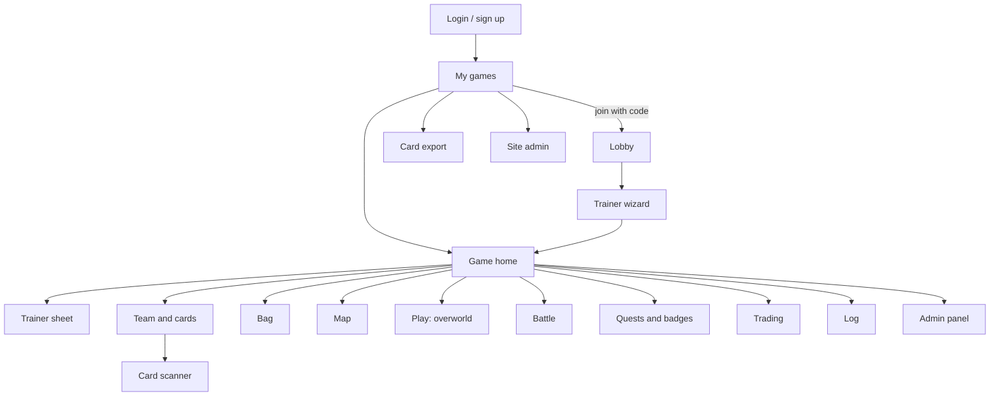

**Routes** (for implementers):

| Area | Route | Who |
|---|---|---|
| Public | `/login`, `/register`, `/forgot`, `/verify-email`, `/oauth/callback/:provider` | everyone |
| Account | `/account` (profile, linked Minecraft accounts, notifications, language, theme, sessions) | users |
| Games | `/games` (list; join with a code) | users |
| | `/games/:id` (home), `/games/:id/lobby`, `/games/:id/trainer/create` | members |
| | `/games/:id/trainer`, `/team`, `/team/:pokemonId`, `/bag`, `/cards`, `/cards/scan` | players |
| | `/games/:id/map`, `/play`, `/battle/:battleId`, `/quests`, `/badges`, `/trade`, `/log`, `/shop` | players |
| | `/games/:id/spectate` | spectators |
| Admin panel | `/games/:id/admin` (live board), `/admin/players`, `/admin/rolls`, `/admin/battle`, `/admin/world`, `/admin/settings`, `/admin/log`, `/admin/camera` | game admins |
| Cards | `/cards/export`, `/cards/jobs` | users |
| Site admin | `/admin/servers`, `/admin/servers/:id`, `/admin/users`, `/admin/data`, `/admin/system` | site admins |

#### 11.3 For players

- **Trainer wizard** (name, class, scores, skills, skin, starter).
- **Trainer sheet**: abilities, skills, HP, AC, class features, level and XP.
- **Team**: every Pokémon with its card; edit moves (digital mode), nickname, held item; storage boxes.
- **Bag**: items in pockets; use outside battle at any time.
- **Play screen**: during the overworld shows whose turn it is; the movement roll prompt; the reachable nodes; talk to NPCs; shop; heal.
- **Battle screen**: both sides, HP bars; the action menu; **roll requests** with a dice pad and a *Roll for me* button; the log.
- **Map**: the BlueMap view with overlays (11.5).
- **Quests and badges**, **trading** (at a trade centre), the game **log**.
- **Cards**: virtual cards, the **scanner**, **print card**, **export** (also reachable from outside a game).
- **Cosmetics shop** for virtual cards.

Key flows:

| Flow | Steps |
|---|---|
| **Join** | Enter the lobby code → wait for the admin → make a trainer |
| **Answer a roll request** | Open the prompt → roll a real die and type it (or tap *Roll for me*) → wait for approval if needed |
| **Bind a card** (physical mode) | Cards → Scan → choose the Pokémon → confirm |
| **Trade** | At a trade centre: propose → other player confirms → (admin approves) → done |
| **Evolve** | A prompt appears → *Evolve* or *Not now* → (physical mode) scan the new card |

#### 11.4 The admin panel

The admin panel is the **control room**. On a phone it is a set of tabs; on a PC, a dashboard.

| Section | What the admin can do |
|---|---|
| **Live board** | See every party and trainer, the round, who is up; pending approvals and roll requests; advance the round; pause/resume |
| **Players** | Accept or reject join requests, kick, edit anyone's sheet, team, bag, money, XP; give or remove Pokémon and items; heal; bind or unbind cards; promote co-admins |
| **Rolls** | Approval queue (approve, edit, reject), enter rolls for anyone, re-roll, swap the die |
| **Battle** | Reorder the action queue; add or remove participants; spawn, edit or remove enemies; take over enemy control; force flee or capture; end the battle |
| **World** | Edit regions, nodes, edges, NPCs, events and quests; trigger an encounter anywhere; teleport trainers or parties; open gates; set time and weather |
| **Camera** | Jump the Minecraft camera to any party, trainer, battle or node |
| **Settings** | Every setting in this document, with its default and where it was overridden; save, load, import and export **rule sets** |
| **Log** | The full action log and the audit trail; **undo** |

(The full list of admin powers and the undo rules are in chapter 12.)

#### 11.5 The map

The map is the server's **BlueMap** view, **proxied through the API** so it is shown only to members of the game (decided). On top of it the app shows:

| Layer | Shows | For |
|---|---|---|
| **Trainers and parties** | Live positions | players, spectators |
| **Paths and nodes** | The graph and node types; the editor for admins | players (discovered parts), admins (all) |
| **NPCs and encounters** | NPC markers, active battles and bosses | players (discovered), admins (all) |
| **Regions** | Cuboids | **off by default**, admin only (`app.map.layers.regions`) |

**Fog of war** is configurable per game (default on). For players it hides nodes, edges, NPCs and markers that nobody in the game has discovered yet. Discovery means that the party's trainer came within `world.fogOfWar.revealRadiusBlocks` of that place. The admin and `Psychic`-class (Clairvoyance) trainers see everything.

> **Risk:** BlueMap cannot hide terrain tiles per user. The app therefore draws an opaque mask over undiscovered areas on the client. This hides things visually but doesn't stop a determined user who reads the tile URLs. Stronger protection is possible later by having the API proxy refuse tiles outside discovered areas.

The **path editor** works on this map: place a node by tapping, drag to link two nodes, add waypoints along the line.

#### 11.6 Notifications

**Web Push** (decided) plus in-app toasts. Events that can notify a user (each can be switched off by the user):

| Group | Events |
|---|---|
| **Your turn / roll requested** | The party is up; you must roll; a battle needs your action |
| **Approvals** | Join accepted; roll approved, edited or rejected; trade or evolution prompts |
| **Game state** | Game started, paused, resumed, ended; round advanced |

The admin gets no separate push for the approvals queue (decided), though the admin panel shows it live.

#### 11.7 Other app details

- **Responsive:** one layout per size class (phone, tablet, desktop); large touch targets; dark and light themes.
- **Accessibility:** keyboard navigation, screen-reader labels, sufficient contrast, no information by colour alone (type icons carry text).
- **Language:** English and Portuguese from the start; strings in translation files; the language follows the browser, changeable in the account.
- **Card scanner:** uses the camera (needs HTTPS and permission). If the camera is denied, the admin can bind the card by hand.
- **Spectators** see the map, the battle view and log, and every player's team and cards (decided).

#### 11.8 Settings & defaults

| Key | Default | What it does |
|---|---|---|
| `app.language.default` | `browser` | Starting language. |
| `app.language.gameTextFallback` | `pt_pt,pt_br,en_us` | Order in which Cobblemon's language files are tried for game texts (Pokédex text, move and item descriptions). |
| `app.theme.default` | `system` | `system`, `light`, `dark`. |
| `app.push.enabled` | `true` | Web Push available to users. |
| `app.push.events` | `turn,approvals,gameState` | Events that notify. |
| `app.map.layers.default` | `trainers,paths,npcs` | Layers on by default. |
| `app.map.layers.regions` | `false` | Region layer (admins only). |
| `app.spectators.seeTeams` | `true` | Spectators can see teams and cards. |
| `app.log.visibility` | `allPlayers` | Who sees the battle log: `allPlayers`, `participants`, `adminOnly`. |
| `app.scanner.manualBindFallback` | `true` | Admin can bind cards by hand. |

---

## Part 2 — Settings and admin control

### 12. Starting a game, rule sets and admin powers

#### 12.1 Fast or detailed — your choice

**One-click start.** *New game → pick the server → name it → Open lobby.* Everything uses defaults.

**Presets.** Pick a starting point instead of the plain defaults:

> **Suggested — please review:** the presets (they are just bundles of settings).

| Preset | What changes from the defaults |
|---|---|
| **Defaults** | Nothing. |
| **Casual** | Digital rolls only and no approvals, easy enemy AI, no money penalty when you white out, fog of war off. |
| **Hardcore** | Physical rolls with approvals, 60-second turn timer, death saves, 50 % money loss, hard AI, bosses 1 in 30, healers cost ₽100. |
| **At the table** | Physical cards, player-submitted rolls with approval, no digital rolls. |
| **Remote** | Digital rolls allowed with approvals for typed ones, turn timer 120 s, push notifications on. |

**Custom wizard.** Eight short steps, each with a "keep defaults" button: *Basics → Players → Dice → Combat → World → Cards → Camera → Review.*

**Everything is changeable later**, during the game too. A change to a rule applies from the next action.

#### 12.2 How settings combine

A setting's final value comes from the **highest layer that sets it**:

1. built-in default
2. site-wide default (site admin)
3. server default (server admin)
4. **rule set** chosen for the game
5. **game overrides** (what the admin changed for this game)
6. **live override** (a temporary change, for example "no crits for this battle")

The settings screen shows each value together with **where it came from**, and a **reset to default** button.

Nothing is locked after the game starts; risky changes (switching card mode, for example) show a warning first.

#### 12.3 Rule sets

A **rule set** is a named bundle of settings and data (class list, skill list, power table, type chart, loot table, presets…). An admin can **save** the current game's rules as a rule set, **start new games from it**, **export** it as a JSON file, and **import** one shared by a friend.

```json
{
  "name": "Kanto Weekend",
  "formatVersion": 1,
  "basedOn": "builtin:defaults",
  "settings": { "dice.input.modes": "playerSubmit,adminEnter", "combat.turnTimer.enabled": true },
  "data": { "classes": [], "powerTable": null }
}
```

Applying a rule set shows a **preview of what would change**. Rule sets store only differences from the defaults, so they stay readable.

#### 12.4 What the admin can do

The principle: **the admin can override anything**, always. Every override is logged.

| Area | Powers |
|---|---|
| **Flow** | Open/close the lobby; accept, reject, kick; start, pause, resume, end; advance rounds; skip a turn or a whole party |
| **Dice** | Enter any roll; approve, edit or reject; re-roll; swap the die; change a roll's chance; cancel a request; roll for enemies |
| **Rules** | Change any setting now; live overrides; load a rule set |
| **Players** | Edit trainer sheets, ability scores, class, level, XP, HP, money; grant badges; heal; revive |
| **Pokémon** | Create, give, remove, edit any Pokémon (species, level, IVs, EVs, nature, ability, moves, held item, shiny, friendship); evolve or de-evolve |
| **Items** | Give or remove items and ₽; edit shops and prices |
| **Battle** | Add or remove participants; spawn, edit or remove enemies; reorder actions; take over the AI; force outcomes; end it |
| **World** | Trigger an encounter anywhere; set time and weather; teleport parties; open gates; reset NPCs; edit regions, paths, NPCs, events, quests |
| **Cards** | Bind or unbind cards; print cards for anyone |
| **Camera** | Jump the camera; toggle build mode |
| **History** | Read the log and audit trail; undo |

#### 12.5 Undo

The game records every change as an **event**, so the admin can **undo** (decided: "undo the last action").

- **Undo last action**: one tap. It restores the state from before the last action, and puts back any roll requests that belonged to it so they can be answered again.
- **Undo several**: pick a point in the recent history (the last `admin.undo.depth` actions, default 20).
- After an undo the mod is told to **re-sync** the Minecraft side (positions, entities, HUD).
- Real-world things can't be undone, but their effects in the game can.

The game also takes a **snapshot every round** so that a pause, a crash or a very deep undo can restore it.

#### 12.6 Settings & defaults

| Key | Default | What it does |
|---|---|---|
| `admin.undo.depth` | `20` | How many recent actions can be undone. |
| `admin.confirmDestructive` | `true` | Ask before destructive actions. |
| `admin.audit.retentionDays` | `0` | Days to keep the audit log (0 = forever). |
| `game.ruleset.default` | `builtin:defaults` | Rule set used by new games. |
| `game.autosave.everyRounds` | `1` | Snapshot frequency. |
| `game.presets.enabled` | `true` | Show presets in the wizard. |


---

## Part 3 — How it is built

### 13. Repository layout and tech stack

#### 13.1 Folders

```text
PokeDND/
├── README.md               what it is, folders, build steps (phase 06)
├── LICENSE                 MPL-2.0, official text (phase 06)
├── CREDITS.md              credits and third-party licences (phase 06)
├── CONTRIBUTING.md         the MPL source-file notice and the art rules (phase 06)
├── .gitignore              exists — ignores the Cobblemon jar, /vendor, /extracted and the generated /resources and /build
├── project.md              the original brief (kept unchanged)
├── project_v2.md           this document
├── todo.md                 the work cut into small phases, as a checklist (chapter 22)
├── phases/                 one prompt file per phase
├── CLAUDE.md               short instructions for Claude Code sessions in this repository
├── Core/                   NEW (skeleton made in phase 03) · shared Java library: rules, models, dice, data importer
├── API/                    Quarkus service (empty today)
├── App/                    Angular PWA (empty today)
├── Mod/                    Fabric mod (renamed from ./PokeDnD in phase 02)
├── tools/                  exists, now tracked · extract.mjs, render-icons.mjs, build-csv.mjs, effect-coverage.mjs, port-posers.mjs,
│                           filter-sounds.mjs, check-resources.mjs, check-docs.mjs, lib/, ported-posers/, extract.config.json; NEW: check-assets
├── deploy/                 NEW · docker-compose.yml, Caddyfile, .env.example
├── resources/              generated by tools/extract.mjs, not stored in git: assets, five CSVs, icons, card art, language files
├── build/                  generated reports and staging files (not in git)
├── extracted/              obsolete old working copy of the extraction; may be deleted
├── vendor/                 BlueMap and SkinRestorer jars (exists)
├── Cobblemon-fabric-1.8.4+1.21.1.jar   exists · the source jar (140 MB)
└── .github/workflows/      NEW · CI
```

**Separate builds, not a monorepo** (decided): `Core`, `API` and `Mod` are separate Gradle builds, `App` is its own npm project. A single git repository holds all of them.

#### 13.2 What exists today

| Item | State |
|---|---|
| `Mod/` (the mod) | A clean Fabric project (renamed from `PokeDnD/` in phase 02): Minecraft **26.3**, Fabric Loader **0.20.1**, Fabric API **0.165.2+26.3**, Loom plugin `net.fabricmc.fabric-loom` **1.19-SNAPSHOT**, **Java 25**, Gradle wrapper **9.8.2**, mod id `pokednd`, group `net.quimmilho.mods`. Source sets are split into `main` and `client`. Classes: `PokeDnD` (main entry), `PokeDnDClient`, `PokeDnDDataGenerator`. Licence MPL-2.0, Gradle wrapper in place, built with a Java 25 toolchain (`gradle/gradle-daemon-jvm.properties` asks for Java 25, so the build runs on it even though the machine's default is JDK 27). |
| Cleanups | **Done in phase 02**: folder renamed to `Mod`; `license` is `MPL-2.0`; `description`, `authors` and the Cobblemon credit (as a contributor) filled in; `yarn_mappings` removed; MPL-2.0 text in `Mod/LICENSE` (it is also packed into the jar); entry classes renamed; Gradle wrapper generated. |
| `Core/` (shared library) | **Skeleton done in phase 03**: its own Gradle build (Java 25 toolchain, Gradle wrapper 9.8.2), group `net.quimmilho.pokednd`, artifact `core`. Dependencies pinned in `gradle/libs.versions.toml`: Jackson 2.23.0, SLF4J API 2.0.20, JUnit 6.1.3. One class (`CoreVersion`) and one test. `./gradlew build` also runs `checkAllowedDependencies`; `./gradlew publishToMavenLocal` installs `net.quimmilho.pokednd:core:1.0-SNAPSHOT`. |
| `API/` (the service) | **Skeleton done in phase 04**: Quarkus 3.40.1 on Gradle 9.8.2 with a Java 25 toolchain, group `net.quimmilho.pokednd`. Extensions: REST with Jackson, health, metrics (Micrometer + Prometheus), scheduler, PostgreSQL JDBC. Depends on `net.quimmilho.pokednd:core` from Maven local, so run `./gradlew publishToMavenLocal` in `Core/` first. `/q/health` and `/q/metrics` answer; three `@QuarkusTest` tests. Database settings are read from `QUARKUS_DATASOURCE_*` environment variables. |
| `App/` | Empty folder. |
| `vendor/` | `bluemap-5.29-fabric.jar` (MIT) and `skinrestorer-2.11.1-26.3-fabric.jar` (MIT, by Lionarius). Both are **server mods**, installed next to ours; we don't bundle them. |
| `resources/` | **Generated, not stored in git** *(decided)*: `node tools/extract.mjs` rebuilds it from the Cobblemon jar (about 110 MB and 16,000 files, plus card art). It holds Cobblemon 1.8.4 assets and data, five CSVs (the four originals and `tm.csv`), four resource packs, the language files, TM definitions, the ported posers, icons and card art. See chapter 19. |
| `tools/` | Node scripts and a small library, **no dependencies** (Node 22.2 or newer). **`extract.mjs`** rebuilds `resources/` from the jar (it checks the jar's SHA-512 and can download it from Modrinth; settings in `extract.config.json`). **`build-csv.mjs`** builds the CSVs from Cobblemon's own data. **`render-icons.mjs`** is a software renderer that turns a Bedrock model plus texture into a 2D PNG (icons and card art; options in 9.8). **`effect-coverage.mjs`** measures how much of the Showdown move, ability and item data is plain data (19.6). **`port-posers.mjs`** converts Cobblemon's Kotlin poser classes to JSON (15.3, Appendix C.3); its output is in `ported-posers/`. **`check-resources.mjs`** checks that a rebuilt `resources/` is complete (phase 01). **`check-assets.mjs`** checks every Pokémon's assets and writes the asset report and the roster (phase 09). **`filter-sounds.mjs`** is now part of `extract.mjs`. `lib/` holds the zip, PNG, CSV and Showdown readers. |
| `extracted/`, the Cobblemon jar | The jar is the source of everything in `resources/`. Its SHA-512 equals Modrinth's **Cobblemon 1.8.4** release, which was the newest for Minecraft 1.21.1 on 2026-11-08. `extracted/` is an old working copy (the same files minus the 16 Aprijuice icons that `resources/` also lacks) and is no longer needed. |
| Git | **A git repository with one commit** (`README.md`). **Decided:** `/tools` is tracked and `resources/` is generated and ignored (CI downloads the jar from Modrinth and runs `tools/extract.mjs`). `.gitignore` ignores the jar, `/vendor`, `/extracted`, `/resources` and `/build`. `PokeDnD/`, `tools/` and the two project documents are not committed yet. |

#### 13.3 Technology

| Part | Choice | Notes |
|---|---|---|
| Language (Core, API, Mod) | **Java 25** | Same as the mod; Minecraft 26.3 needs it |
| Build (Core, API, Mod) | **Gradle** (wrapper 9.8.2) | |
| Mod loader | **Fabric** | Fabric API 0.165.2+26.3 |
| API framework | **Quarkus** | REST, WebSockets (WebSockets Next), scheduler, health, metrics |
| Database | **PostgreSQL, MySQL, MariaDB or MongoDB** — chosen by configuration (see 16.3) | Default: PostgreSQL |
| Frontend | **Angular** + **Angular Material** | PWA, standalone components, signals |
| i18n | Angular's built-in i18n, **EN and PT** | **Decided 2026-11-08:** built-in (one build per language, `/en/` and `/pt/`), not Transloco |
| PDF and QR | A JVM PDF library (OpenPDF or Apache PDFBox) and ZXing | Deterministic layout, no browser needed |
| Push | Web Push with VAPID keys | |
| Maps | **BlueMap** (existing mod) | |
| Skins | **SkinRestorer** (existing mod) | |
| Tests | JUnit 6 (+ Testcontainers) · Jasmine/Karma + Playwright · Fabric GameTest | **Decided 2026-11-08:** Jasmine/Karma for the App's unit tests, not Jest |
| Delivery | Docker Compose, GitHub Actions | |

**Exact versions** of Quarkus, Angular, Node and the databases are chosen and pinned in milestone M0 (the newest stable at that time) and recorded in each project's `gradle.properties` / `package.json`.

#### 13.4 How the parts are built

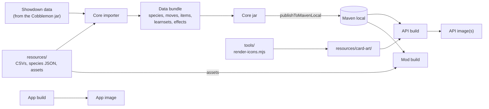

- **Core** is plain Java: **no Minecraft code and no Quarkus code**. Allowed dependencies: a JSON library (Jackson) and the SLF4J API.
- `Core` is **published to Maven local** (decided) and the API and Mod build against `net.quimmilho.pokednd:core:<version>`. The Mod includes it in its jar (Fabric *jar-in-jar*).
- The Core build runs the **importer** (chapter 19) to produce the data bundle that ships inside the jar.
- The Mod build also copies the model, texture, sound and resource-pack assets from `resources/` into its jar under its own namespace (15.2).

#### 13.5 Deployment (Docker Compose)

Everything is self-hosted with Docker Compose (decided). The Minecraft server runs on its own machine (it needs a lot of memory and often lives elsewhere); an optional profile can start one for testing.

| Service | Purpose |
|---|---|
| `caddy` | Reverse proxy with **automatic HTTPS**. HTTPS is required: the PWA, the camera scanner and Web Push do not work without it. |
| `app` | Serves the built Angular app (static files). |
| `api` | The Quarkus service. One image per database flavour (see 16.3). |
| `db` | PostgreSQL by default; profiles for MySQL, MariaDB and MongoDB. |
| `mailpit` | A fake mail server for development. |
| `minecraft` *(optional profile)* | A test Minecraft server with the mod, BlueMap and SkinRestorer. |

```yaml
# deploy/docker-compose.yml  (illustrative)
services:
  caddy:
    image: caddy:2
    ports: ["80:80", "443:443"]
    volumes: ["./Caddyfile:/etc/caddy/Caddyfile", "caddy_data:/data"]
  app:
    image: ghcr.io/OWNER/pokednd-app:latest
  api:
    image: ghcr.io/OWNER/pokednd-api:latest-postgres
    env_file: .env
    volumes: ["api_data:/data"]
    depends_on: [db]
  db:
    image: postgres:17
    environment: { POSTGRES_PASSWORD: "${DB_PASSWORD}" }
    volumes: ["db_data:/var/lib/postgresql/data"]
volumes: { caddy_data: {}, api_data: {}, db_data: {} }
```

**API configuration (environment variables)**

| Variable | Purpose |
|---|---|
| `POKEDND_BASE_URL` | Public URL of the app, used for links and OAuth callbacks |
| `QUARKUS_DATASOURCE_JDBC_URL`, `…_USERNAME`, `…_PASSWORD` (or `QUARKUS_MONGODB_CONNECTION_STRING`) | Database connection |
| `POKEDND_JWT_PRIVATE_KEY`, `POKEDND_JWT_PUBLIC_KEY` | Token signing keys |
| `POKEDND_BOOTSTRAP_ADMIN_EMAIL`, `…_PASSWORD` | Creates the first site admin on first start |
| `POKEDND_OAUTH_DISCORD_*` | Discord OAuth client id and secret |
| `POKEDND_SMTP_*` | Mail server for verification and password reset |
| `POKEDND_VAPID_PUBLIC`, `…_PRIVATE`, `…_SUBJECT` | Web Push keys |
| `POKEDND_DATA_DIR` | Where skins, card art and export files live (a volume) |

**Mod configuration** (`config/pokednd.json` on the Minecraft server)

| Field | Purpose |
|---|---|
| `apiUrl` | Base URL of the API (`https://…`) |
| `serverToken` | The secret from the server's registration |
| `bluemapUrl` | The BlueMap web address the API should proxy |
| `logLevel`, `debug` | Diagnostics |
| `positionReportHz` | How often positions are reported (default 2) |

#### 13.6 Continuous integration (GitHub Actions)

| Workflow | Runs |
|---|---|
| `core` | Build and unit tests; publishes the Core jar as an artifact |
| `api` | Build, unit and integration tests against **each database** with Testcontainers; builds the image(s) |
| `app` | Lint, build, unit tests, Playwright end-to-end tests against a test API |
| `mod` | Build and Fabric GameTests on a headless server |
| `assets` | `tools/check-assets`: fails when the playable roster would contain a species with missing assets |
| `release` | On a version tag: GitHub release with the mod jar, Docker images pushed, release notes |

---

### 14. Architecture

#### 14.1 The big picture

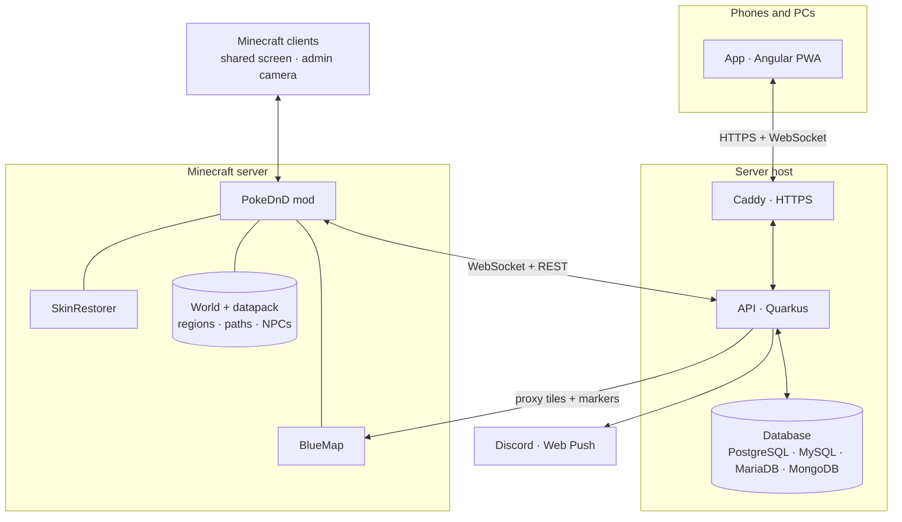

#### 14.2 Who is in charge of what

| Concern | Authority |
|---|---|
| Accounts, games, trainers, Pokémon, items, money, quests, battle state, **all dice and rule outcomes** | **API** (with the rules from `Core`). The database is the source of truth. |
| What is physically in the Minecraft world: positions, entities, blocks, who is online | **Mod** reports facts; it does not decide game outcomes |
| **World configuration** (regions, paths, NPCs, events) | **Per world**: the datapack files on the server are canonical; the API keeps a versioned copy per game (15.7) |
| What each user sees and can do | **API** enforces roles; the App is only a view |
| Visuals: models, camera, HUD, sounds | **Mod** (client) |

The mod uses `Core` for data models, validation of configuration files and the species/move registry, **not** to decide outcomes. This keeps one rule engine (in the API) and avoids two copies disagreeing.

#### 14.3 Channels

| Channel | Between | Used for |
|---|---|---|
| **REST** (`/api/v1/…`) | App ↔ API, Mod ↔ API | Create and read things; one-off commands |
| **WebSocket `/ws/app`** | App ↔ API | Live updates for a user: turn changes, roll requests, approvals, battle state, notifications |
| **WebSocket `/ws/mod`** | Mod ↔ API | Live commands to the server and facts from it: spawn fake players, walk, roll prompts, positions, arrivals |
| **Fabric networking** | Mod server ↔ Minecraft clients | Camera commands, HUD state, overlays, join-code screen |

All realtime messages share one envelope (chapter 18.3) with ids so that commands are idempotent.

#### 14.4 Key flows

**Registering a server**

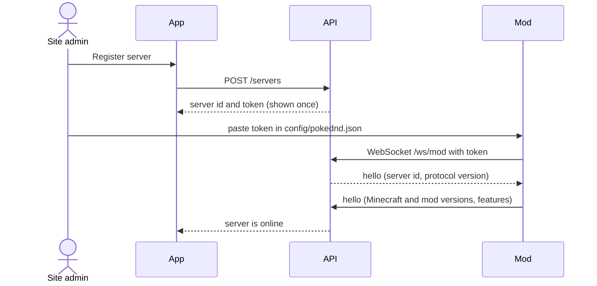

**Opening a lobby and joining**

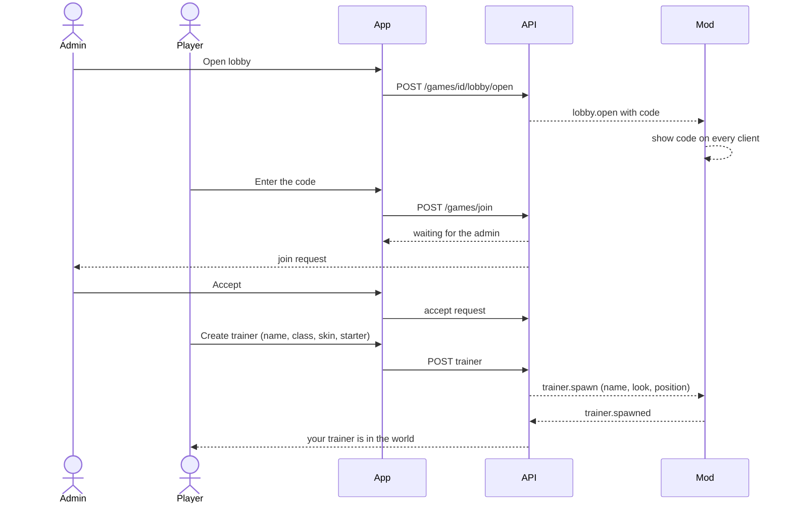

**Linking a Minecraft account**

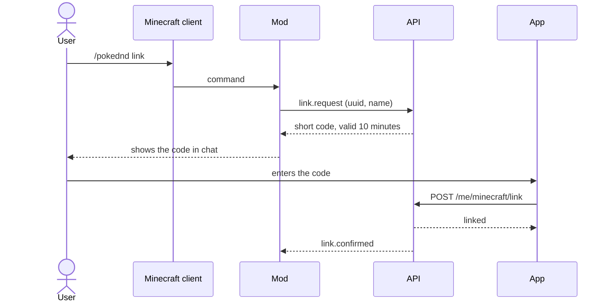

**Applying a skin**

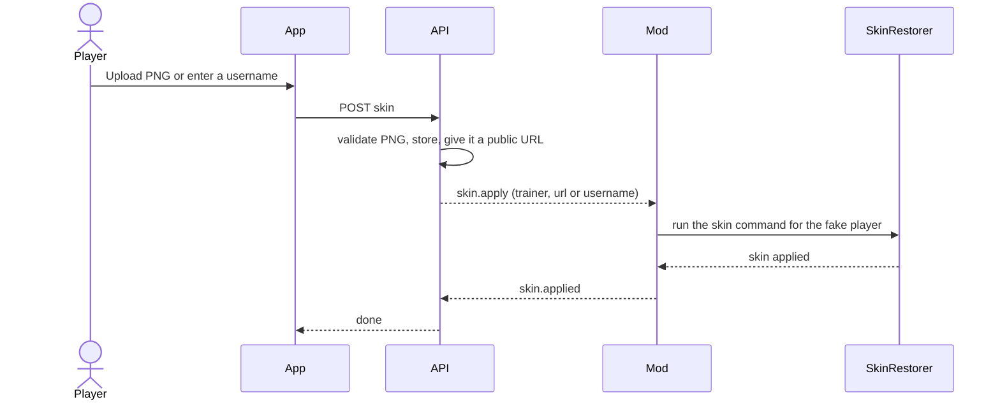

**One roll in a battle**

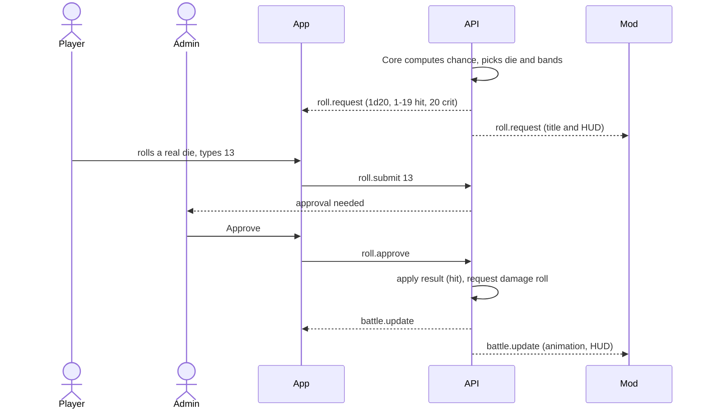

**A movement round**

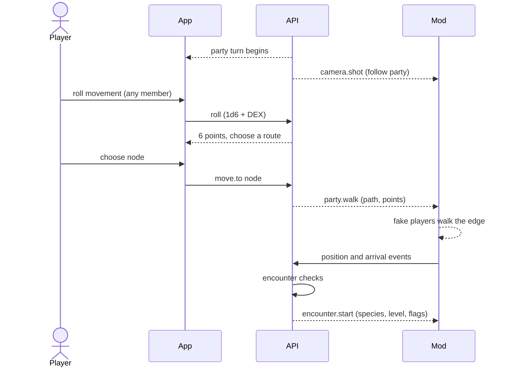

**Binding a physical card**

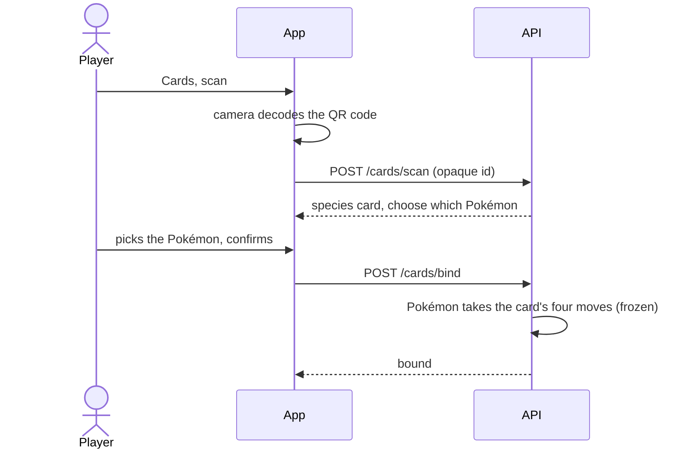

**Switching the camera**

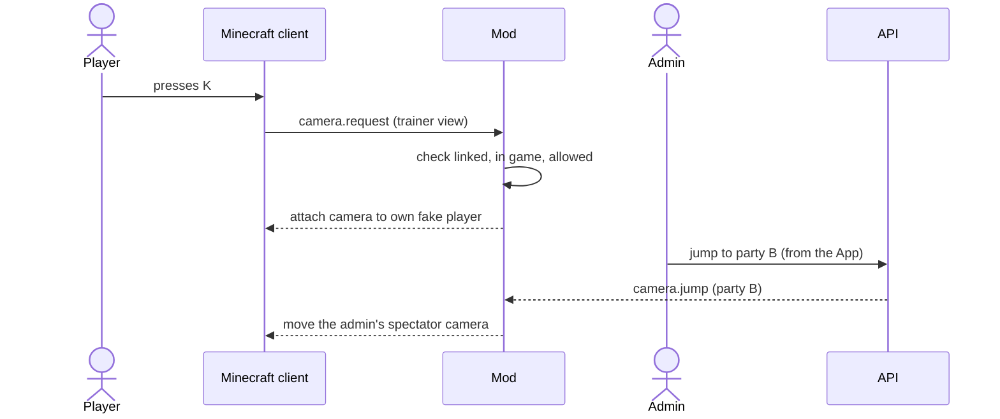

#### 14.5 Battle engine

The battle logic lives in `Core` as a **pure state machine**: `(state, command) → (new state, events, pending roll requests)`. It has no clock, no randomness of its own (random numbers come from a provider), and no I/O, so it can be unit-tested exactly and replayed from the event log (which is also how **undo** works).

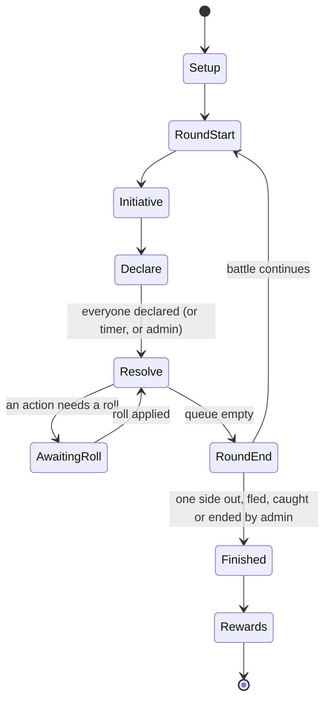

#### 14.6 Security

| Area | Design |
|---|---|
| **Transport** | HTTPS everywhere; the proxy handles TLS |
| **User tokens** | Short-lived signed access token (15 minutes) + rotating refresh token in an HTTP-only, same-site cookie. WebSocket authenticates with the access token in its first message |
| **Server tokens** | 256-bit random secret; only a hash is stored; shown once at creation; rotatable; bound to one server |
| **Passwords** | Argon2id; email verification; password-reset tokens expire |
| **OAuth** | Authorization-code flow for Discord (a small custom client; use PKCE if Discord supports it for this kind of app, to be checked when it is built) |
| **Authorisation** | Checked on every request and WebSocket message: role per scope (site / server / game) |
| **Uploads** | Skins: PNG only, 64×64, size-limited, re-encoded to strip metadata |
| **Rate limits** | Login, sign-up, roll submissions, exports, WebSocket messages |
| **Browser** | Strict content-security policy, CORS limited to the app origin |
| **Privacy** | Minimal personal data (email, display name, linked Minecraft ids); account deletion removes or anonymises it |
| **Cheating** | Digital rolls are server-side; every roll is logged with its source; typed rolls need approval by default |

#### 14.7 When things go wrong

| Failure | Behaviour |
|---|---|
| **API unreachable from the mod** | The mod shows "connection lost", freezes game actions, and retries with exponential back-off; on reconnect it sends a state hash and the API re-syncs anything that changed |
| **Mod disconnects / server restarts** | Fake players are re-created from the game's stored positions on reconnect; the game state in the database is untouched |
| **Player's app drops** | Their fake player waits; pending roll requests stay open; on reconnect the app reloads state |
| **Duplicate or late messages** | Commands carry ids and are idempotent |
| **API restarts mid-battle** | State is rebuilt from the last snapshot plus the event log |

#### 14.8 Size and speed

This is a small-group game.

> **Suggested — please review:** the design targets for size and speed (players per game, message rates, first-load size). Nothing in the rules depends on them; they only guide sizing and testing.

- **Up to about 10 players and 3 spectators per game**, and a few games per installation.
- The mod reports positions at 2 Hz in batches; the API should handle several hundred messages per second.
- The App's first load should stay under about 1.5 MB gzipped, with other screens loaded lazily.


---

### 15. The Mod

> **A note on names.** Minecraft 26.3 is new and Fabric's APIs for it may differ from earlier versions. In this chapter, class and API names are *descriptions of what is needed*. Confirm the exact names when implementing.

#### 15.1 Structure

The mod is one Fabric mod (id `pokednd`) with the template's two source sets:

| Source set | Contents |
|---|---|
| `main` (common + server) | Connection to the API, game session mirror, fake players, regions, paths, NPCs, Pokémon entities, battle presenter, camera director (server side), commands, protection rules, world-config storage, BlueMap and SkinRestorer integration, networking |
| `client` | Model/animation renderer, HUD and screens, key bindings, camera handling, sounds, settings screen |

It **requires** Fabric API and runs with BlueMap and SkinRestorer installed on the server (checked at start-up; the mod says clearly what is missing). Both are server-side, so they are *not* hard dependencies for clients.

**Required clean-up of the template** is listed in chapter 13.2.

#### 15.2 Assets

The mod **bundles** the assets from `resources/` into its jar (decided), so there is no separate download.

| Source (`resources/…`) | In the jar (`assets/pokednd/…`) | Size now |
|---|---|---:|
| `assets/cobblemon/bedrock/pokemon/models` | `models/pokemon` (Bedrock `*.geo.json`) | 21 MB |
| `…/animations` | `animations/pokemon` (`*.animation.json`) | 30 MB |
| `…/posers` | `posers/pokemon` | 1 MB |
| `…/resolvers` | `resolvers/pokemon` | 0.6 MB |
| `assets/cobblemon/textures/pokemon` | `textures/pokemon` | 5 MB |
| `assets/cobblemon/sounds` + `sounds.json` | `sounds` + `sounds.json` | 21 MB |
| `resourcepacks/*` (4 packs) | merged in, **all enabled** (decided) | 2 MB |
| `data/cobblemon/species…` | read by Core's importer, not shipped raw | — |

That is about **79 MB before compression**. Because the files are mostly JSON, the jar is expected to be much smaller.

The build task `bundleAssets`:

1. keeps only species that **pass `tools/check-assets`** (so incomplete species aren't shipped);
2. **rewrites the namespace** `cobblemon:` to `pokednd:` inside resolvers and posers (for example `cobblemon:squirtle.geo` → `pokednd:squirtle.geo`);
3. copies the `license` files and writes a credits file (chapter 21).

#### 15.3 The renderer

The mod has **its own renderer** for Cobblemon-style Pokémon models; it does **not** depend on Cobblemon (decided). It is the largest single piece of client work.

**What it reads**

| Data | File | Notes |
|---|---|---|
| **Geometry** | `*.geo.json` (Bedrock, format 1.12.0): 1,170 files | Bones, cubes, pivots, rotations, locators (`root`, `top`, `target`, `middle`…) |
| **Animations** | `*.animation.json`: 1,010 files | Keyframes plus expressions |
| **Poser** | `posers/…/*.json` | Which animation plays in which pose |
| **Resolver** | `resolvers/…/*.json`: 1,091 files | For each species/form: which model, poser and texture to use for which *aspects* (shiny, gender, forms, cosmetic items), plus extra layers (such as emissive eyes) |
| **Species data** | `data/cobblemon/species/…` | Hitbox size, base scale, movement behaviour (walk/swim/fly), eye heights |

**What it must support**

- **Poses:** `STAND`, `WALK`, `SLEEP`, `FLOAT`, `SWIM`, `HOVER`, `FLY`, `PORTRAIT`, `PROFILE`, `NONE` (plus `SHOULDER_LEFT/RIGHT`, which can be ignored).
- **Aspects:** the base look, `shiny`, gender variants and form aspects, from the resolver.
- **Layers:** extra textures drawn over the model, some emissive.
- **Animation expressions.** The poser files use a small query vocabulary; these are all the functions that occur:

| In posers | Purpose |
|---|---|
| `q.bedrock('model', 'anim')` · `q.bedrock_stateful` · `q.bedrock_primary` | Play an animation (looping, stateful, or as a one-shot primary animation) |
| `q.bedrock_quirk` · `q.bedrock_primary_quirk` | Occasional animations such as blinking |
| `q.look('head')` | Turn a bone toward where the Pokémon looks |
| `q.curve(…)`, `q.array(…)` | Blend curves and arrays |
| `q.biped_walk`, `q.quadruped_walk`, `q.bimanual_swing`, `q.sine_wing_flap`, `q.pitch_tilt` | Procedural walk and flight motions |
| `q.is_standing_on_blocks`, `q.has_aspect` | Conditions |

| In animation files | Purpose |
|---|---|
| `q.anim_time` / `query.anim_time`, `math.sin`, `math.cos`, `math.clamp`, `math.abs`, `math.min`, `math.max`, `math.pow`, `math.sqrt`, `math.exp`, `math.mod`, `math.round`, `math.ceil`, `math.random`, `math.random_integer` | Time-based motion |
| `v.*` variables | Local variables (`v.blink`, `v.foot`…) |
| `q.sound`, `q.has_entity` | Sound and entity hooks |
| `q.r.*` (15 names: `dive`, `pitch`, `pitch_change`, `roll_change`, `yaw_change`, `speed`, `input_forward`, `input_right`, `input_up`, `velocity_forward`, `velocity_right`, `velocity_up`, `velocity_y`, `target_distance_x`, `target_distance_y`), `q.input_up`, `q.riding_yaw_change` | **Riding and movement queries.** 309 animations use `q.r.*`, 301 of them named `ride_*` (the other 8 are Ekans/Arbok walk and run cycles, Blaziken's look, Drampa's flight, Wyrdeer's idle/walk/run). They always give a default in brackets, for example `q.r.dive(0)`. PokeDnD has no riding, so **they evaluate to 0**, which the existing icon renderer already does. This meaning is inferred from the names and the animation names; Cobblemon's own source was not read for it |

- **Ported posers.** **277 poser names** (in **254 species folders**) are named by a resolver but have no poser file in the jar (Appendix C.3). Their poses are defined in Cobblemon's Kotlin code, which is public (MPL-2.0; gitlab.com/cable-mc/cobblemon, tag 1.8.4). `tools/port-posers.mjs` converts those classes to JSON posers in the same format as the 759 that exist: **258 are complete and 19 are partial** (list in C.3). They are saved in `tools/ported-posers/` and `tools/extract.mjs` adds them to `resources/`. The walk, wing and look motions that Cobblemon builds in code are written as the Molang functions in the table above (`q.look`, `q.biped_walk`, `q.quadruped_walk`, `q.bimanual_swing`, `q.sine_wing_flap`, `q.bedrock_quirk`, `q.bedrock_primary_quirk`), so **the renderer must implement them**; Cobblemon's own definitions give their parameters and defaults.
- **Fallback poser.** The renderer still needs a **generic fallback poser** (idle, walk, sleep, a "cry" and a "faint" using the model's own `ground_idle`, `ground_walk`, `sleep`, `cry`, `faint` animations if present): for the parts of the 19 partial posers that could not be ported, and for any future species added without a poser.
- **Scale and hitbox** from the species data (`baseScale`, `hitbox`) multiplied by the boss scale.
- **Performance:** target 60 FPS with about 40 Pokémon entities on screen; cull far entities, simplify animation updates for distant ones.

#### 15.4 Fake players

A **fake player** is a server-side player entity that is not connected to a real client. It must:

- appear in the **tab list** and be visible to every client with its **name and skin**;
- be **invulnerable**, not need food, and not be pushed around;
- be moved only by the mod (never by a client), with proper walking animation;
- keep the **chunks around it loaded** while the game is running;
- be saved with its position so it can be restored after a restart;
- be removed cleanly when the game ends.

It is implemented **by the mod itself** (decided): a `ServerPlayer` with a dummy network connection. (The Fabric API's own FakePlayer doesn't show in the tab list by default and Carpet's is a different mod.)

**Walking.** A fake player follows the **waypoints** of the edge at about `world.walk.speedBlocksPerSecond`, snapping to the ground, stepping up one-block rises, swimming through water. If it is blocked for more than 3 seconds it **teleports to the next waypoint** (and the mod logs a warning). The admin can fast-forward (teleport) any walk.

#### 15.5 Commands

All commands start with `/pokednd` (decided). **Linked server admins** can use the admin commands; everybody can use `link` and `camera`. (Minecraft's own operator level is *not* used for permissions.)

| Command | Who | What |
|---|---|---|
| `link` | anyone | Start linking this Minecraft account to an app account |
| `camera auto` / `camera trainer [name]` | players, admin | Switch camera mode |
| `game status` / `lobby open` / `lobby close` / `start` / `pause` / `resume` / `end` | admin | Control the game |
| `tp party\|trainer\|battle\|node\|npc <name>` | admin | Jump the camera |
| `build [on\|off]` | admin | Build mode |
| `region create\|delete\|list\|info\|edit\|tp\|wand <id>` | admin | Regions |
| `path node add\|remove\|info\|tp`, `path edge link\|unlink\|waypoint\|gate`, `path wand` | admin | The path graph |
| `npc create\|edit\|delete\|list\|tp` | admin | NPCs |
| `time <value>` / `weather <value>` | admin | Time and weather |
| `reload` | admin | Reload the world configuration from the datapack |
| `debug …` | admin | Diagnostics |

#### 15.6 Wands and build mode

Spectators can't click blocks, so editing needs **build mode** (chapter 10.6). In build mode the admin has two items:

| Item | Use |
|---|---|
| **Region wand** | Left-click: first corner. Right-click: second corner. Sneak + right-click: open the region menu. Shows the selection as a particle outline. |
| **Path wand** | Right-click a block: add a node (a menu asks for its type). Right-click a node, then another: link them with an edge. Sneak + right-click: add a waypoint to the edge you are standing on. Left-click a node or edge: select it. |

The same changes can be made in the app's map editor.

#### 15.7 World configuration: datapack, sync and hot-reload

Regions, paths, NPCs, events and quests are stored in a **datapack** inside the world save (decided):

```text
<world>/datapacks/pokednd_world/
├── pack.mcmeta
└── data/pokednd/
    ├── regions/*.json        one file per region (decided)
    ├── paths/*.json          the node and edge graph, split per area if large
    ├── npcs/*.json
    ├── events/*.json
    └── quests/*.json
```

**The datapack in the world folder is the canonical copy** (decided: "per world, synced"). The API keeps a **versioned copy per game** so that the app can edit it.

Each file has a `revision` number and a content hash. The mod watches the folder, and also reloads on `/reload`.

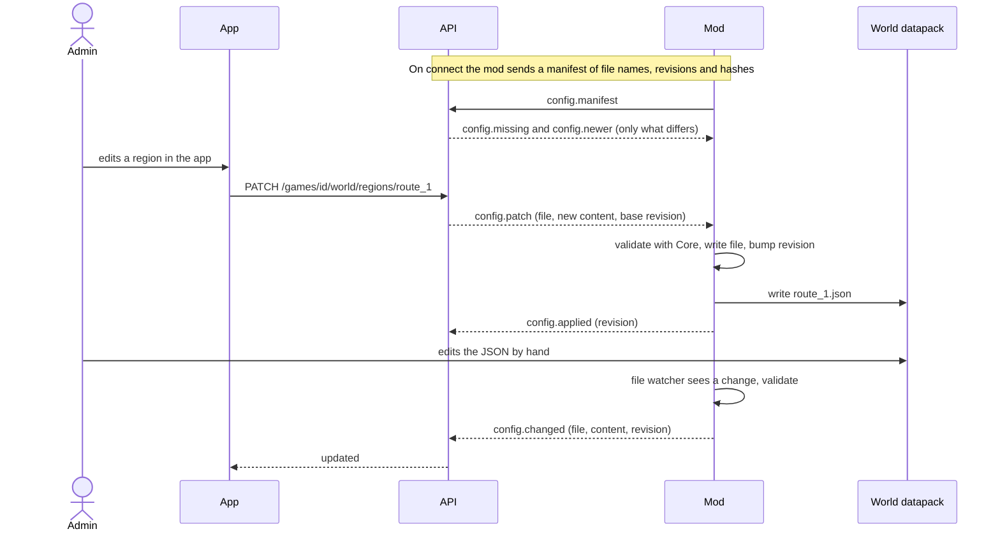

**Conflicts.** If two edits arrive from different places based on the same revision, the later one is rejected with the current content, and the editor is asked to merge. Invalid files are never applied: the mod keeps the previous good version and reports the validation errors to the admin.

#### 15.8 World protection and vanilla rules

While a game is running (and a lobby is open), in the game's world:

- **Hostile mobs don't spawn** and existing ones are removed.
- **Hunger and vanilla damage are off**: food level fixed, no fall/lava/drowning damage to fake players. (Trainers can only be hurt through the game rules, chapter 7.12.)
- **Blocks can't be broken or placed**, except by an admin in build mode.
- The mod sets the relevant game rules and handles the remaining cases with events.
- Time and weather are driven by `world.time.mode` and `world.weather.mode`.

All of this is controlled by game settings (`world.protect.*`), because the admin may want to build.

#### 15.9 Pokémon in the world

| Kind | Behaviour |
|---|---|
| **Ambient wild** | Wander inside their region (walk, swim or fly according to the species `behaviour` data); no collisions with trainers, can't be hurt; limited per region; removed when the game pauses |
| **Encounter / battle** | Spawned at the encounter point; stand still facing the trainers; animate by the battle presenter |
| **Follower** | A trainer's lead Pokémon trails behind its trainer (walk, swim or fly) |
| **Boss** | Like an encounter Pokémon but at the boss scale, with a boss bar and a special entrance |
| **NPC Pokémon** | Placed by an NPC definition (as a model NPC or in an NPC's team) |

#### 15.10 The battle presenter

The presenter **shows** what the API has already decided:

- places the fighters, plays `battle-standing` poses, cries on send-out and faint, recoil on hit;
- generic **move effects**: a particle and sound per type (flames, water drops, sparks…) and a stronger flash on critical hits;
- ball throw and shake animation (the number of shakes follows how close the catch roll was);
- HP bars and numbers on the HUD, damage popups;
- boss bar.

It never decides outcomes. If it falls behind, the state it shows converges to the API's next `battle.update`.

#### 15.11 Networking inside Minecraft

Custom payloads between the mod's server side and its client side:

| Payload | Direction | Carries |
|---|---|---|
| `camera_request` | client → server | Wants auto or trainer view |
| `camera_state` | server → client | Current mode, target, shot parameters |
| `admin_action` | client → server | Admin menu choices (jump, build mode) |
| `admin_menu` | server → client | Lists for the teleport menu (parties, trainers, nodes, NPCs, battle) |
| `join_code` | server → client | The code to show, or "hide" |
| `roll_prompt` | server → client | The roll request: who, why, dice, bands, chance |
| `battle_state` | server → client | HUD data: fighters, HP, status, turn order, round |
| `party_state` | server → client | Active party, movement points left, node |
| `path_overlay` | server → client | Nodes and edges to draw (respecting fog of war), reachable stretch |
| `toast` | server → client | Short notifications |

The client **trusts nothing**: it only draws what it is told, and every request is validated by the server.

#### 15.12 BlueMap integration

BlueMap includes a Java API (`BlueMapAPI` and marker sets are in the jar). The mod creates **marker sets** for trainers/parties, nodes/edges and NPCs/encounters, and updates them as the game changes. The **API proxies** BlueMap's tiles and marker files to the app, **filtering markers per viewer** for fog of war and roles.

> **Suggested — please review:** this split (BlueMap draws the overlays from the mod's markers; the app adds only the path *editor* on top) is a design choice, not something the brief settled.

#### 15.13 SkinRestorer integration

As noted in chapter 3.6, **SkinRestorer 2.11.1** has no written API documentation, but its jar (`./vendor`) has a **usable public Java API**, found by inspecting it with `javap` (Appendix E gap 11): `SkinService.setSkinAsync(server, targets, new SkinProviderContext(provider, argument, variant), save)` fetches a skin through a provider and applies it; `SkinService.applySkin(ServerPlayer, SkinValue, save)` applies a ready-made skin; `SkinTarget.of(uuid)` names the target; `SkinStorage.setSkin(uuid, value)` stores one; `SkinProviderRegistry.register(name, provider)` lets our mod add its own provider. The built-in providers are Mojang, Ely.by, MineSkin (a URL is turned into a signed texture by the MineSkin service), a collection provider and SkinShuffle. The mod therefore **calls this API directly** *(Suggested: Appendix D #25)* (SkinRestorer is a compile-time dependency and is installed next to our mod, never bundled). The fallback is to run SkinRestorer's `/skin` command as the server, targeted at the fake player.

**Spike M4-S1** (narrowed): confirm that applying a skin to a **fake player** works (including after a restart); that the textures display to all clients; **how an uploaded PNG gets a signed texture** (the API serves the PNG at a public URL and MineSkin signs it, or we write our own provider); and what the rate limits are.

#### 15.14 Client screens

| Screen | Notes |
|---|---|
| Join-code overlay | Full screen, huge text, hides when the lobby closes |
| Roll prompt | Title + HUD panel with dice and bands; countdown if a timer is set |
| Battle overlay | Compact; scales with `camera.hud.scale` |
| Teleport menu | Admin only; searchable list |
| Settings screen | HUD scale, sound sliders, camera key mode |

#### 15.15 Tests

Fabric **GameTests** (run on a headless server) cover: fake player spawn, tab-list entry and removal; walking an edge; teleport fallback; region lookup; node arrival; world protection; datapack load, hot-reload and validation failure; camera mode requests (allowed/denied); reconnect and resync. The renderer is tested with golden-image comparisons of a few models in each pose.

#### 15.16 Settings & defaults

| Key | Default | What it does |
|---|---|---|
| `world.protect.blocks` | `true` | Block breaking/placing is blocked (except admin build mode). |
| `world.protect.hostileMobs` | `true` | No hostile mob spawning. |
| `world.protect.hunger` | `true` | Hunger disabled. |
| `world.protect.damage` | `true` | Vanilla damage disabled. |
| `world.fakePlayers.keepChunksLoaded` | `true` | Keep chunks loaded around fake players. |
| `world.fakePlayers.stuckSeconds` | `3` | Seconds before the stuck teleport fallback. |
| `world.positions.reportHz` | `2` | Position reports per second. |
| `world.followers.enabled` | `true` | Lead Pokémon follows its trainer. |

---

### 16. The API

#### 16.1 Modules

| Module | Responsibility |
|---|---|
| **auth** | Sign-up, login, OAuth (Discord), tokens, email verification, password reset, Minecraft account linking by code |
| **users / roles** | Profiles, roles per scope, sessions |
| **servers** | Registering Minecraft servers, tokens, server admins, online status |
| **games** | Lifecycle (draft → lobby → running → paused → ended), members, co-admins, join codes, snapshots |
| **settings** | Layered settings, rule sets, presets |
| **reference data** | Species, moves, items, abilities, natures, types (read-only, from `Core`'s data bundle) |
| **trainers** | Sheets, classes, skills, levelling, skins |
| **pokemon** | Individuals, teams, storage, evolution, moves, friendship |
| **engine** | Runs `Core`'s battle and movement logic, roll requests, approvals, the event log, undo |
| **world** | Regions, paths, NPCs, events, quests; synced copy of the datapack |
| **economy** | Money, shops, trading, loot |
| **cards** | Species and personal cards, QR codes, scanning, binding, PDF export jobs |
| **map** | BlueMap proxy with filtering |
| **realtime** | The `/ws/app` and `/ws/mod` endpoints, fan-out |
| **push** | Web Push subscriptions and sending |
| **audit** | Audit trail |

#### 16.2 Roles and permissions

| Action | Site admin | Server admin (that server) | Game admin | Player | Spectator |
|---|:-:|:-:|:-:|:-:|:-:|
| Manage users | ✔ | | | | |
| Register / delete servers, rotate tokens | ✔ | | | | |
| Assign server admins | ✔ | | | | |
| Create games on a server | ✔ | ✔ | | | |
| Run the game, approve, override, undo | ✔ | ✔ (if game admin) | ✔ | | |
| Edit the world (regions, paths, NPCs) | ✔ | ✔ | ✔ | | |
| Own and play a trainer | | | if `game.admin.plays` | ✔ | |
| Roll, command, trade, use items | | | | ✔ (own) | |
| View map, battles, teams, cards | ✔ | ✔ | ✔ | ✔ | ✔ |
| Export species cards | ✔ | ✔ | ✔ | ✔ | ✔ *(any logged-in user)* |

#### 16.3 Database support

The database is **configurable** *(decided)*: **PostgreSQL, MySQL, MariaDB or MongoDB**. (SQLite was considered and **dropped on 2026-11-08**.)

- The code talks to **repository interfaces** in the API's domain layer. There are two adapters: a **SQL** adapter (Hibernate ORM with Panache) and a **MongoDB** adapter (MongoDB with Panache).
- **Quarkus fixes the database kind at build time.** So the project builds **one API image per flavour**: `…-postgres`, `…-mysql`, `…-mariadb`, `…-mongo`. The user picks the image they want.
- Flexible data (settings, class definitions, config documents) is stored as **JSON**: JSON/JSONB columns in SQL, native documents in MongoDB.
- Schema changes use migrations: **Flyway** for SQL (with one folder per dialect where needed) and versioned migration scripts for MongoDB.
- The same **test suite** runs against every flavour (Testcontainers).

#### 16.4 Authentication details

- **Email + password:** Argon2id; email verification; reset by email.
- **Discord:** authorization-code flow. Discord is plain OAuth 2 (no discovery document); it needs a small custom client. *(Google and Microsoft sign-in were considered and cut on 2026-11-08, so no OIDC library is needed.)*
- **Minecraft linking is by code only:** 8-character code, valid 10 minutes, single use. The automatic Microsoft → Minecraft link (Xbox Live and Minecraft services, which needs Mojang's approval of the app) was cut together with Microsoft sign-in, so **no Mojang application is needed**.
- **Tokens and sessions:** see chapter 14.6.

#### 16.5 Cards: the PDF endpoint

Cards are rendered **in the API** (decided), without a browser:

1. The export request is stored as a **job** (queued, running, done, failed).
2. For each card: the data comes from `Core` (the species' moves, stats, types, the dice for each move), the art from `resources/card-art` (or the 128 px icon as a fallback), the QR from the card's opaque ID (ZXing), and everything is drawn with a PDF library onto sheets.
3. The layout engine computes cards per sheet, bleed, gaps and crop marks, and for double-sided output mirrors the columns of the backs.
4. The result is a PDF (or a ZIP of PDFs when it is large) in `POKEDND_DATA_DIR`, linked from the job; it is deleted after `cards.export.fileTtlHours`.
5. A `manifest.csv` listing each card's position and ID is included.

Fonts must be licensed for embedding. Both languages (EN, PT) need the accented characters.

#### 16.6 The BlueMap proxy

`GET /api/v1/servers/{serverId}/map/**` forwards to the server's BlueMap web address after checking that the caller is a member of the server's game. Static tiles are cached (ETag). The marker files are **filtered per viewer** (fog of war, roles). The app never talks to BlueMap directly.

#### 16.7 Operations

- Health: `/q/health` (liveness and readiness); metrics: `/q/metrics`.
- Structured JSON logs with request ids; no personal data in logs.
- Backups: database dump + the data volume (skins, card art, exports).
- Upgrades: migrations run on start; an API of version *n* refuses a mod with an incompatible protocol version and says why.
- OpenAPI for REST (with a Swagger UI) and AsyncAPI for the WebSocket messages are generated and published at `/docs`; the app's REST client is generated from the OpenAPI file (decided).


---

### 17. Data model

#### 17.1 The map of entities

Static **reference data** (species, moves, items, abilities, natures, types) comes from the data bundle built by the importer (chapter 19) and is **not** stored in the database. The tables below hold *game state*.

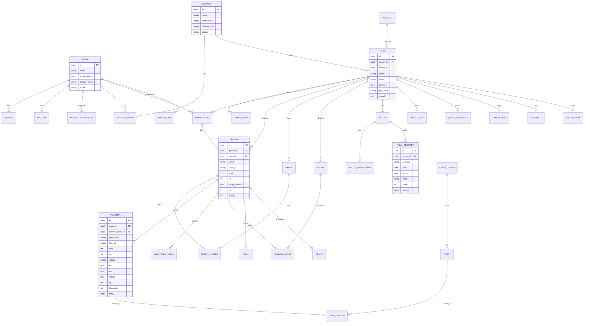

#### 17.2 Entities and their main fields

All ids are UUIDs (time-ordered). All rows have `created_at` and `updated_at`. "json" means a JSON column (SQL) or an embedded document (MongoDB).

**Accounts and servers**

| Entity | Main fields |
|---|---|
| **User** | `email`, `email_verified`, `password_hash` (null for OAuth-only), `display_name`, `locale`, `theme`, `site_role` (`none` or `siteAdmin`), `deleted_at` |
| **Identity** | `user_id`, `provider` (`password`, `discord`), `provider_user_id` |
| **McLink** | `user_id`, `mc_uuid` (unique), `mc_name`, `source` (`code`), `linked_at` |
| **RefreshToken** | `user_id`, `token_hash`, `expires_at`, `revoked_at`, `user_agent` |
| **PushSubscription** | `user_id`, `endpoint`, `keys`, `prefs` |
| **Server** | `name`, `token_hash`, `token_prefix`, `bluemap_url`, `status`, `last_seen_at`, `mod_version`, `mc_version` |
| **ServerAdmin** | `server_id`, `user_id` |

**Games**

| Entity | Main fields |
|---|---|
| **Game** | `server_id`, `owner_id`, `name`, `state` (`draft`, `lobby`, `running`, `paused`, `ended`, `archived`), `rule_set_id`, `settings` (json overrides), `join_code`, `lobby_open`, `round`, `phase`, `time_of_day`, `weather` |
| **GameAdmin** | `game_id`, `user_id`, `role` (`owner`, `co`) |
| **Membership** | `game_id`, `user_id`, `role` (`player`, `spectator`), `status` (`requested`, `accepted`, `rejected`, `kicked`) |
| **RuleSet** | `scope` (`site`, `server`, `user`), `owner_id`, `name`, `format_version`, `settings` (json), `data` (json: classes, skills, power table, type chart, loot, presets) |
| **Snapshot** | `game_id`, `round`, `state` (compressed json) |
| **GameEvent** | `game_id`, `seq`, `type`, `actor_user_id`, `payload`, `undone` — the event log used for history and undo |
| **AuditEntry** | `game_id`, `actor_user_id`, `action`, `target`, `before`, `after` |

**Characters**

| Entity | Main fields |
|---|---|
| **Trainer** | `game_id`, `user_id`, `name`, `class_id`, `level`, `xp`, `ability_scores`, `skills`, `hp`, `hp_max`, `money`, `skin_id`, `party_id`, `position` (`node_id` or `edge_id` + `progress_points`), `ko_state`, `flags` |
| **Skin** | `user_id`, `source` (`upload`, `username`), `mc_name`, `file_path`, `sha256`, `variant` (`classic`, `slim`) |
| **Party** | `game_id`, `name`, `leader_trainer_id` |
| **PartyMember** | `party_id`, `trainer_id` |
| **Badge** | `game_id`, `name`, `icon`, `description`, `gym_npc_id` |
| **TrainerBadge** | `trainer_id`, `badge_id`, `earned_at` |
| **QuestProgress** | `game_id`, `quest_id`, `subject_type` (`trainer`, `party`), `subject_id`, `status`, `objectives` (json) |
| **Discovery** | `game_id`, `kind` (`node`, `edge`, `npc`, `area`), `ref`, `by_trainer_id`, `at` |

**Pokémon and items**

| Entity | Main fields |
|---|---|
| **Pokemon** | `game_id`, `owner_trainer_id`, `species_id`, `form_id`, `nickname`, `level`, `xp`, `nature`, `ivs`, `evs`, `gender`, `ability`, `shiny`, `held_item_id`, `moves` (json: id, pp, pp-ups), `status`, `hp`, `friendship`, `original_trainer_id`, `ball_id`, `caught_at`, `location` (`party`, `box`, `daycare`, `npc`), `slot`, `box_no`, `hidden_value`, `evolution_pending` (json), `card_binding_id` |
| **InventoryStack** | `trainer_id`, `item_id`, `quantity` |
| **TrainerCosmetic** | `trainer_id`, `cosmetic_id` |
| **Trade** | `game_id`, `from_trainer_id`, `to_trainer_id`, `offer` (json), `status`, `approved_by` |

**Battles and rolls**

| Entity | Main fields |
|---|---|
| **Battle** | `game_id`, `type`, `state`, `round`, `location`, `settings_snapshot`, `started_at`, `ended_at` |
| **BattleParticipant** | `battle_id`, `side`, `kind` (`trainer`, `npc`, `wild`, `boss`), `trainer_id`, `npc_id`, `active_pokemon_ids`, `declared_action` |
| **RollRequest** | `game_id`, `battle_id`, `subject_trainer_id`, `purpose`, `dice`, `bands`, `chance`, `modifiers`, `state`, `value`, `source` (`physicalAdmin`, `physicalPlayer`, `digital`), `approved_by`, `requested_at`, `resolved_at` |

**World**

| Entity | Main fields |
|---|---|
| **WorldFile** | `game_id`, `kind` (`region`, `path`, `npc`, `event`, `quest`), `name`, `revision`, `hash`, `content` (json) — the synced copy of the datapack (15.7) |

**Cards**

| Entity | Main fields |
|---|---|
| **CardDesign** | `species_id`, `form_id`, `version`, `qr_id` (stable), `signature_moves` (json) |
| **Card** | `kind` (`species`, `personal`), `design_id`, `qr_id` (unique for personal cards), `owner_user_id`, `pokemon_id`, `game_id`, `serial`, `collectible`, `printed_at` |
| **CardBinding** | `game_id`, `pokemon_id`, `card_id`, `moves_snapshot`, `bound_at`, `bound_by`, `active` |
| **ExportJob** | `user_id`, `request` (json), `state`, `progress`, `file_path`, `expires_at` |

#### 17.3 Notes

- **Settings** are stored as the layers described in chapter 12.2. The resolved value is computed, never stored.
- **The event log** records every change as an event with enough data to replay or undo it. Row state and event log are written in the same transaction.
- **Static ids** (`species_id`, `move_id`, `item_id`) are the ids used in the CSVs and Cobblemon data (for example `pidgey`, `tackle`, `poke_ball`).
- **Deleting** an account anonymises the user and keeps game history.

---

### 18. REST and WebSocket reference

Base path: `/api/v1`. JSON bodies. Errors use a single shape: `{ "code": "…", "message": "…", "details": {…} }`. Lists are paginated with `limit` and `cursor`.

**Who** column: `any` = no login, `user` = logged in, `member` = member of the game, `player`, `gameAdmin`, `siteAdmin`, `server` = the Minecraft mod's server token.

> The complete, always-current contract is generated: OpenAPI at `/docs` for REST and AsyncAPI for WebSockets. The tables here give the shape and meaning.

#### 18.1 REST

**Authentication and account**

| Method and path | Who | Purpose |
|---|---|---|
| `POST /auth/register` · `/auth/login` · `/auth/refresh` · `/auth/logout` | any / user | Sign-up, login, rotate tokens, logout |
| `POST /auth/verify-email` · `/auth/forgot` · `/auth/reset` | any | Email verification and password reset |
| `GET /auth/oauth/{provider}/start` · `/callback` | any | Discord login (the provider is a path parameter, so another one could be added later) |
| `GET /me` · `PATCH /me` · `DELETE /me` | user | Profile, preferences, delete account |
| `GET /me/sessions` · `DELETE /me/sessions/{id}` | user | Manage sessions |
| `POST /me/minecraft/link` | user | Complete linking with a code |
| `GET /me/minecraft` · `DELETE /me/minecraft/{uuid}` | user | List or unlink Minecraft accounts |
| `POST /me/push/subscribe` · `DELETE /me/push/{id}` · `GET/PATCH /me/notification-prefs` | user | Web Push |

**Servers**

| Method and path | Who | Purpose |
|---|---|---|
| `GET /servers` · `POST /servers` | siteAdmin | List / register a server (returns the token once) |
| `GET/PATCH/DELETE /servers/{id}` | siteAdmin | Manage |
| `POST /servers/{id}/token/rotate` | siteAdmin | New token |
| `PUT/DELETE /servers/{id}/admins/{userId}` | siteAdmin | Assign / remove server admin |
| `GET /servers/{id}/status` | server admin | Online state, versions |
| `GET /servers/{id}/map/**` | member | BlueMap proxy (filtered) |

**Games and settings**

| Method and path | Who | Purpose |
|---|---|---|
| `GET /games` · `POST /games` | user / server admin | My games / create one |
| `GET /games/{id}` · `PATCH` · `DELETE` | member / gameAdmin | Read, edit, archive |
| `POST /games/join` | user | Join with a code |
| `POST /games/{id}/lobby/open` · `/lobby/close` | gameAdmin | Lobby |
| `GET /games/{id}/requests` · `POST /games/{id}/requests/{rid}/accept` · `/reject` | gameAdmin | Join requests |
| `POST /games/{id}/start` · `/pause` · `/resume` · `/end` | gameAdmin | Lifecycle |
| `GET /games/{id}/members` · `DELETE /games/{id}/members/{userId}` | member / gameAdmin | List / kick |
| `PUT/DELETE /games/{id}/admins/{userId}` | owner | Co-admins |
| `GET/PATCH /games/{id}/settings` | member / gameAdmin | Resolved settings with provenance / change overrides |
| `POST /games/{id}/settings/reset` | gameAdmin | Reset keys to default |
| `GET /games/{id}/presets` | gameAdmin | Presets |
| `GET/POST /rulesets` · `GET/PUT/DELETE /rulesets/{id}` | user | Rule sets |
| `POST /rulesets/import` · `GET /rulesets/{id}/export` | user | Import / export JSON |
| `POST /games/{id}/rulesets/apply` | gameAdmin | Apply (with `dryRun`) |
| `POST /games/{id}/undo` | gameAdmin | Undo `steps` actions |
| `GET /games/{id}/log` · `/audit` | member / gameAdmin | Game log and audit trail |

**Trainers and parties**

| Method and path | Who | Purpose |
|---|---|---|
| `GET /games/{id}/classes` | member | The game's classes |
| `GET /games/{id}/trainers` · `POST /games/{id}/trainers` | member / player | List / create my trainer |
| `GET /trainers/{id}` · `PATCH /trainers/{id}` | member / gameAdmin | Read / admin edit |
| `POST /trainers/{id}/level-up` | player | Choose level-up options |
| `PUT /trainers/{id}/skin` | player | Upload a PNG (multipart) or `{ "username": "…" }` |
| `POST /games/{id}/parties` · `POST /parties/{id}/join` · `/leave` · `PATCH /parties/{id}` | player | Form, join, leave, change leader |

**Pokémon and bag**

| Method and path | Who | Purpose |
|---|---|---|
| `GET /trainers/{id}/pokemon` · `GET /pokemon/{id}` | member | Team and details |
| `PATCH /pokemon/{id}` | owner / gameAdmin | Nickname, held item, moves (digital mode), cosmetic |
| `POST /pokemon/{id}/move-to` | owner | Party ↔ box |
| `POST /pokemon/{id}/evolve` | owner | `accept` or `decline` |
| `POST /pokemon/{id}/learn-move` | owner | Learn / replace a move |
| `POST /pokemon/{id}/use-item` | owner | Use an item on it |
| `POST /games/{id}/pokemon` | gameAdmin | Create or give a Pokémon |
| `GET /trainers/{id}/bag` · `POST /trainers/{id}/bag/use` | owner | Bag |
| `POST /trainers/{id}/bag/give` | gameAdmin | Give or remove items and ₽ |

**Playing: movement, battles, rolls**

| Method and path | Who | Purpose |
|---|---|---|
| `GET /games/{id}/state` | member | Whole visible state (for reconnecting) |
| `POST /games/{id}/rounds/advance` | gameAdmin | Next round / next party |
| `POST /parties/{id}/move/to` · `/move/stop` | player | Choose a destination / stop |
| `POST /games/{id}/encounters` | gameAdmin | Trigger an encounter (species, level, boss…) |
| `POST /games/{id}/battles` · `GET /battles/{id}` · `/log` | gameAdmin / member | Start / read |
| `POST /battles/{id}/declare` | player | Declare an action |
| `POST /battles/{id}/participants` · `DELETE …/{pid}` | gameAdmin | Add / remove |
| `POST /battles/{id}/enemy/{eid}/control` | gameAdmin | Take over an enemy |
| `POST /battles/{id}/end` | gameAdmin | End the battle |
| `GET /games/{id}/rolls/pending` | member | Open roll requests |
| `POST /rolls/{id}/submit` | player | Typed result |
| `POST /rolls/{id}/roll` | player | Digital roll |
| `POST /rolls/{id}/approve` · `/edit` · `/reject` · `/cancel` · `/enter` | gameAdmin | Admin handling |
| `POST /games/{id}/time` · `/weather` | gameAdmin | Set time and weather |

**World, NPCs and quests**

| Method and path | Who | Purpose |
|---|---|---|
| `GET /games/{id}/world/{kind}` | member (filtered) / gameAdmin | List regions, paths, npcs, events, quests |
| `POST/PATCH/DELETE /games/{id}/world/{kind}/{fileId}` | gameAdmin | Edit (synced to the mod) |
| `POST /games/{id}/world/validate` | gameAdmin | Validate a file without saving |
| `GET /games/{id}/world/discovery` | member | What the viewer has discovered |
| `POST /npcs/{id}/talk` · `/heal` · `/battle` | player | Interact |
| `POST /npcs/{id}/shop/buy` · `/shop/sell` · `/tutor/learn` | player | Shop and tutor |
| `GET /games/{id}/quests` · `POST /quests/{id}/accept` · `/complete` | player / gameAdmin | Quests |
| `GET /games/{id}/badges` · `POST …/badges/{id}/award` | member / gameAdmin | Badges |

**Trading and cosmetics**

| Method and path | Who | Purpose |
|---|---|---|
| `POST /trades` · `GET /trades/{id}` | player | Propose / read (at a trade centre) |
| `POST /trades/{id}/confirm` · `/cancel` · `/approve` · `/reject` | player / gameAdmin | Complete the trade |
| `GET /games/{id}/cosmetics` · `POST /cosmetics/{id}/buy` | player | Cosmetics shop |

**Cards**

| Method and path | Who | Purpose |
|---|---|---|
| `GET /cards/designs` · `GET /cards/designs/{id}` | user | Browse species card designs (filters: generation, type, form, search) |
| `POST /cards/exports` · `GET /cards/exports` · `GET /cards/exports/{id}` · `/download` | user | Export jobs |
| `POST /pokemon/{id}/cards` | owner | Print a personal card |
| `POST /cards/scan` | player | Look up an opaque card id |
| `POST /cards/bind` · `/unbind` | player / gameAdmin | Bind or unbind a card |

**Reference data** (read-only, cached with ETags)

| Method and path | Purpose |
|---|---|
| `GET /data/roster` | The playable species and forms |
| `GET /data/species` · `/data/species/{id}` | Species data (stats, abilities, evolutions…) |
| `GET /data/moves` · `/data/items` · `/data/abilities` · `/data/types` · `/data/natures` | The rest |
| `GET /data/learnsets/{species}` | Learnset by form and method |

**Site administration**

| Method and path | Who | Purpose |
|---|---|---|
| `GET /admin/users` · `PATCH /admin/users/{id}` | siteAdmin | Users |
| `GET /admin/system` · `POST /admin/data/reimport` | siteAdmin | System info; reload the data bundle |

**Mod channel REST helpers** (`server` token)

| Method and path | Purpose |
|---|---|
| `GET /mod/games/active` | The server's active game |
| `POST /mod/link-code` | Create an account-linking code |
| `GET /mod/world/manifest` | World-file manifest |

#### 18.2 Realtime: connection

- **App:** `wss://…/ws/app`. After connecting the client sends `auth` with its access token, then `subscribe` to a game.
- **Mod:** `wss://…/ws/mod`. Authenticates with the server token in the `Authorization` header and then exchanges `hello`.
- Heartbeat every 20 seconds; the client reconnects with back-off and re-subscribes; after a reconnect it fetches `GET /games/{id}/state` (App) or sends a state hash (Mod).

#### 18.3 Message envelope

```json
{
  "v": 1,
  "id": "01JC0ZJ7Q8…",
  "ref": null,
  "type": "roll.request",
  "gameId": "5d1f…",
  "ts": "2026-11-08T21:14:03Z",
  "data": { }
}
```

| Field | Meaning |
|---|---|
| `v` | Protocol version. A peer refuses versions it doesn't know |
| `id` | Unique id of this message (ULID); receivers ignore ids they have seen |
| `ref` | The `id` this message answers (acks, errors, replies) |
| `type` | Event name |
| `gameId` | The game, where relevant |
| `data` | Payload |

Replies are `{ "type": "ack", "ref": … }` or `{ "type": "error", "ref": …, "data": { "code": "…", "message": "…" } }`.

**Roll request payload**

```json
{
  "rollId": "7a2c…",
  "forTrainer": "ana",
  "purpose": "Scratch: hit and critical",
  "dice": { "count": 1, "sides": 20 },
  "bands": [
    { "label": "hit",  "from": 1,  "to": 19 },
    { "label": "crit", "from": 20, "to": 20 }
  ],
  "chance": { "hit": 1.0, "crit": 0.05 },
  "modifiers": ["Command +4 pp"],
  "modes": ["playerSubmit", "digital"],
  "expiresAt": null
}
```

#### 18.4 App ↔ API events

| Direction | Event | Meaning |
|---|---|---|
| App → API | `auth`, `subscribe`, `unsubscribe`, `ping` | Connection |
| App → API | `roll.submit`, `roll.digital` | Answer a roll request |
| App → API | `battle.declare`, `move.to`, `party.*` | Player actions (the REST calls also exist) |
| API → App | `game.state`, `game.settings` | State and settings changes |
| API → App | `membership.request`, `membership.update` | Joining |
| API → App | `round.start`, `party.turn`, `movement.result` | Overworld flow |
| API → App | `roll.request`, `roll.update` | Roll requests and their status |
| API → App | `battle.start`, `battle.update`, `battle.end` | Battle |
| API → App | `prompt.evolution`, `prompt.learnMove`, `prompt.trade` | Decisions waiting for the player |
| API → App | `encounter.start` | An encounter begins |
| API → App | `trainer.update`, `pokemon.update`, `bag.update` | Changes to the player's data |
| API → App | `world.discovered`, `quest.update` | World progress |
| API → App | `undo.applied` | An undo happened |
| API → App | `log.entry`, `notification` | Log lines and toasts |

#### 18.5 Mod ↔ API events

| Direction | Event | Meaning |
|---|---|---|
| Mod → API | `hello` | Versions, features, state hash |
| Mod → API | `player.joined`, `player.left` | Real clients joining or leaving, with Minecraft uuid |
| Mod → API | `link.request` | Start account linking |
| Mod → API | `admin.command` | An admin typed a game command in Minecraft |
| Mod → API | `trainer.spawned`, `skin.applied` | Confirmations |
| Mod → API | `walk.progress`, `walk.arrived`, `walk.blocked` | Fake-player movement facts |
| Mod → API | `battle.ready`, `animation.done` | Presenter is ready |
| Mod → API | `config.manifest`, `config.changed`, `config.applied` | World files (15.7) |
| Mod → API | `error` | Problems the admin should see |
| API → Mod | `hello.ack` | Protocol and game info |
| API → Mod | `lobby.open`, `lobby.close` | Show or hide the join code |
| API → Mod | `game.state` | Running, paused, ended |
| API → Mod | `trainer.spawn`, `trainer.update`, `trainer.remove` | Fake players |
| API → Mod | `skin.apply` | Apply a skin |
| API → Mod | `party.walk`, `party.stop`, `party.teleport` | Move trainers |
| API → Mod | `encounter.start` | Spawn wild Pokémon (species, form, level, shiny, boss flags) |
| API → Mod | `battle.start`, `battle.update`, `battle.end` | Show the battle |
| API → Mod | `roll.request`, `roll.update` | Show roll prompts |
| API → Mod | `camera.shot`, `camera.jump` | Camera director commands |
| API → Mod | `hud.state` | Party and movement-point panel |
| API → Mod | `config.patch`, `config.missing` | World file changes |
| API → Mod | `time.set`, `weather.set` | Environment |
| API → Mod | `link.confirmed` | Account linked |
| API → Mod | `resync.request` | Send everything again |


---

### 19. The data import pipeline

The importer (in `Core`) turns the raw files in `resources/` into one clean **data bundle** that the API and the mod both use. It runs at build time and is **deterministic**: the same inputs always give the same bundle, and the bundle carries a content hash.

#### 19.1 Inputs

| Input | What is in it | Things to know |
|---|---|---|
| `resources/pokedex.csv` | 1,025 rows, 35 columns: Dex number, name, types, six base stats and total, abilities (two + hidden), height and weight, EV yields, base experience, catch rate, growth group, base friendship, colour, gender ratio, egg cycles, two egg groups, evolution text | The file starts with a byte-order mark. The header has a typo (`Attcak EVs`). `Type` is a combined text like `Grass/Poison`. Evolution text is free-form (5.4). |
| `resources/attack.csv` | 930 rows (929 usable moves): id, name, type, category (Physical/Special/Status), power, accuracy, PP, priority, target, description | Accuracy `—` means "never misses". Priority runs −7 to +5. Targets: `normal`, `self`, `allAdjacentFoes`, `allAdjacent`, `all`, `adjacentFoe`, `any`, `allySide`, `foeSide` and a few more. One malformed row (`nihillight`: no type, category or numbers) must be skipped, which leaves 929. |
| `resources/item.csv` | 390 items: id, name, category, icon path, description | The 7 Pokédex rows are excluded (Aprijuice, 16 rows, was removed from the game and is no longer in the file). 371 items have a description. |
| `resources/tm.csv` | 391 TMs: move id, name, type, source (`cobblemon` 334 / `generated` 57), how Cobblemon obtains it (`default` / `unlockable`), icon path | Built by `tools/build-csv.mjs` from Cobblemon's `data/cobblemon/tms/*.json` plus every move that has a `tm` row in `pokemon-attacks.csv`. All 334 Cobblemon TMs are among those 391 moves. The 18 icons are in `resources/icons/tm/` |
| `resources/pokemon-attacks.csv` | 130,704 rows: Dex, species, form, move id, move name, method, level, implemented | Methods: level, tm, tutor, egg, legacy, special, form_change. 63 distinct `form` values. `implemented` is `true` for 112,863 rows and `false` for 17,841: exactly the rows of the 120 species without a model (the file used to leave these blank). |
| `resources/data/cobblemon/species/…` | 1,025 species JSON files in generation folders (1–9, 7b, 8a) | Base stats, abilities, `moves`, `evolutions`, hitbox, `baseScale`, `behaviour`, `labels`, `pokedex` (language keys only), `drops`, and `implemented: true` for the 905 species with models |
| `resources/data/cobblemon/species_features`, `species_feature_assignments` | Form/feature definitions | Used to map forms to aspects |
| `resources/assets/cobblemon/bedrock/pokemon/resolvers` | Which model/texture serves which form | Source of truth for "which forms have assets" |
| **Pokémon Showdown data** (in the Cobblemon jar) | `data/cobblemon/showdown.zip` (11.6 MB, "showdownVersion" 19): compiled `moves.js`, `abilities.js`, `items.js`, `learnsets.js`, `pokedex.js`, `natures.js`, `typechart.js`, `text/moves.js` and more | Showdown is MIT-licensed. This is Cobblemon's own copy, so it matches the move and species ids in the CSVs (19.5) |
| **Cobblemon bag-item scripts** (in the jar) | `data/cobblemon/bag_items/*.js`: potion, potion by portion, full restore, revive, ether, elixir, cure status, clear boost, X stat, Dire Hit, Guard Spec | MPL-2.0. A ready reference for item effects (8.8) |
| **Cobblemon language files** | `assets/cobblemon/lang/en_us.json`, `pt_br.json`, `pt_pt.json`: Pokédex descriptions, move and item texts. The jar has 26 more languages | Copied into `resources/` by `tools/extract.mjs`. `pt_pt` is incomplete (6,503 of about 9,500 keys, no Pokédex descriptions): lookup order **pt_pt → pt_br → en_us** |
| **Ported posers** | `tools/ported-posers/<folder>/<poser>.json`: 277 posers converted from Cobblemon's Kotlin classes | Added to `resources/…/posers/` by `tools/extract.mjs`; never overwrite a poser from the jar (15.3, Appendix C.3) |

**How the CSVs are made.** The five CSVs are generated by `tools/build-csv.mjs` (run by `tools/extract.mjs`) from Cobblemon's own data: its species files, the Showdown data, the TM definitions and the English language file. So the CSVs and the species JSON should mostly agree; the importer still reports every disagreement. The whole `resources/` folder is **rebuilt from the Cobblemon jar** and is not stored in git (Appendix E gap 17); the rebuild was checked file by file against the copy that existed before (identical, apart from the intended changes: Aprijuice removed, TMs, language files, licence copies and ported posers added).

#### 19.2 Outputs (the bundle)

| File | Contents |
|---|---|
| `species.json` | Merged species and forms: stats, types, abilities, gender ratio, growth, catch rate, friendship, egg data, size, behaviour, stage |
| `evolutions.json` | Normalised evolution rules (5.4) |
| `learnsets.json` | Per species and form: moves by method and level |
| `moves.json` | Merged CSV + Showdown data: type, category, power, accuracy, PP, priority, target, description, **effect** |
| `abilities.json`, `items.json` | Same, with effects. Items include generated TM items and default prices |
| `natures.json`, `typechart.json` | Reference tables |
| `roster.json` | The playable species and forms (assets complete) |
| `derived.json` | Computed values: stage badges, weaknesses/resistances, default hit bands per move, default damage dice per move, signature moves |
| `reports/*.md` | Conflicts, coverage, and asset reports |
| `MANIFEST.json` | Version, input hashes, output hash |

#### 19.3 Steps

1. **Read and clean the CSVs.** Remove the byte-order mark, fix header names, parse numbers, turn `—` into "none", split `Type` into two, skip malformed rows.
2. **Read the Cobblemon species JSON** and index it by Dex number.
3. **Merge species.** Start from the CSV row; fill gaps from the JSON (hitbox, scale, behaviour, labels, move lists). **If they disagree, the CSV wins** (decided). Every disagreement is written to `reports/conflicts.md`.
4. **Normalise evolutions.** Parse the evolution text into rules (5.4) and cross-check them against the JSON's `evolutions` list; mismatches are reported.
5. **Work out the roster.** A species or form is playable only when its model, texture, resolver, icon and (for cries) sounds exist — the same check as `tools/check-assets` (chapter 22, asset track).
6. **Items.** Drop overlay and duplicate rows; keep the category; attach the category's effect handler (using Cobblemon's `bag_items` scripts as the reference); set a default price (8.8); **create the TM items from `tm.csv`** (391: 334 defined by Cobblemon and 57 generated for moves that some species learns by TM). Drop the Pokédex rows.
7. **Moves and abilities.** Merge with the Showdown snapshot and classify each (19.6).
8. **Learnsets.** Map each row's `form` text to a form id; attach the move; keep the method and level.
9. **Derive** the values that cards and prompts need: stage badge, weaknesses, default hit bands, damage dice from the power table, signature moves (9.3).
10. **Validate.** Fail the build if any id is dangling (a learnset move that doesn't exist, an evolution result that doesn't exist, a roster species without data…).
11. **Write** the bundle and the reports.

#### 19.4 Forms

`pokemon-attacks.csv` identifies forms with free text. The importer must map all 63 values to form ids. The most common:

| In the data | Meaning |
|---|---|
| *(blank)* | The base form |
| `Alola`, `Galar`, `Hisui` | Regional forms (2,514 / 2,003 / 1,783 rows) |
| `F` | Female form (where male and female differ) |
| A type name (`Fire`, `Ice`, `Poison`, `Fighting`, …) | Arceus and Silvally type forms |
| `Origin`, `Dusk`, `Midnight`, `Unbound`, `Attack`, `Defense`, `Speed`, `Shadow` … | Named forms (Giratina, Lycanroc, Hoopa, Deoxys, Necrozma, Calyrex…) |

Forms are tied to **resolver variations** in the assets; a form counts as playable only if its resolver entry and texture exist. There are **no Mega, Gigantamax, Primal or Terastal forms** in the assets, so no rules for them are needed; Darmanitan's *Zen* form exists.

#### 19.5 The Showdown snapshot

Pokémon Showdown's data files (moves, abilities, items, type chart, natures) are MIT-licensed. The Cobblemon jar already contains a copy as compiled JavaScript modules (`data/cobblemon/showdown.zip`), and `tools/build-csv.mjs` already loads files from it. A small Node script in `tools/` should unpack that zip and convert the data files to JSON; the JSON is **committed** to `Core/src/main/resources/showdown/` together with the MIT notice, so CI needs neither the jar nor the network. Updating it is a deliberate act, done together with a Cobblemon update.

> **Suggested — please review:** using the copy inside the Cobblemon jar instead of upstream Showdown. Its advantage is that it matches the species, move and item ids in the CSVs exactly (they came from it). Its disadvantage is that it follows Cobblemon's changes to Showdown, not the latest upstream.

#### 19.6 Effects: declarative, scripted, manual

The Showdown data has two kinds of effect:

- **Declarative** fields — base power, accuracy, PP, priority, flags, `secondary` effects (chance + status/boost), recoil, drain, healing, multi-hit, one-hit-KO, fixed damage, self-boosts… These can be converted automatically.
- **Scripted** behaviour — event handlers written as code (`onHit`, `onModifyDamage`…), used for many moves and almost all abilities and held items. These can't be converted automatically.

The importer sorts every move, ability and item into one of:

| Class | Meaning |
|---|---|
| **automatic** | Fully declarative; works without any code |
| **implemented** | Scripted in Java inside `Core` (the most-used ones first) |
| **manual** | No automatic effect; the app shows the text and the **admin applies it** (7.8) |

A report (`reports/coverage.md`) lists how many of each. The first version targets **all declarative moves automatic**, and the most common scripted moves and abilities implemented, with the rest manual. The real percentages are measured below.

**Measured** with `tools/effect-coverage.mjs` on 2026-11-08 (Showdown data of Cobblemon 1.8.4; the rule is in the tool's header and `build/reports/coverage.md` has the full lists). A move counts as *scripted* if it contains any code, or applies a condition that PokeDnD does not implement itself (the six major statuses, confusion and flinch are built in).

| | Total | Automatic / no script | Scripted | Other |
|---|---:|---:|---:|---|
| Moves (`attack.csv`) | 930 | 445 (47.8 %) | 397 (42.7 %) | 87 Z/Max moves (not used), 1 without data |
| Abilities used by playable species | 252 | 9 (3.6 %) | 243 (96.4 %) | — |
| Items (`item.csv`, usable) | 383 | 100 (26.1 %) | 152 (39.7 %) | 131 not in Showdown (mostly Cobblemon's own medicine, candies, mints, battle items and some balls, see 8.8) |

What that means for play, counted over the 112,863 learnset rows of playable species: automatic moves alone cover **50.9 %** of them; adding the **25** most-learned scripted moves gives **71.0 %**, the top **50** give **79.5 %**, the top **100** give **90.2 %**. **Implement first:** Rest, Sleep Talk, Helping Hand, Giga Impact, Hyper Beam, Protect, Endure, Substitute, Tera Blast, Facade, Snore, Round, Attract, Hidden Power, Return, Frustration, Endeavor, Secret Power, Curse, Knock Off.

Abilities are the bigger gap. Automatic abilities cover only 6.1 % of the 2,328 species-ability slots; the top 25 scripted abilities reach 37.1 %, the top 50 reach 57.0 %, the top 100 reach 81.2 %. **Implement first:** Swift Swim, Sturdy, Chlorophyll, Keen Eye, Intimidate, Inner Focus, Blaze, Overgrow, Sheer Force, Swarm. Until then the admin applies them by hand, or switches abilities off with `combat.abilities.enabled` (7.9). Six of the automatic moves also set weather or terrain; that part is ignored (weather and terrain are not in the game).

#### 19.7 Build options

| Option | Default | Meaning |
|---|---|---|
| Conflict policy | CSV wins | Which source wins when CSV and Cobblemon JSON disagree |
| Require assets for roster | yes | Hide species without complete assets |
| Exclude Pokédex items | yes | The 7 Pokédex rows of `item.csv` (Aprijuice is already left out by `tools/extract.mjs`) |
| Generate TM items | yes | From `tm.csv`: one per move with `tm` learnset rows |
| Showdown snapshot | the copy in the Cobblemon jar | Source of move and ability effects |

---

### 20. Testing, quality and deployment

#### 20.1 What is tested where (decided)

| Part | Test types |
|---|---|
| **Core** | Unit tests for all rules |
| **API** | Integration tests, run against **each database flavour** with Testcontainers |
| **App** | Unit tests and end-to-end tests |
| **Mod** | Fabric GameTests |
| **Everything** | One scripted full-game test using a fake mod client |

#### 20.2 Core: the rules test-suite

- **Smart dice:** the selection algorithm must reproduce every example in chapter 6.5 and [Appendix B](#appendix-b--smart-dice-reference) exactly. Property tests: bands always add up to the die's sides; the chosen die's error never exceeds the tolerances; a result never leaves a possible outcome with zero faces.
- **Formulas:** stats, XP (including all six growth groups), damage, catch, flee, crit, accuracy stages — each with the worked examples in this document as test cases, plus a few official values.
- **Type chart:** every pair, against an independently written table.
- **Evolution parser:** all 450 evolution strings parse, and the unparseable ones are listed deliberately.
- **Importer:** the bundle has no dangling ids; the roster equals the asset check; the item filter removes exactly the 9 + 7 rows.
- **Battle engine:** replaying an event log gives the same state; undo returns to the exact previous state.

#### 20.3 API

Auth flows and roles; every REST endpoint's permission check; WebSocket flows with a **fake mod client** (lobby, trainer spawn, walking, encounter, battle, roll approval, undo, config sync); card export (valid PDF, right number of pages, QR codes that decode); the BlueMap proxy's filtering with a stub server; migrations from the previous version.

#### 20.4 App

- **Unit:** components, services, translation completeness (every key exists in EN and PT).
- **End-to-end (Playwright), against a real API:** register and log in; join a game; create a trainer; answer a roll request; admin approves; export a card set; switch language.
- **Accessibility:** automated checks on the main screens.
- **Visual:** phone and desktop screenshots for the main screens.

#### 20.5 Mod

GameTests listed in chapter 15.15, plus renderer golden images. A **manual checklist** for things that need a real client: model quality in all poses, camera shots, key bindings, HUD readability on a TV.

#### 20.6 Play-tests

Before each milestone's release, run a real session with the people who will play. Use this checklist and write down surprises:

1. Can a new player join and make a trainer in under 5 minutes?
2. Are roll prompts understandable without explanation?
3. Is the die ever surprising or wrong for the odds shown?
4. Does the admin ever need a power that isn't there?
5. Does the shared screen show what is happening?
6. How long is a round? A battle?
7. What was boring? What was confusing?

#### 20.7 Deployment runbook (first install)

1. Clone the repository; copy `deploy/.env.example` to `.env` and fill in secrets (database password, JWT keys, OAuth, SMTP, VAPID keys, bootstrap admin).
2. `docker compose up -d` (choose the database profile).
3. Open the app, log in as the bootstrap admin, register the Minecraft server, copy the token.
4. On the Minecraft server: install Fabric, Fabric API, BlueMap, SkinRestorer and the PokeDnD jar; paste the token and the API URL into `config/pokednd.json`; start.
5. The server appears as *online*. Assign a server admin; that admin runs `/pokednd link` and enters the code.
6. Create a game with the defaults and open the lobby.

#### 20.8 Backups, upgrades, monitoring

- **Backups:** a nightly database dump and a copy of the data volume; the Minecraft world (with its datapack) is backed up separately by the server owner.
- **Upgrades:** pull new images, `docker compose up -d`; migrations run automatically; the mod and API refuse to talk if their protocol versions are incompatible and say which one to update.
- **Monitoring:** `/q/health`, `/q/metrics`, and log search by request id.

---

### 21. Licensing and credits

#### 21.1 The rules we have to follow

| Material | Licence | What we must do |
|---|---|---|
| **Our code** (Core, API, App, Mod, tools) | **MPL-2.0** (decided) | Include `LICENSE`; add the standard source-file notice; set `license` in `fabric.mod.json` |
| **Pokémon models, textures, animations, icons, sounds** (from Cobblemon) | **CC BY-NC 3.0** | **Non-commercial only.** Credit the original authors. Keep the licence file with the models. **Label modified or derived work as modified** (the icons, card art, converted resolvers and posers, and PDF cards are derivatives). |
| **Cobblemon code and data** (species JSON, schema, any ported code) | **MPL-2.0** | Keep notices; files we modify stay MPL-2.0 |
| **Pokémon Showdown data** | MIT | Keep the MIT notice with the snapshot |
| **BlueMap** | MIT | We don't bundle it; users install it |
| **SkinRestorer** (Lionarius) | MIT | We don't bundle it; users install it |
| **Pokémon, characters, names** | Trademarks of Nintendo, Creatures Inc. and GAME FREAK inc. | Unofficial fan content; no affiliation; no ads or payments |
| **Minecraft** | Mojang / Microsoft | Follow the brand and EULA rules; not affiliated |

**Public, free and non-commercial** is the distribution plan (decided). Practically: no ads, no paid features, no paywalled content. Treat donations carefully, because CC BY-NC forbids use "primarily intended for commercial advantage or monetary compensation".

#### 21.2 What we found in the repository

- `resources/ATTRIBUTION.md` says every model folder has a `license` file. In fact **529 of the 905 model folders have one**; **376 do not** (none in generation 1; most from generation 2 on), though there is a single `license` file in the `models` root. The Cobblemon jar itself has the same 529, so this is not an extraction mistake. All the files that exist contain the **same generic CC BY-NC 3.0 legal text** and **name no author**. The texture folders have none. `tools/extract.mjs` now copies the `models/license` file into each of the 376 folders that lack one, so every model folder in `resources/` has one, and it writes `resources/ATTRIBUTION.md` from `tools/attribution.template.md`.
- The jar's `fabric.mod.json` names the author only as **"The Cobblemon Team"** (code licence MPL-2.0). No individual artist credits are in the jar or in the repository.
- So the real author credits are **not available locally**, and none were found online either: the Cobblemon wiki page that could be read names no artists (cobblemon.com's own credits page returned an error), and the assets repository (gitlab.com/cable-mc/cobblemon-assets, described as "raw forms of assets for posterity") has no credits file. **Decided** *(Appendix E gap 2)*: the project credits **"The Cobblemon Team"** with links to cobblemon.com and that assets repository, names CC BY-NC 3.0, and labels everything derived as *modified*. **This is no longer a release blocker.** Two cautions: the Cobblemon team itself has not been asked whether this wording is enough; and the licence is version 3.0 in the jar's licence files and in the assets repository, although one fan project cites 4.0 (this project follows the jar). If Cobblemon later publishes per-artist credits, add them to `CREDITS.md`.

#### 21.3 Where credits appear

| Place | What |
|---|---|
| `README.md` and `CREDITS.md` | Full credits, licences, the fan-content disclaimer |
| `resources/ATTRIBUTION.md` and the `license` file in every model folder | Generated by `tools/extract.mjs`: the credit to The Cobblemon Team, CC BY-NC 3.0, the "modified" rule |
| The app's **About** page | Same, plus "modified" labels |
| The mod's `fabric.mod.json` (`credits`, `license`) and a credits screen | Same |
| The footer of every exported card PDF | One line: *"Fan project · not for sale · art based on Cobblemon models, CC BY-NC 3.0, modified"* |
| The release notes | Licence summary |

---

## Part 4 — The plan

### 22. Roadmap

Order decided: **data and cards first, then accounts, then combat, then the Minecraft mod.** A parallel **asset track** completes the missing Pokémon.

**Day-to-day work follows [`todo.md`](./todo.md)**, which cuts these milestones into many small phases. Each phase has a prompt file in `phases/` and a checkbox that is ticked only when the phase has been added **and** tested. The first phase regenerates all resources.

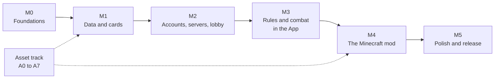

To let the API and App be built and tested **before** the mod exists, M2 adds `tools/fake-mod`: a small program that speaks the mod's protocol (answers lobby, spawn and walk commands, reports arrivals). It is also what the automated end-to-end tests use.

#### M0 — Foundations
- Git is initialised. **Decided:** `/tools` is tracked, and `resources/` is **generated** from the Cobblemon jar by `tools/extract.mjs` and ignored (done: `.gitignore` updated, extract verified against the previous copy). CI downloads the jar from Modrinth and checks its SHA-512 (`tools/extract.config.json`).
- Rename `PokeDnD/` → `Mod/`; clean-ups in 13.2; set the licence to MPL-2.0.
- Create `Core/`, `API/`, `App/`, `tools/`, `deploy/` skeletons; pin versions; CI skeletons.
- **Already done** (Appendix E pass): `tools/extract.mjs`, the card-art options of `tools/render-icons.mjs` (9.8), `tools/effect-coverage.mjs`, `tools/port-posers.mjs`. `tools/check-assets` (phase 09).
- **Done when:** all four projects build in CI; the API starts and answers a health check; the app builds and opens.

#### M1 — Data and cards
- Importer, bundle, reports (chapter 19); roster; asset check (A0).
- In `Core`: dice selector, stat, XP, damage-dice, catch and flee calculators with the full test-suite (chapter 20.2).
- Card layout engine, signature-move rule and overrides, PDF export jobs, QR codes.
- API: reference-data endpoints, minimal accounts (email + password), card endpoints.
- App: login, card browser and **export screen**.
- **Done when:** a logged-in user exports Generation 1 species cards with backs as a print-ready PDF.

#### M2 — Accounts, servers, lobby, settings
- Discord sign-in, email flows, sessions, Minecraft linking by code.
- Servers: registration, tokens, server admins, status. Games: lifecycle, memberships, join codes, co-admins.
- Layered settings, rule sets, presets, the settings screen (all keys in Appendix A).
- App shell: navigation, i18n (EN, PT), themes, trainer wizard (classes, skills, ability scores, starter, skin upload).
- `tools/fake-mod`.
- **Done when:** an admin creates a game, opens a lobby, three players join and make trainers, and the fake mod shows the spawn commands.

#### M3 — Rules and combat in the App (no Minecraft yet)
- The full engine in `Core`: roll requests, battles, catching, fleeing, XP, evolution, items, status, enemy AI, trainer attacks, knock-out rules.
- Movement rounds, parties, encounters, NPC roles, shops, quests, badges, trading, bosses and loot.
- Roll input modes, approvals, digital rolls; the admin panel (live board, approvals, battle control, undo, audit log).
- Virtual cards, physical-card binding and scanning, personal cards.
- A simple 2D "virtual map" so the overworld can be played without Minecraft.
- **Done when:** the scripted full-game test passes, and a real group can play a short session in the app alone.

#### M4 — The Minecraft mod
- **M4a** Skeleton: connection, hello, fake players, skins (spike M4-S1).
- **M4b** Renderer and Pokémon entities (with the fallback poser).
- **M4c** World: regions, paths, NPCs, wands, build mode, datapack sync and hot-reload.
- **M4d** Camera director, key bindings, the **PokeDnD Controls category**, HUD and screens.
- **M4e** Battle presentation, catch animation, boss presentation, sounds.
- **M4f** BlueMap markers, API map proxy, map and path editor in the app, fog of war.
- **Done when:** the whole example session in chapter 2 can be played with Minecraft as the screen.

#### M5 — Polish and release
Complete Portuguese; push notifications; accessibility and performance passes; the credit wording (decided in 21.2) in place in the README, app, mod and cards, and the Cobblemon team asked whether they are happy with it; documentation and a getting-started guide; release pipeline; play-tests with a real group and fixes.

#### Asset track (runs in parallel)

| Step | Task |
|---|---|
| **A0** | **Done (phase 09).** Write `tools/check-assets`: for every species and form report model, texture, shiny texture, animations, poser, resolver, icon, cry, licence file. It generates Appendix C and the roster. |
| **A1** | **Done.** `tools/extract.mjs` rebuilds `resources/` from the jar. **Cobblemon 1.8.4 is the newest release** for Minecraft 1.21.1 (checked on Modrinth, 2026-11-08), so a re-extraction adds nothing; run it again when a newer release appears (change `tools/extract.config.json`). The language files (`en_us`, `pt_br`, `pt_pt`) are copied. |
| **A2** | Use community model packs only if their licence is compatible with CC BY-NC (credit authors, keep licence files). |
| **A3** | Model what is still missing in **Blockbench** as original work (starting with the ordinary species that are missing: Gulpin line, Castform, Vullaby line, Oricorio, Oranguru, Passimian, Blipbug line, Pawmi line, Bombirdier, Frigibax line). |
| **A4** | Animations for Bounsweet and Pyukumuku. |
| **A5** | **Done for 258 of 277.** `tools/port-posers.mjs` converts Cobblemon's per-species `…Model.kt` classes (MPL-2.0) to JSON posers: 277 poser names in 254 species folders, **258 complete and 19 partial** (Appendix C.3). What is left is optional hand work on the 19 partial ones, and the generic fallback poser (15.3). |
| **A6** | Render icons and high-resolution card art for every new species with `tools/render-icons.mjs`. |
| **A7** | A species joins the playable roster only when it passes the check; the roster file is regenerated and CI fails if a listed species is incomplete. |

#### Risks

| Risk | Plan |
|---|---|
| Minecraft 26.3 and Fabric APIs are new and may change | Pin versions; keep Minecraft-specific code behind thin adapters; an early spike in M4a |
| The renderer is large (Molang subset, procedural walk and wing functions) | The 277 missing posers are now ported (258 complete, 19 partial); generic fallback poser for the rest; polish the starters first |
| SkinRestorer's API is undocumented (but present in the jar) | Call its Java API directly (15.13); narrowed spike M4-S1: how an uploaded PNG gets a signed texture; fallback: the `/skin` command, or set the profile's signed texture directly |
| Most abilities and many moves are scripted in Showdown | Manual (admin) fallback; implement the most used first. **Measured** (19.6): 96 % of abilities and 43 % of moves are scripted; the 50 most-learned scripted moves lift coverage from 51 % to 80 % of learnset rows |
| Fog of war on map tiles | Client-side mask now; API tile filtering later |
| Author credits (21.2) | Team credit decided, no longer a blocker; the Cobblemon team has not been asked whether it is enough |
| Item data is thin (prices; a few effects) | TMs, IV candies and Aprijuice are settled (8.8); the price table is a draft (Appendix D); text-only items go to the admin |
| Dice-based damage may feel swingy; movement may feel slow | Everything is a setting; tune in play-tests |
| Scope | Only M1–M4 are needed for a first playable game; M5 is polish |
| Jar size (about 79 MB of assets before compression) | Acceptable; revisit a separate asset pack only if a host rejects it |

---

## Appendices

### Appendix A — All settings and defaults

Every setting in this document, collected from the "Settings & defaults" table at the end of each chapter (234 keys). **All defaults are suggestions** unless the chapter says *decided*. Presets that change several at once are in chapter 12.1. The "Ch." column says where the setting is explained.

#### Game, lobby and accounts

| Key | Default | What it does | Ch. |
|---|---|---|:-:|
| `game.admin.plays` | `false` | The admin also has a trainer. | 3 |
| `game.admin.coAdminsAllowed` | `true` | The owner can add co-admins. | 3 |
| `game.lobby.lateJoin` | `true` | Players can join after the game started (admin accepts). | 3 |
| `game.lobby.codeLength` | `6` | Length of the join code. | 3 |
| `game.lobby.autoAccept` | `false` | Accept every join request automatically. | 3 |
| `game.players.max` | `0` | Maximum number of players (0 = no limit). | 3 |
| `game.spectators.enabled` | `true` | Spectators may join. | 3 |
| `game.spectators.allowUnlinked` | `true` | Minecraft accounts that are not linked to the app may join as spectators. | 3 |
| `game.trainerNames.mode` | `perGame` | Trainer name chosen per game (alternatives: `accountName`). | 3 |
| `game.skins.allowUpload` | `true` | Players may upload PNG skins. | 3 |
| `game.skins.allowCopyFromUsername` | `true` | Players may copy a skin from a Minecraft username. | 3 |
| `game.disconnect.behaviour` | `idle` | Disconnected player's trainer stays in the world (`idle`) or is removed until return (`hide`). | 3 |
| `game.import.allow` | `false` | Players may import a trainer and team from another game. | 3 |
| `game.import.copy` | `trainer,pokemon,bag,money` | What an import copies. | 3 |
| `game.import.requireApproval` | `true` | The admin must approve each import. | 3 |
| `game.ruleset.default` | `builtin:defaults` | Rule set used by new games. | 12 |
| `game.autosave.everyRounds` | `1` | Snapshot frequency. | 12 |
| `game.presets.enabled` | `true` | Show presets in the wizard. | 12 |

#### Trainers

| Key | Default | What it does | Ch. |
|---|---|---|:-:|
| `trainer.abilityScores.method` | `pointBuy` | Allowed method: `pointBuy`, `standardArray`, `roll4d6DropLowest`, or `any`. | 4 |
| `trainer.abilityScores.pointBuyBudget` | `27` | Points for point buy. | 4 |
| `trainer.level.start` | `1` | Starting trainer level. | 4 |
| `trainer.level.cap` | `20` | Maximum trainer level. | 4 |
| `trainer.xp.multiplier` | `1.0` | Scales all trainer XP. | 4 |
| `trainer.xp.table` | *(table in 4.5)* | XP awarded per event. | 4 |
| `trainer.xp.curveFactor` | `25` | Total XP to reach L is `factor × L × (L − 1)`. | 4 |
| `trainer.start.money` | `3000` | Starting ₽. | 4 |
| `trainer.start.items` | `pokeBall×5, potion×3` | Common starting kit. | 4 |
| `trainer.classes.set` | *(the nine defaults)* | Class list used by the game; fully editable. | 4 |
| `trainer.skills.set` | *(the 17 skills)* | Skill list; fully editable. | 4 |
| `trainer.hp.recoverPerRoundPct` | `10` | Trainer HP regained per overworld round. | 4 |
| `trainer.ko.mode` | `faintRespawn` | `faintRespawn`, `deathSaves` or `admin`. | 4 |
| `trainer.ko.deathAllowed` | `false` | With `deathSaves`: third failure kills the trainer. | 4 |

#### Dice

| Key | Default | What it does | Ch. |
|---|---|---|:-:|
| `dice.skillChecks.natural20And1` | `false` | Natural 20 always passes and natural 1 always fails on skill checks. | 4 |
| `dice.available` | `4, 6, 8, 10, 12, 20, 100` | The dice the table owns | 6 |
| `dice.tolerance.absolutePp` | `2.5` | A band may be off by at most this many percentage points | 6 |
| `dice.tolerance.relativePct` | `15` | …and by at most this share of its own size | 6 |
| `dice.d100Below` | `5` | If the rarest band is rarer than this %, use a d100 | 6 |
| `dice.style` | `smart` | `smart`, or `classic` (d20 for most things, d100 for rare ones). | 6 |
| `dice.percentile.method` | `d100` | `d100` or `2d10`. | 6 |
| `dice.direction` | `high` | Roll high to succeed (`high`) or low (`low`). | 6 |
| `dice.forceDie` | `{}` | Force a die per roll type, e.g. `{ "catch": 20 }`. | 6 |
| `dice.skillChecks.style` | `classic` | `classic` (d20 + mod vs DC) or `smart`. | 6 |
| `dice.initiative.style` | `classic` | `classic` or `smart`. | 6 |
| `dice.defence.style` | `classic` | Trainer defence roll style. | 6 |
| `dice.input.modes` | `playerSubmit,digital,adminEnter` | Allowed ways to answer a roll request. | 6 |
| `dice.approval.required` | `true` | Player-submitted physical rolls need the admin's approval. | 6 |
| `dice.approval.autoSeconds` | `0` | Auto-approve after this many seconds (0 = never). | 6 |
| `dice.entry.perDie` | `true` | Enter each die separately (otherwise the total). | 6 |
| `dice.batch.attackRolls` | `false` | Ask for hit, damage and effect dice together. | 6 |
| `dice.prompt.showTrueChance` | `true` | Show the exact chance in the prompt. | 6 |
| `dice.prompt.timeoutSeconds` | `0` | Time limit for a roll request (0 = none). | 6 |
| `dice.enemy.mode` | `auto` | `auto`, or `adminPhysical` (admin rolls real dice for enemies). | 6 |
| `dice.secret.mode` | `auto` | `auto`, or `adminPhysical` for encounter, shiny, boss and loot rolls. | 6 |
| `dice.rng.source` | `secure` | Random generator used for digital rolls. | 6 |
| `dice.advantage.enabled` | `true` | Advantage/disadvantage on classic d20 rolls. | 6 |

#### Combat

| Key | Default | What it does | Ch. |
|---|---|---|:-:|
| `combat.command.accuracyPpPerPoint` | `1` | Accuracy bonus per Handling point. | 4 |
| `combat.command.accuracyCapPp` | `10` | Cap on the command accuracy bonus. | 4 |
| `combat.catch.bonusPerPoint` | `0.05` | Relative catch bonus per Handling point. | 4 |
| `combat.catch.allowPenalty` | `false` | Negative Handling modifiers also reduce the catch chance. | 4 |
| `combat.flee.bonusPpPerPoint` | `2` | Flee bonus per DEX modifier point. | 4 |
| `combat.joinRadius` | `16` | Blocks around the encounter in which trainers join. | 7 |
| `combat.joinRadius.adminOverride` | `true` | The admin can add/remove participants. | 7 |
| `combat.activePerTrainer` | `1` | Active Pokémon per trainer. | 7 |
| `combat.declare.hidden` | `true` | Hide declared actions from other players. | 7 |
| `combat.initiative.speedDivisor` | `20` | Initiative modifier is `floor(Speed / divisor)`. | 7 |
| `combat.initiative.rerollEachRound` | `true` | Roll initiative every round (otherwise once per battle). | 7 |
| `combat.order.trainerActionsFirst` | `true` | Switch/item/ball/flee resolve before moves. | 7 |
| `combat.turnTimer.enabled` | `false` | Use a turn timer. | 7 |
| `combat.turnTimer.seconds` | `90` | Length of the timer. | 7 |
| `combat.turnTimer.onTimeout` | `skip` | `skip` or `autoMove`. | 7 |
| `combat.crit.chancesPct` | `5,10,15,25` | Crit chance for stages 0, +1, +2, +3 or more. | 7 |
| `combat.crit.multiplier` | `1.5` | Critical damage multiplier. | 7 |
| `combat.stab.multiplier` | `1.5` | Same-type attack bonus. | 7 |
| `combat.accuracy.stageEffects` | `true` | Accuracy/evasion stages change hit chance. | 7 |
| `combat.damage.dicePowerFactor` | `5` | Effective power = dice total × this. | 7 |
| `combat.damage.powerTable` | *(table in 7.6)* | Move power → damage dice. | 7 |
| `combat.multihit.damageDice` | `once` | Roll damage once or per hit. | 7 |
| `combat.spread.rollPerTarget` | `whenDifferent` | `always`, `never`, `whenDifferent`. | 7 |
| `combat.typeChart` | `official` | Type chart data (editable). | 7 |
| `combat.pp.enabled` | `true` | Moves use PP. | 7 |
| `combat.abilities.enabled` | `true` | Abilities have effects. | 7 |
| `combat.heldItems.enabled` | `true` | Held items have effects. | 7 |
| `combat.catch.enabled` | `true` | Catching allowed. | 7 |
| `combat.catch.allowTrainerOwned` | `false` | Allow catching NPC Pokémon. | 7 |
| `combat.flee.allowTrainerBattles` | `false` | Flee from NPC/PvP battles. | 7 |
| `combat.flee.allowBoss` | `true` | Flee from bosses. | 7 |
| `combat.ai.level` | `normal` | `easy`, `normal`, `hard`. | 7 |
| `combat.ai.targetTrainerPct` | `10` | Chance per enemy action to target a trainer. | 7 |
| `combat.trainer.damageScale` | `0.25` | Scales damage dealt to trainers. | 7 |
| `combat.trainer.defenseBase` | `20` | Trainer Defense value, base. | 7 |
| `combat.trainer.defensePerLevel` | `4` | Trainer Defense value, per trainer level. | 7 |
| `combat.trainer.attackLevelDivisor` | `8` | Enemy attack bonus is `level / divisor`. | 7 |
| `combat.pvp.enabled` | `true` | PvP battles allowed. | 7 |
| `combat.pvp.wagerAllowed` | `false` | Players may wager money. | 7 |
| `combat.prize.perLevel` | `40` | ₽ per level of the opponent's highest Pokémon. | 7 |
| `combat.whiteout.moneyLossPct` | `10` | Money lost on a whiteout or trainer knock-out. | 7 |

#### Pokémon

| Key | Default | What it does | Ch. |
|---|---|---|:-:|
| `pokemon.party.size` | `6` | Maximum Pokémon in the party. | 5 |
| `pokemon.pc.boxes` | `0` | Number of PC boxes (0 = unlimited). | 5 |
| `pokemon.pc.boxSize` | `30` | Pokémon per box. | 5 |
| `pokemon.pc.access` | `healerNpc` | Where the PC can be used: `healerNpc`, `anywhere`. | 5 |
| `pokemon.starter.method` | `pick` | `pick`, `assign` or `random`. | 5 |
| `pokemon.starter.list` | *(all modelled starters, Gen 1–9)* | Species a player may pick from. | 5 |
| `pokemon.starter.level` | `5` | Starting level of the starter. | 5 |
| `pokemon.level.cap` | `100` | Maximum Pokémon level. | 5 |
| `pokemon.xp.share` | `gen6` | `gen6` (non-participants get half), `participantsOnly`, `all`. | 5 |
| `pokemon.xp.multiplier` | `1.0` | Scales all Pokémon XP. | 5 |
| `pokemon.evolution.mode` | `askPlayer` | `askPlayer`, `askAdmin`, `automatic`. | 5 |
| `pokemon.evolution.unknownFallback` | `askAdmin` | What to do with evolutions the game can't evaluate. | 5 |
| `pokemon.friendship.evolveAt` | `220` | Friendship needed for friendship evolutions. | 5 |
| `pokemon.friendship.levelUpGain` | `5,4,3` | Gain per level-up by friendship band (<100, 100–199, ≥200). | 5 |
| `pokemon.friendship.faintLoss` | `1` | Friendship lost when fainting. | 5 |
| `pokemon.friendship.pointsPerGain` | `10` | Movement points travelled per +1 friendship. | 5 |
| `pokemon.ivs.mode` | `random` | `random` (0–31 each) or `fixed`. | 5 |
| `pokemon.ivs.fixedValue` | `15` | The IV used for every stat when the mode is `fixed`. | 5 |
| `pokemon.natures.enabled` | `true` | Use natures. | 5 |
| `pokemon.breeding.enabled` | `false` | Turn breeding on. | 5 |
| `pokemon.breeding.pointsPerCycle` | `2` | Movement points per egg cycle. | 5 |
| `pokemon.moves.max` | `4` | Moves a Pokémon can know. | 5 |
| `pokemon.pp.recoverPerRound` | `0` | PP recovered per overworld round (0 = off). | 5 |
| `pokemon.moves.tutorLegacyAllowed` | `true` | Tutors may teach `legacy` moves. | 5 |
| `pokemon.fainting.rule` | `classic` | `classic` only in this version. | 5 |

#### World, movement, encounters, bosses

| Key | Default | What it does | Ch. |
|---|---|---|:-:|
| `world.movement.mode` | `freeParties` | `freeParties`, `soloOnly`, `singleParty`. | 8 |
| `world.movement.formula` | `1d6+DEX` | The movement roll. | 8 |
| `world.movement.minPoints` | `1` | Minimum points from a roll. | 8 |
| `world.movement.blocksPerPoint` | `8` | Blocks per movement point (for edge lengths). | 8 |
| `world.movement.partyModifier` | `lowest` | Which member's modifier a party uses: `lowest`, `highest`, `roller`, `average`. | 8 |
| `world.movement.carryOver` | `false` | Keep unused points for the next turn. | 8 |
| `world.movement.allowReverse` | `true` | A party may turn back mid-edge. | 8 |
| `world.party.maxSize` | `4` | Trainers per party. | 8 |
| `world.party.branchChoice` | `leader` | Who picks at a junction: `leader`, `vote`, `roller`. | 8 |
| `world.round.order` | `sequential` | `sequential` or `free`. | 8 |
| `world.round.autoAdvance` | `false` | Advance the round automatically when everyone has moved. | 8 |
| `world.walk.speedBlocksPerSecond` | `4.3` | Speed of fake players on the road. | 8 |
| `world.nodes.arrivalRadius` | `3` | Arrival radius of a node, in blocks. | 8 |
| `world.npc.interactRadius` | `6` | Distance at which a party can talk to an NPC. | 8 |
| `world.npc.rematch` | `false` | Beaten NPC trainers can be fought again. | 8 |
| `world.gates.retry` | `nextRound` | When a failed gate check can be retried. | 8 |
| `world.encounter.stopChancePct` | `60` | Chance when stopping on an encounter node. | 8 |
| `world.encounter.passChancePct` | `30` | Chance when passing through an encounter node. | 8 |
| `world.encounter.edgeChancePct` | `15` | Chance per checkpoint along an edge in a region. | 8 |
| `world.encounter.edgeBlocks` | `24` | Blocks between edge checkpoints. | 8 |
| `world.encounter.defaultCount` | `1` | Wild Pokémon per encounter (regions override). | 8 |
| `world.encounter.spawnDistance` | `12` | Blocks ahead of the party where wild Pokémon appear. | 8 |
| `world.wildLevel.mode` | `party` | `party` (near the party's level), `uniform`, `fixed`. | 8 |
| `world.wildLevel.spread` | `2` | ± levels around the party level. | 8 |
| `world.ambient.enabled` | `true` | Ambient roaming Pokémon. | 8 |
| `world.ambient.maxPerRegion` | `6` | Limit per region. | 8 |
| `world.shiny.oneIn` | `512` | Shiny chance is 1 in this number. | 8 |
| `world.boss.oneIn` | `50` | Boss chance is 1 in this number. | 8 |
| `world.boss.levelBonus` | `5` | Boss level above the region maximum. | 8 |
| `world.boss.statMultiplier` | `1.5` | Boss stat multiplier. | 8 |
| `world.boss.scale` | `2.5` | Boss model scale. | 8 |
| `world.boss.moneyPerLevel` | `100` | ₽ per boss level, split between participants. | 8 |
| `world.boss.lootRecipients` | `allParticipants` | `allParticipants`, `lastHit`, `byDamage`. | 8 |
| `world.boss.lootRolls` | `3` | Loot rolls per recipient. | 8 |
| `world.fogOfWar` | `true` | Players only see what they have discovered. | 8 |
| `world.fogOfWar.revealRadiusBlocks` | `64` | How far around visited places is revealed. | 8 |
| `world.time.mode` | `admin` | `admin`, `rounds`, `vanilla`. | 8 |
| `world.time.start` | `noon` | Starting time of day. | 8 |
| `world.time.ticksPerRound` | `1000` | Time advanced per round in `rounds` mode. | 8 |
| `world.weather.mode` | `admin` | `admin`, `rounds`, `vanilla`. | 8 |
| `world.weather.start` | `clear` | Starting weather. | 8 |
| `world.protect.blocks` | `true` | Block breaking/placing is blocked (except admin build mode). | 15 |
| `world.protect.hostileMobs` | `true` | No hostile mob spawning. | 15 |
| `world.protect.hunger` | `true` | Hunger disabled. | 15 |
| `world.protect.damage` | `true` | Vanilla damage disabled. | 15 |
| `world.fakePlayers.keepChunksLoaded` | `true` | Keep chunks loaded around fake players. | 15 |
| `world.fakePlayers.stuckSeconds` | `3` | Seconds before the stuck teleport fallback. | 15 |
| `world.positions.reportHz` | `2` | Position reports per second. | 15 |
| `world.followers.enabled` | `true` | Lead Pokémon follows its trainer. | 15 |

#### Money, shops and trading

| Key | Default | What it does | Ch. |
|---|---|---|:-:|
| `economy.currency.symbol` | `₽` | Currency symbol. | 8 |
| `economy.prices.table` | *(table in 8.8)* | Default buy prices. | 8 |
| `economy.prices.tm` | `3000` | Default buy price of every TM. | 8 |
| `economy.sellRatio` | `0.5` | Sell price as a fraction of the buy price. | 8 |
| `economy.healer.price` | `0` | Default healing price (NPCs override). | 8 |
| `economy.tutor.price` | `1000` | Default move-tutor price per move. | 8 |
| `economy.merchant.restockRounds` | `10` | Rounds between merchant restocks (0 = never). | 8 |
| `economy.trade.requireApproval` | `false` | Trades need admin approval. | 8 |
| `economy.trade.location` | `tradeCentre` | Where trading is allowed: `tradeCentre` or `anywhere`. | 8 |

#### Bag

| Key | Default | What it does | Ch. |
|---|---|---|:-:|
| `bag.limit.slotsPerPocket` | `0` | Slots per pocket (0 = unlimited). | 8 |
| `bag.limit.stackSize` | `0` | Maximum per stack (0 = unlimited). | 8 |
| `items.ivCandy.step` | `1` | How much one IV candy raises or lowers an IV (the IV stays within 0–31). It changes that Pokémon's stored IV, so it works in every `pokemon.ivs.mode`. | 8 |

#### Quests

| Key | Default | What it does | Ch. |
|---|---|---|:-:|
| `quests.autoTrack` | `true` | Track structured objectives automatically. | 8 |
| `quests.allowFreeForm` | `true` | Allow admin-tracked quests. | 8 |

#### Cards

| Key | Default | What it does | Ch. |
|---|---|---|:-:|
| `cards.mode` | `digital` | `digital` or `physical`. | 9 |
| `cards.physical.unboundBehaviour` | `block` | `block` or `digitalMoves`. | 9 |
| `cards.physical.evolutionRequiresScan` | `true` | Evolution completes when the new card is scanned. | 9 |
| `cards.physical.rescanAfterTrade` | `true` | The new owner must scan the card again. | 9 |
| `cards.cosmetics.enabled` | `true` | Virtual card cosmetics. | 9 |
| `cards.back.showId` | `false` | Print the card ID text next to the QR code. | 9 |
| `cards.export.defaultSizeMm` | `63x88` | Default export card size. | 9 |
| `cards.export.defaultPaper` | `A4` | Default paper. | 9 |
| `cards.export.bleedMm` | `3` | Bleed. | 9 |
| `cards.export.gapMm` | `2` | Gap between cards. | 9 |
| `cards.export.maxCardsPerJob` | `1500` | Limit per export job. | 9 |
| `cards.export.fileTtlHours` | `24` | How long finished exports stay downloadable. | 9 |
| `cards.signature.stageLevelCaps` | `25,40,100` | Level cap for signature moves by stage. | 9 |
| `cards.signature.overridesFile` | `cards/signature-overrides.json` | Manual overrides. | 9 |

#### Minecraft cameras, keys and HUD

| Key | Default | What it does | Ch. |
|---|---|---|:-:|
| `camera.director.enabled` | `true` | Use the automatic director. | 10 |
| `camera.director.cutSeconds` | `3` | Time between cuts in battle shots. | 10 |
| `camera.director.smoothing` | `0.15` | Camera smoothing (0 = none, 1 = very slow). | 10 |
| `camera.director.followScope` | `activeParty` | `activeParty`, `ownParty`, `fixed`. | 10 |
| `camera.player.followOwnPartyOnly` | `true` | Players' auto camera sticks to their own party. | 10 |
| `camera.player.allowTrainerView` | `true` | Players may switch to trainer view. | 10 |
| `camera.player.trainerView.perspective` | `first` | `first` or `third`. | 10 |
| `camera.player.switchKeyMode` | `toggle` | `toggle` or `hold` (client option). | 10 |
| `camera.admin.default` | `free` | Admin's starting view: `free`, `auto`, `trainer`. | 10 |
| `camera.admin.buildModeWhileRunning` | `true` | Build mode is allowed while the game runs. | 10 |
| `camera.spectators.allowUnlinked` | `true` | Unlinked Minecraft accounts may join as spectators. | 10 |
| `camera.keys.camera` | `K` | Default key for the camera switch (rebindable in Controls). | 10 |
| `camera.keys.nextParty` / `camera.keys.prevParty` | `]` / `[` | Admin party cycling keys. | 10 |
| `camera.keys.jump` | `G` | Jump to active turn or battle. | 10 |
| `camera.keys.build` | `B` | Build mode. | 10 |
| `camera.keys.teleportMenu` | `U` | Teleport menu. | 10 |
| `camera.keys.hud` / `camera.keys.pathOverlay` | `H` / `N` | HUD and path overlay toggles. | 10 |
| `camera.hud.enabled` | `true` | Show the HUD by default. | 10 |
| `camera.hud.scale` | `1.0` | HUD scale (client option). | 10 |
| `camera.sound.cries` | `true` | Play cries. | 10 |
| `camera.sound.ambient` | `true` | Play ambient sounds. | 10 |

#### The App

| Key | Default | What it does | Ch. |
|---|---|---|:-:|
| `app.language.default` | `browser` | Starting language. | 11 |
| `app.language.gameTextFallback` | `pt_pt,pt_br,en_us` | Order in which Cobblemon's language files are tried for game texts (Pokédex text, move and item descriptions). | 11 |
| `app.theme.default` | `system` | `system`, `light`, `dark`. | 11 |
| `app.push.enabled` | `true` | Web Push available to users. | 11 |
| `app.push.events` | `turn,approvals,gameState` | Events that notify. | 11 |
| `app.map.layers.default` | `trainers,paths,npcs` | Layers on by default. | 11 |
| `app.map.layers.regions` | `false` | Region layer (admins only). | 11 |
| `app.spectators.seeTeams` | `true` | Spectators can see teams and cards. | 11 |
| `app.log.visibility` | `allPlayers` | Who sees the battle log: `allPlayers`, `participants`, `adminOnly`. | 11 |
| `app.scanner.manualBindFallback` | `true` | Admin can bind cards by hand. | 11 |

#### Admin tools

| Key | Default | What it does | Ch. |
|---|---|---|:-:|
| `admin.undo.depth` | `20` | How many recent actions can be undone. | 12 |
| `admin.confirmDestructive` | `true` | Ask before destructive actions. | 12 |
| `admin.audit.retentionDays` | `0` | Days to keep the audit log (0 = forever). | 12 |


### Appendix B — Smart-dice reference

Generated by the reference algorithm below (settings: dice d4, d6, d8, d10, d12, d20, d100; tolerance 2.5 percentage points and 15 %; d100 when the rarest band is under 5 %). `Core` must reproduce this table exactly (chapter 20.2).

#### B.1 One success chance → die

<details><summary>Show the table (1 % to 99 %)</summary>

| Chance | Die | Succeeds on | Real chance | | Chance | Die | Succeeds on | Real chance |
|--:|:-:|:-:|--:|---|--:|:-:|:-:|--:|
| 1 % | d100 | 100 | 1 % |  | 51 % | d4 | 3–4 | 50 % |
| 2 % | d100 | 99–100 | 2 % |  | 52 % | d4 | 3–4 | 50 % |
| 3 % | d100 | 98–100 | 3 % |  | 53 % | d20 | 10–20 | 55 % |
| 4 % | d100 | 97–100 | 4 % |  | 54 % | d20 | 10–20 | 55 % |
| 5 % | d20 | 20 | 5 % |  | 55 % | d20 | 10–20 | 55 % |
| 6 % | d100 | 95–100 | 6 % |  | 56 % | d12 | 6–12 | 58.3 % |
| 7 % | d100 | 94–100 | 7 % |  | 57 % | d12 | 6–12 | 58.3 % |
| 8 % | d12 | 12 | 8.3 % |  | 58 % | d10 | 5–10 | 60 % |
| 9 % | d10 | 10 | 10 % |  | 59 % | d10 | 5–10 | 60 % |
| 10 % | d10 | 10 | 10 % |  | 60 % | d8 | 4–8 | 62.5 % |
| 11 % | d8 | 8 | 12.5 % |  | 61 % | d8 | 4–8 | 62.5 % |
| 12 % | d8 | 8 | 12.5 % |  | 62 % | d8 | 4–8 | 62.5 % |
| 13 % | d8 | 8 | 12.5 % |  | 63 % | d8 | 4–8 | 62.5 % |
| 14 % | d8 | 8 | 12.5 % |  | 64 % | d8 | 4–8 | 62.5 % |
| 15 % | d6 | 6 | 16.7 % |  | 65 % | d6 | 3–6 | 66.7 % |
| 16 % | d6 | 6 | 16.7 % |  | 66 % | d6 | 3–6 | 66.7 % |
| 17 % | d6 | 6 | 16.7 % |  | 67 % | d6 | 3–6 | 66.7 % |
| 18 % | d6 | 6 | 16.7 % |  | 68 % | d6 | 3–6 | 66.7 % |
| 19 % | d6 | 6 | 16.7 % |  | 69 % | d6 | 3–6 | 66.7 % |
| 20 % | d10 | 9–10 | 20 % |  | 70 % | d10 | 4–10 | 70 % |
| 21 % | d10 | 9–10 | 20 % |  | 71 % | d10 | 4–10 | 70 % |
| 22 % | d10 | 9–10 | 20 % |  | 72 % | d10 | 4–10 | 70 % |
| 23 % | d4 | 4 | 25 % |  | 73 % | d4 | 2–4 | 75 % |
| 24 % | d4 | 4 | 25 % |  | 74 % | d4 | 2–4 | 75 % |
| 25 % | d4 | 4 | 25 % |  | 75 % | d4 | 2–4 | 75 % |
| 26 % | d4 | 4 | 25 % |  | 76 % | d4 | 2–4 | 75 % |
| 27 % | d4 | 4 | 25 % |  | 77 % | d4 | 2–4 | 75 % |
| 28 % | d10 | 8–10 | 30 % |  | 78 % | d10 | 3–10 | 80 % |
| 29 % | d10 | 8–10 | 30 % |  | 79 % | d10 | 3–10 | 80 % |
| 30 % | d10 | 8–10 | 30 % |  | 80 % | d10 | 3–10 | 80 % |
| 31 % | d6 | 5–6 | 33.3 % |  | 81 % | d6 | 2–6 | 83.3 % |
| 32 % | d6 | 5–6 | 33.3 % |  | 82 % | d6 | 2–6 | 83.3 % |
| 33 % | d6 | 5–6 | 33.3 % |  | 83 % | d6 | 2–6 | 83.3 % |
| 34 % | d6 | 5–6 | 33.3 % |  | 84 % | d6 | 2–6 | 83.3 % |
| 35 % | d6 | 5–6 | 33.3 % |  | 85 % | d6 | 2–6 | 83.3 % |
| 36 % | d8 | 6–8 | 37.5 % |  | 86 % | d8 | 2–8 | 87.5 % |
| 37 % | d8 | 6–8 | 37.5 % |  | 87 % | d8 | 2–8 | 87.5 % |
| 38 % | d8 | 6–8 | 37.5 % |  | 88 % | d8 | 2–8 | 87.5 % |
| 39 % | d8 | 6–8 | 37.5 % |  | 89 % | d8 | 2–8 | 87.5 % |
| 40 % | d8 | 6–8 | 37.5 % |  | 90 % | d10 | 2–10 | 90 % |
| 41 % | d10 | 7–10 | 40 % |  | 91 % | d10 | 2–10 | 90 % |
| 42 % | d10 | 7–10 | 40 % |  | 92 % | d12 | 2–12 | 91.7 % |
| 43 % | d12 | 8–12 | 41.7 % |  | 93 % | d100 | 8–100 | 93 % |
| 44 % | d12 | 8–12 | 41.7 % |  | 94 % | d100 | 7–100 | 94 % |
| 45 % | d20 | 12–20 | 45 % |  | 95 % | d20 | 2–20 | 95 % |
| 46 % | d20 | 12–20 | 45 % |  | 96 % | d100 | 5–100 | 96 % |
| 47 % | d20 | 12–20 | 45 % |  | 97 % | d100 | 4–100 | 97 % |
| 48 % | d4 | 3–4 | 50 % |  | 98 % | d100 | 3–100 | 98 % |
| 49 % | d4 | 3–4 | 50 % |  | 99 % | d100 | 2–100 | 99 % |
| 50 % | d4 | 3–4 | 50 % |  |  |  |  |  |

</details>

#### B.2 Several outcomes on one roll

| Situation | Bands (low → high) | Die | Faces per band |
|---|---|:-:|---|
| Accuracy 100 %, crit stage 0 | 95 % / 5 % | d20 | hit / crit: 1–19 · 20 |
| Accuracy 95 %, crit stage 0 | 5 % / 90 % / 5 % | d20 | miss / hit / crit: 1 · 2–19 · 20 |
| Accuracy 90 %, crit stage +1 | 10 % / 80 % / 10 % | d10 | miss / hit / crit: 1 · 2–9 · 10 |
| Accuracy 85 %, crit stage 0 | 15 % / 80 % / 5 % | d20 | miss / hit / crit: 1–3 · 4–19 · 20 |
| Accuracy 80 %, crit stage 0 | 20 % / 75 % / 5 % | d20 | miss / hit / crit: 1–4 · 5–19 · 20 |
| Accuracy 75 %, crit stage +1 | 25 % / 65 % / 10 % | d20 | miss / hit / crit: 1–5 · 6–18 · 19–20 |
| Accuracy 70 %, crit stage 0 | 30 % / 65 % / 5 % | d20 | miss / hit / crit: 1–6 · 7–19 · 20 |
| Accuracy 60 %, crit stage 0 | 40 % / 55 % / 5 % | d20 | miss / hit / crit: 1–8 · 9–19 · 20 |
| Accuracy 100 %, crit stage +2 | 85 % / 15 % | d6 | hit / crit: 1–5 · 6 |
| Accuracy 100 %, crit stage +3 | 75 % / 25 % | d4 | hit / crit: 1–3 · 4 |
| 100 % move at accuracy stage −1 (75 %), crit 0 | 25 % / 70 % / 5 % | d20 | miss / hit / crit: 1–5 · 6–19 · 20 |
| 100 % move at accuracy stage −2 (60 %), crit 0 | 40 % / 55 % / 5 % | d20 | miss / hit / crit: 1–8 · 9–19 · 20 |
| Sleep length 1–3 turns | 33.3 % / 33.3 % / 33.3 % | d6 | 1 / 2 / 3 turns: 1–2 · 3–4 · 5–6 |
| Confusion length 2–5 turns | 25 % / 25 % / 25 % / 25 % | d4 | 2 / 3 / 4 / 5 turns: 1 · 2 · 3 · 4 |
| Multi-hit 2–5 hits (35/35/15/15 %) | 35 % / 35 % / 15 % / 15 % | d6 | 2 / 3 / 4 / 5 hits: 1–2 · 3–4 · 5 · 6 |

#### B.3 Reference implementation

This JavaScript is the version used to produce the tables above and to check the examples in this document. The Java version in `Core` must give the same results.

```js
const DICE = [4, 6, 8, 10, 12, 20];
const TOL_PP = 0.025;   // absolute tolerance per band
const TOL_REL = 0.15;   // relative tolerance per band
const RARE = 0.05;      // below this -> d100

// bands: array of probabilities summing to 1 (e.g. [miss, hit, crit])
function allocate(bands, sides) {
  const raw = bands.map(p => p * sides);
  const counts = raw.map(Math.floor);
  let left = sides - counts.reduce((a, b) => a + b, 0);
  const order = raw.map((r, i) => [r - Math.floor(r), i]).sort((a, b) => b[0] - a[0]);
  for (const [, i] of order) { if (left <= 0) break; counts[i]++; left--; }
  return counts;
}
function ok(bands, counts, sides) {
  return bands.every((p, i) => {
    const q = counts[i] / sides;
    const abs = Math.abs(q - p);
    if (p === 0) return counts[i] === 0;
    if (counts[i] === 0) return false;           // a possible outcome must stay possible
    return abs <= TOL_PP + 1e-9 && abs / p <= TOL_REL + 1e-9;
  });
}
export function pick(bands) {
  const rarest = Math.min(...bands.filter(p => p > 0));
  if (rarest >= RARE - 1e-9) {
    for (const s of DICE) {
      const c = allocate(bands, s);
      if (ok(bands, c, s)) return { die: s, counts: c, exact: false };
    }
  }
  const c = bands.map(p => Math.round(p * 100));
  const diff = 100 - c.reduce((a, b) => a + b, 0);
  c[c.indexOf(Math.max(...c))] += diff;
  return { die: 100, counts: c, exact: false };
}
export function needAtLeast(p) { // single success chance -> "roll >= X"
  const r = pick([1 - p, p]);
  const n = r.counts[1];
  return { die: r.die, need: r.die - n + 1, actual: n / r.die };
}
```

### Appendix C — Missing assets

Checked against the files in `./resources` on 2026-11-08. `tools/check-assets.mjs` (phase 09) reproduces these numbers in `build/reports/assets.md`, and a test compares its result with the list in C.1.

> **Good to know:** Cobblemon 1.8.4 itself marks exactly the **905** modelled species as `implemented`. The 120 species below carry no such flag, so re-extracting from the same Cobblemon version will not complete them; a newer release might.

#### C.1 Species with no model, texture, resolver or icon (120)

These species are **not playable** until their assets exist (decision: only species with models are playable). Counted from `./resources/pokedex.csv` against the folders in `./resources/assets/cobblemon/bedrock/pokemon/models`.

| Generation | Dex range | Missing | Species |
|---|---|---|---|
| 1 | 1–151 | 0 | — |
| 2 | 152–251 | 4 | 243 Raikou, 244 Entei, 245 Suicune, 251 Celebi |
| 3 | 252–386 | 7 | 316 Gulpin, 317 Swalot, 351 Castform, 382 Kyogre, 383 Groudon, 385 Jirachi, 386 Deoxys |
| 4 | 387–493 | 13 | 480 Uxie, 481 Mesprit, 482 Azelf, 483 Dialga, 484 Palkia, 485 Heatran, 487 Giratina, 488 Cresselia, 489 Phione, 490 Manaphy, 491 Darkrai, 492 Shaymin, 493 Arceus |
| 5 | 494–649 | 15 | 494 Victini, 629 Vullaby, 630 Mandibuzz, 638 Cobalion, 639 Terrakion, 640 Virizion, 641 Tornadus, 642 Thundurus, 643 Reshiram, 644 Zekrom, 645 Landorus, 646 Kyurem, 647 Keldeo, 648 Meloetta, 649 Genesect |
| 6 | 650–721 | 5 | 717 Yveltal, 718 Zygarde, 719 Diancie, 720 Hoopa, 721 Volcanion |
| 7 | 722–809 | 28 | 741 Oricorio, 765 Oranguru, 766 Passimian, 772 Type: Null, 773 Silvally, 785 Tapu Koko, 786 Tapu Lele, 787 Tapu Bulu, 788 Tapu Fini, 789 Cosmog, 790 Cosmoem, 791 Solgaleo, 792 Lunala, 793 Nihilego, 794 Buzzwole, 795 Pheromosa, 796 Xurkitree, 797 Celesteela, 798 Kartana, 799 Guzzlord, 800 Necrozma, 801 Magearna, 802 Marshadow, 805 Stakataka, 806 Blacephalon, 807 Zeraora, 808 Meltan, 809 Melmetal |
| 8 | 810–905 | 11 | 824 Blipbug, 825 Dottler, 826 Orbeetle, 888 Zacian, 889 Zamazenta, 891 Kubfu, 892 Urshifu, 896 Glastrier, 897 Spectrier, 898 Calyrex, 905 Enamorus |
| 9 | 906–1025 | 37 | 921 Pawmi, 922 Pawmo, 923 Pawmot, 962 Bombirdier, 984 Great Tusk, 985 Scream Tail, 986 Brute Bonnet, 987 Flutter Mane, 988 Slither Wing, 989 Sandy Shocks, 990 Iron Treads, 991 Iron Bundle, 992 Iron Hands, 993 Iron Jugulis, 994 Iron Moth, 995 Iron Thorns, 996 Frigibax, 997 Arctibax, 998 Baxcalibur, 1001 Wo-Chien, 1002 Chien-Pao, 1003 Ting-Lu, 1004 Chi-Yu, 1005 Roaring Moon, 1006 Iron Valiant, 1007 Koraidon, 1008 Miraidon, 1014 Okidogi, 1015 Munkidori, 1016 Fezandipiti, 1017 Ogerpon, 1020 Gouging Fire, 1021 Raging Bolt, 1022 Iron Boulder, 1023 Iron Crown, 1024 Terapagos, 1025 Pecharunt |

#### C.2 Models without animations (2)

`0761_bounsweet`, `0771_pyukumuku`

#### C.3 Posers that exist only as Cobblemon code (277 names, 254 species folders)

Each resolver names a poser (for example the Squirtle resolver says `"poser": "cobblemon:squirtle"`). **277 poser names have no JSON file** in `bedrock/pokemon/posers`, in **254 species folders**: **249** folders have no poser file at all (the number in the first draft of this document), and 5 more (Sandslash, Exeggutor, Marowak, Avalugg, Gimmighoul) have a poser for one form but not for another. The Cobblemon jar has exactly the same 759 poser files, so nothing was lost in extraction: the other poses are defined in Kotlin classes (for example `SquirtleModel` in `…/client/render/models/blockbench/pokemon/gen1/`).

**Ported.** `tools/port-posers.mjs` reads those classes from Cobblemon's public source (tag 1.8.4, MPL-2.0) and writes JSON posers in the format of the 759 existing ones. The format was checked against Cobblemon's own loader (`JsonPose.kt`, `PoseAdapter.kt`) and its Molang function definitions. Result: **258 complete and 19 partial; none failed.** No ported poser names a bone that is missing from its model, and the icons for all of them render without errors. The files are in `tools/ported-posers/`, `tools/extract.mjs` adds them to `resources/`, and the tool's report with every left-out detail is `build/reports/posers-port.md`.

The **19 partial** posers are complete except for one kind of detail each:

| Poser(s) | What is left out | Why |
|---|---|---|
| Archen | A condition "is falling" | No JSON key for it |
| Gimmighoul (chest) | A condition "has an owner" | No JSON key for it |
| Dubwool, Mareep | Wool visibility, and Mareep's sheared walk | Depends on a game constant that Cobblemon defines in code |
| Dodrio, Exeggutor, Tandemaus | Looking with several heads | The class uses a separate head object |
| Huntail, Qwilfish (and its Hisuian form), Overqwil | A wave animation | Code-only animation |
| Naganadel | A sine movement of the root | Code-only animation |
| Vibrava, Yanma, Yanmega | A wing flap with a triangle wave | The JSON format only has the sine version |
| Electrode, Voltorb (and their Hisuian forms) | A callback when a pose is entered | Code-only |

These species still work: their poses exist, and the renderer's generic fallback covers the missing detail (15.3). Two things to know: the walk, wing and look motions that Cobblemon builds in code became Molang functions (`q.biped_walk`, `q.quadruped_walk`, `q.bimanual_swing`, `q.sine_wing_flap`, `q.look`), so the renderer must implement them; and 22 species that already have a JSON poser also have an older Kotlin class, which is out of date and was ignored.

#### C.4 Folder counts

| Folder | Species folders |
|---|---|
| models | 905 |
| resolvers | 905 |
| icons | 905 |
| textures | 905 |
| anims | 904 *(903 species + a shared `special` folder)* |
| posers | 906 *(905 species + a shared `special` folder)*. The jar has 657 *(656 species + `special`)*; the ported posers (C.3) fill the 249 species folders that have none, and the missing form posers in 5 more |

### Appendix D — Suggested values to review

Everything below was proposed by me because it was not decided. Change anything: they are all data or settings. The full list of default values is in [Appendix A](#appendix-a--all-settings-and-defaults).

| # | Where | What to review |
|--:|---|---|
| 1 | 4.2 How a trainer affects their Pokémon | These three conversion rates (1 pp, 5 %, 2 pp). They are small on purpose so that the trainer's sheet helps without overpowering the official odds. |
| 2 | 4.4 Classes | The whole default class list (names, hit dice, saves, skills, features and numbers). |
| 3 | 4.5 Levelling up | The XP curve and the XP table. A multiplier (`trainer.xp.multiplier`) scales everything, and the admin can grant XP at any time. |
| 4 | 5.8 Friendship | The friendship numbers. |
| 5 | 5.10 Breeding *(optional)* | The whole breeding model. It is deliberately minimal. |
| 6 | 7.3 The round | The order of switches, items and flee ahead of moves, and the `Speed / 20` initiative rule. |
| 7 | 7.6 Damage | The power → dice table. It is data (`combat.damage.powerTable`) and can be edited per game. |
| 8 | 7.10 Catching | The ball table. It covers the common balls only. |
| 9 | 7.12 Enemies attacking trainers | The 10 % targeting chance, the `level / 8` attack bonus, the trainer Defense value and the 0.25 damage scale. |
| 10 | 8.3.1 Event nodes | This list of steps is a first proposal. It is data-driven, so more can be added. |
| 11 | 8.8 Items, money and shops | The whole default price table for shops. |
| 12 | 8.9 Bosses and shinies | The default loot table: Rare Candy (weight 20), Exp. Candy L (25), Exp. Candy XL (10), Revive (25), Max Revive (10), Full Restore (10), a random evolution stone (15), Lucky Egg (5), Leftovers (5), Life Orb (3), Master Ball (1). Loot rolls are made by the system. |
| 13 | 9.3 The four signature moves of a species card | The whole signature-move selection rule (candidate filter, scoring, and the pick order). |
| 14 | 9.7 Look and feel | The type colours. |
| 15 | 10.7 The PokeDnD section in Controls | The default keys. |
| 16 | 12.1 Fast or detailed — your choice | The presets (they are just bundles of settings). |
| 17 | 14.8 Size and speed | The design targets for size and speed (players per game, message rates, first-load size). Nothing in the rules depends on them; they only guide sizing and testing. |
| 18 | 15.12 BlueMap integration | This split (BlueMap draws the overlays from the mod's markers; the app adds only the path *editor* on top) is a design choice, not something the brief settled. |
| 19 | 19.5 The Showdown snapshot | Using the copy inside the Cobblemon jar instead of upstream Showdown. Its advantage is that it matches the species, move and item ids in the CSVs exactly (they came from it). Its disadvantage is that it follows Cobblemon's changes to Showdown, not the latest upstream. |
| 20 | 8.8 Items, money and shops | The TM item name format ("TM <Move>") and the TM price (₽3,000, `economy.prices.tm`). |
| 21 | 8.8 Items, money and shops | IV candies also work when `pokemon.ivs.mode` is `fixed`, because they change that one Pokémon's stored IV. (The ±1 step itself is decided.) |
| 22 | 9.8 Card art | The card-art settings: 1,024 px, 3× supersampling, shiny variants left out. |
| 23 | 15.3 The renderer | The riding queries (`q.r.*`) evaluate to 0. Their meaning is inferred from their names and from the names of the animations that use them; Cobblemon's own source was not read for it. |
| 24 | 19.6 Effects | The rule for what counts as "scripted" (any code, or a condition PokeDnD does not implement itself) and the "implement first" order (most learnset rows, or most species). |
| 25 | 3.6 and 15.13 SkinRestorer | The mod calls SkinRestorer's Java API directly instead of running its `/skin` command (the command stays as the fallback). |
| 26 | 13.2 `tools/` | `tools/check-resources.mjs`, a smoke test that checks the rebuilt `resources/` folder (jar checksum, CSV row counts, 905 model folders with licence files, no missing posers, no Aprijuice item or icon). `data/cobblemon/mechanics/aprijuices.json` is a settings file shipped by the jar, not an item, so the check allows it. |
| 27 | 13.2 `Mod/` | In `fabric.mod.json`: the author `QuimMilho` (taken from the old licence file), The Cobblemon Team listed as a contributor, and the description text. The licence file is called `Mod/LICENSE` (not `LICENSE.txt`) so the build packs it into the jar. `gradle/gradle-daemon-jvm.properties` pins Java 25 for the build. |
| 28 | 13.3 and 13.4 `Core/` | Core uses **Jackson 2.23.0** (not the newer Jackson 3.3.0, to match Quarkus and the Fabric libraries), **SLF4J API 2.0.20** and **JUnit 6.1.3** (the newest stable; the same `@Test` API as JUnit 5). Versions are pinned in `Core/gradle/libs.versions.toml`. A build task, `checkAllowedDependencies`, fails if Core ever depends on anything but Jackson and the SLF4J API. |
| 29 | 13.3 `API/` | The API uses **Quarkus 3.40.1** (newest stable; 4.0.0.Beta3 exists but is a beta), pinned in `API/gradle.properties`. Quarkus fixes its own library versions, so the running API uses **Jackson 2.21.7** and **SLF4J 2.0.18**, slightly older than the versions Core was built with (2.23.0 and 2.0.20). This is harmless; Quarkus wins. `GET /api/core-version` is a small helper endpoint that proves the API uses Core; it can be removed later. |
| 30 | 21.1 and 13.1 documents | The source-file notice is defined in `CONTRIBUTING.md` (new file), and `tools/check-docs.mjs` checks the licence text, the 21.1 rows and the links. `Mod/LICENSE` was replaced by the exact official text (one `http` became `https`), and `.gitattributes` stops line-ending conversion on the two licence files. |

| 31 | 13.5 `deploy/` | How the Compose file is laid out: the database services are named `db` (PostgreSQL), `db-mysql`, `db-mariadb` and `db-mongo` and are switched on with `COMPOSE_PROFILES` in `deploy/.env` (default `postgres`), so exactly one database runs; `mailpit` is the `dev` profile. The edge Caddy publishes only `/api/*`, `/ws/*`, `/q/health*` and the app, and **not** `/q/metrics`. Everything inside Compose speaks plain HTTP; only Caddy does HTTPS. The app image is Caddy serving `/en/` and `/pt/` (the browser's language picks one). `tools/check-deploy.mjs` checks `.env.example` against the 13.5 table. |

| 32 | 19.3 and Appendix C, `tools/check-assets.mjs` | What counts as playable. A species is in the roster (`build/roster.json`) when it has **all** of: resolver, model (every model the resolver names exists), texture (every texture it names exists), animations, poser (every poser it names exists), icon, cry and licence file. So the roster has **903** species, not 905: Bounsweet and Pyukumuku wait for their animations (phase 84). The shiny texture is reported but **not required** (one species, Spiritomb, has none). A cry is found as `pokemon.<species>.cry` or `pokemon.<species>_<form>.cry` in `sounds.json` (Eiscue's is `eiscueice`). A **form** in the roster is one resolver file, named by its file (`marowak_alolan`) with the aspects of its first entry. `--strict` fails on any species that has some assets but lacks a required piece; `--expect` fails on any listed species that is not complete. |

| 33 | 19.1 and 19.3, `Core/…/importer/` | How the raw files are read (phase 10). The `Type` text of the Pokédex is split on `/` and checked against the `Type I` / `Type II` columns (they agree on all 1,025 rows); a blank or `—` cell means "none". `attack.csv` has 930 rows and **929** are usable: a row is skipped when it has no type, category, power, accuracy, PP, priority or target (only `nihillight`). A bad row is skipped and reported, never fatal; a missing file or column stops the import. The species JSON is typed for the fields the next phases merge (stats, types, abilities, gender, growth, egg data, moves, evolutions) and keeps the whole file besides. Core's tests read the real `resources/` too; CI rebuilds it first and fails if it is missing. |

*33 items.* In addition, **every default value in Appendix A** is a suggestion.


### Appendix E — Gaps found while writing

These are the 19 gaps found while writing the first draft. **All of them were worked on on 2026-11-08**; this table shows what became of each. Status:

- **Resolved**: done, nothing needed from you.
- **Decided**: you chose, and it is done.
- **Waiting for you**: an action or a review that only you can do.
- **Open**: still unknown; it is a spike or a later step.

| # | Gap | Status | What was done, and what is left |
|--:|---|---|---|
| 1 | **Pokédex flavour text was not in `resources/`.** | **Decided** | `tools/extract.mjs` now copies `en_us`, `pt_br` and `pt_pt` into `resources/assets/cobblemon/lang/`. Found on the way: `pt_pt` has **no** Pokédex texts (0 of 1,025; `pt_br` has all 1,025, `en_us` 1,024). You chose the lookup order **pt_pt → pt_br → en_us** (9.2, setting `app.language.gameTextFallback`). |
| 2 | **Author credits are missing.** No artist names in the licence files, the jar or the repository. | **Decided** | Credit **"The Cobblemon Team"** with links to cobblemon.com and the assets repository, CC BY-NC 3.0, labelled "modified" (21.2). **No longer a release blocker.** The 376 model folders without a licence file get a copy of the root one. I found no per-artist credits online (the wiki page I could read names no artists; cobblemon.com's credits page returned an error). *Optional:* ask the Cobblemon team whether this wording is enough. |
| 3 | **No TM items and no TM icon.** | **Resolved** | Cobblemon 1.8.4 already ships **334 TM definitions** (`data/cobblemon/tms`: move, type, how it is obtained) and TM disc icons for all 18 types. `resources/tm.csv` lists **391 TMs**: those 334 plus 57 generated for moves that species learn by TM (all 334 are among the 391 moves). `tools/extract.mjs` composites the 18 icons into `resources/icons/tm/` (16 px, as in the game). Price: Suggested ₽3,000. |
| 4 | **No item prices.** | **Waiting for you** | The draft price table stays in 8.8 (Appendix D #11); a TM row was added. |
| 5 | **Cobblemon-specific items have no defined effects** (Aprijuice, "EV candies"). | **Decided** | **Aprijuice is removed from the game** (it only changes Cobblemon's riding stats). The 12 "EV candies" are really **IV candies**: ±1 IV, kept within 0–31 (8.8, `items.ivCandy.step`). 371 of the 390 items in `item.csv` have a description. |
| 6 | **`item.csv` contained non-items.** | **Resolved** | The 16 Aprijuice rows (7 drinks, 9 overlays) are gone from `resources/` and `item.csv`, which now has **390 rows**; the importer drops the 7 Pokédex rows, leaving **383 usable items**. Also found: before this pass `item.csv` listed 16 Aprijuice icons that `resources/` did not contain. |
| 7 | **120 species have no assets** (Appendix C.1). | **Open** (asset track) | Unchanged. **Cobblemon 1.8.4 is the newest release** (checked on Modrinth on 2026-11-08), so re-extracting adds nothing. They need models: asset steps A2 and A3. |
| 8 | **249 posers exist only as compiled Cobblemon code.** | **Resolved** | Checked again: **277 poser names in 254 species folders** (249 folders have no poser at all, as counted before; 5 more lack the poser of one form). `tools/port-posers.mjs` ported all of them from Cobblemon's public Kotlin source: **258 complete, 19 partial, none failed** (Appendix C.3, 15.3). *Optional:* fix the 19 partial ones by hand. |
| 9 | **`tools/render-icons.mjs` only made 128 px icons.** | **Resolved** | Options added (`--size`, `--ss`, `--only`, `--dex`, `--no-shiny`, `--yaw`, `--pitch`, `--margin`); the default output is byte-identical to before (checked on 482 icons). **Generation 1 card art is rendered**: 270 images at 1,024 px, 0 errors (9.8). For the other generations run `node tools/extract.mjs --card-art 1-1025` (estimated about 100 MB). |
| 10 | **The real coverage of move and ability effects was unknown.** | **Resolved** | Measured with `tools/effect-coverage.mjs` (19.6): 445 of 930 moves are automatic, 397 scripted; 243 of 252 abilities in use are scripted. The numbers and "implement first" lists are in 19.6. |
| 11 | **SkinRestorer has no documented API.** | **Open** (narrowed) | Its jar has a **public Java API** (found with `javap`; 15.13), so the mod can call it directly. One spike remains (M4-S1): how an uploaded PNG gets a signed texture, and whether it works for fake players. |
| 12 | **Microsoft login → Minecraft account needs Mojang's approval.** | **Decided** (cut) | On 2026-11-08 you **cut Google and Microsoft sign-in** from the project. Without Microsoft login there is no automatic link, so Minecraft accounts are linked **by code only** (3.2, 16.4) and **no Mojang application is needed**. |
| 13 | **SQLite with Quarkus is unproven.** | **Decided** (cut) | On 2026-11-08 you **dropped SQLite** from the project: the databases are PostgreSQL, MySQL, MariaDB and MongoDB (13.3, 16.3). The M0 spike is gone. |
| 14 | **`pokemon-attacks.csv` had a blank `implemented` value for 17,841 rows.** | **Resolved** | Those rows are **exactly the rows of the 120 species without a model**. The CSV now writes `false` there (`tools/build-csv.mjs`). |
| 15 | **Unconfirmed behaviour of some Cobblemon data** (`q.r` expressions). | **Resolved** (inferred) | 309 animations use 15 `q.r.*` queries; 301 are named `ride_*`: riding and movement queries. PokeDnD has no riding, so they evaluate to 0 (15.3). The meaning is inferred from the names; Cobblemon's own source was not read for it. |
| 16 | **No Pokédex tracking, weather, terrain or Z-moves** (decided). | **Decided** | Nothing to do. Measured: 87 Z/Max moves are in `attack.csv` and 6 automatic moves also set weather or terrain; all of that is ignored (19.6). |
| 17 | **Git state:** `/tools` was ignored and `resources/` (110 MB) was untracked. | **Decided** | **`/tools` is tracked; `resources/` is generated and ignored.** `tools/extract.mjs` rebuilds it from the jar (SHA-512 checked; it can download the jar from Modrinth, so CI needs no stored copy). Checked: the rebuilt folder was identical to the previous one apart from the intended changes. `.gitignore` is updated. **Nothing was committed.** |
| 18 | **Everything marked "Suggested"** is mine. | **Waiting for you** | Collected in Appendix D, which now has 25 items (6 new ones from this pass). |
| 19 | **Cobblemon's item effects are scripts** and none exist for balls, vitamins, candies or Aprijuice. | **Resolved** | The `bag_items` scripts remain the reference for the categories they cover (8.8). Aprijuice is dropped, IV candies are defined (gap 5), vitamins and balls follow 8.8 and 7.10. |

**Still waiting for you:** gap 4 and gap 18 (review prices and Appendix D), and, optionally, gap 2 (ask the Cobblemon team about the credit wording).

**New and changed tools** (all in `tools/`, no dependencies, Node 22.2 or newer): `extract.mjs` (rebuilds `resources/`), `render-icons.mjs` (options), `build-csv.mjs` (`implemented` false; `tm.csv`), `effect-coverage.mjs`, `port-posers.mjs` with `ported-posers/`, `extract.config.json`, `attribution.template.md`, and `lib/` (zip, PNG, CSV, Showdown and Cobblemon-source readers).
